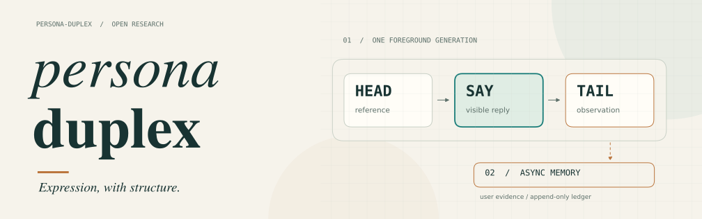

<picture>
  <source media="(prefers-color-scheme: dark)" srcset="docs/assets/readme-hero-dark.svg">
  
</picture>

<h1 align="center">把人格表达，变成可检查的机制。</h1>

<p align="center">
  <strong>一次前台生成 · 有边界的表达选择 · 带证据的异步记忆</strong>
</p>

<p align="center">
  <kbd>Python 3.11+</kbd>&nbsp; <kbd>标准库运行时</kbd>&nbsp; <kbd>OpenAI 兼容端点</kbd>&nbsp; <kbd>MIT</kbd>
</p>

<p align="center">
  <a href="#快速开始">快速开始</a> ·
  <a href="docs/architecture.md">架构设计</a> ·
  <a href="docs/personas-and-protocols.md">人格与协议</a> ·
  <a href="docs/research.md">论文与数据</a> ·
  <a href="docs/README.md">全部文档</a>
</p>

---

**Persona-Duplex** 是一个轻量对话人格框架。通过单次生成、人格参数、跨轮状态和追加式账本，
把关注什么、怎样回应、何时介入、哪些话不说，组织成可记录、可检查的工程职责。

人格可以改变表达选择，事实、计算和证据标准仍需守住。内部判断不要求逐项说出口；
默认同次生成也不证明判断已完全独立。这些边界既是设计要求，也是实验需要检验的问题。

- **表达可配置**：身份参考、注意力、站位与九维行为参数共同影响回应。
- **交付有边界**：用户只看到 SAY；流式交付、协议结构和落账结果分别检查。
- **记忆有来源**：暂定判断保留用户原话与证据轮次，支持更正、回查和状态重建。

## 快速开始

在仓库目录运行离线演示，无需 API key：

```powershell
git clone https://github.com/crisvollerei/persona-duplex.git
cd persona-duplex
python -X utf8 -m persona demo -d data/demo
```

演示使用手写脚本，用于了解流程；真实模型表现见[研究资料](docs/research.md)。

<details>
<summary><strong>连接真实模型</strong> · 默认单次生成与流式输出</summary>

以下为 PowerShell 示例，密钥通过进程环境提供：

```powershell
$env:PERSONA_API_KEY = "你的 API key"
$env:PERSONA_BASE_URL = "https://api.deepseek.com/v1"
python -X utf8 -m persona chat -p shorekeeper -m deepseek-chat -d data/shorekeeper
```

可使用 OpenAI 兼容端点。也可通过 `python -m pip install .` 安装为命令行工具。
完整参数、实验开关与库调用见[使用说明](docs/how-to-start.md)和[库接口](docs/library-api.md)。

</details>

## 一次生成，三段分工

| 区段 | 职责 | 用户可见 |
| :--- | :--- | :---: |
| **HEAD** | 内容参考 `direct`、人格常态 `baseline`、额外位移 `displace` | 否 |
| **SAY** | 实际回复：允许提问、照应、主动建议或有情境依据的留白 | **是** |
| **TAIL** | 有证据的结算、受限状态增量、可选的后续预测 `pending` | 否 |

默认 `text` 的三段来自**同一次前台模型调用**。记忆提炼由后台独立消费缓冲，默认每 300 秒尝试一次；
不增加默认审查、请求重试或格式兜底。`persona`、`tool`、`auto` 是显式选择的实验路径。

`direct → baseline` 是普通人格化，`baseline → SAY` 才记录额外位移。
`displace=none` 是正常状态，仍然保留人格。详见[架构与判断边界](docs/architecture.md)。

## 论文、实验与可复核材料

实验资料同时保存成功与失败样本。协议有效、答案格式匹配、所问结论正确和全文事实正确是不同指标。

| 研究 | 范围 | 阅读入口 |
| :--- | :--- | :--- |
| **初步实证** | 五组实验，65 条对话输出与参数状态快照 | [论文](docs/validation/validation_study_paper.md) · [数据](docs/validation/experiment_results.json) |
| **重复对照与边界验证** | 528 个主单元及真实记忆补充；516 条输出、744 次请求、九幅图 | [论文](docs/validation/followup_2026_11_05/paper.md) · [数据与复现](docs/validation/followup_2026_11_05/README.md) |
| **框架修订的定向验证** | 36 个单元；52 条输出、60 次请求及历史流重放 | [验证材料](docs/validation/framework_revision_2026_11_05/README.md) · [数据](docs/validation/framework_revision_2026_11_05/results.json) |

研究版本保留源码快照；现行框架可以继续演进。小样本结果不构成人格与判断因果独立、普遍安全或长期人格成长的证明。

## 按需要继续阅读

- [开始使用](docs/how-to-start.md)：配置端点、启动对话、观察内部参考、运行报告。
- [架构与设计边界](docs/architecture.md)：判断、表达、位移和交付如何分工。
- [人格配置与生成协议](docs/personas-and-protocols.md)：五套内置配置、行为参数与实验开关。
- [观察、记忆与持久化](docs/memory-and-storage.md)：证据、修复、原话引用、事务与重建。
- [作为 Python 库使用](docs/library-api.md)：`Session`、回调与冻结长期记忆。
- [研究目录](docs/research.md)：论文、方案、数据、图表、版本与复现方式。

## 开发与适用边界

核心框架只依赖 Python 标准库。研究绘图和封面生成使用独立的可选依赖，不影响运行时。

```powershell
python -X utf8 -m unittest discover -s tests -t .
```

同一数据目录用于一个活跃会话，文件存储不提供跨进程事务。模型读法、用户判断和核查结果都可能出错；
未知应保持未知。默认记忆固化不自动推动人格参数，成长接口仅供显式实验。

项目结构与详细约束见[文档导航](docs/README.md)。

---

[MIT License](LICENSE)
