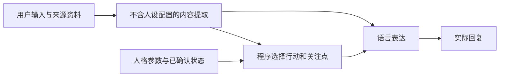

# 可执行人格策略实验

[文档导航](README.md) · [项目首页](../README.md)

`PolicySession` 是显式启用的实验接口。程序在表达生成前选择交流行动与关注点，模型负责内容理解和语言表达。现有 `Session` 默认 `text` 路径仍为一次生成 `HEAD → SAY → TAIL`，不会自动切换到该实验。

另可显式启用[受约束的信息追问](inquiry-policy.md)，在开放交流中选择应用审核过的缺失信息问题，并等待应用确认回答。它不依赖扩大固定倾听台词库，也不把问题槽或其答案当作模型可自行写入的权限。

## 数据与控制流



普通文本先调用一次内容提取；默认bounded表达在respond/listen/clarify时由程序直接组合受限语句及原文引用，不再调用表达模型，其他行动再调用表达模型一次。调用方已有 `ContentFrame` 时可省去提取，因此完整路径为0—2次调用。这里的受限表达是预先选定的执行方式，不是失败后的兜底。所有路径均不默认重试或增加模型裁判，也不生成 `direct/baseline/TAIL`。

内容提取请求不接收人格身份、语气或策略参数；只接收当前用户文字、来源资料、最近12条已接受输入及同主题的已确认开放承诺。通常不传先前的人格化回复；出现“你刚才第二条”等明确指代时，把最近最多6条实际回复作为prior_reply来源数据提供，避免无依据代答。被指代的回复不因此变成事实或控制指令，旧回复的语感也可能影响理解，不能声称完整上下文中毫无人格信息。输入隔离不等于推理正确：提取模型仍可能误解、漏掉条件或算错。

## 程序负责什么

`PolicyConfig` 包含四个0—1参数和固定抽样种子：

| 参数 | 控制对象 |
| --- | --- |
| `intervention` | 开放交流且允许建议时，主动选择 `advise` 的抽样阈值 |
| `practical` | 对实际事务关注候选的偏好 |
| `feeling` | 对用户已表达感受关注候选的偏好 |
| `detail` | 对具体细节关注候选的偏好 |
| `seed` | 与轮次序号一起确定可复算的抽样值 |

关注点按对应偏好选最高者，同分保持内容提取时的顺序；候选证据必须实际出现在用户文字或指定来源中。选择机制不假定数值对应真实心理量表，也不保证候选的语义分类正确。

未显式传 `policy` 时，`intervention` 读取现有人格配置的同名参数，`attention` 的 surface/subtle 映射为 practical/feeling 偏好。现有其他参数和 `bias` 不修改该实验的事实把握度。表达模型只接收已选行动、关注点及身份/voice语感参考，不再解释这四个人格策略数值。

行动优先级如下：

1. 明确的建议请求选 `advise`，仅作为本轮例外，不自动撤销长期边界。
2. 实际问题选 `answer`；只想倾听选 `listen`。
3. 明确要求继续约定、且同主题有唯一匹配的开放承诺时选 `continue`；可用ContentFrame.resume_id指定目标，不明确或目标不可用时选 `clarify`，不任取第一项。
4. 其他交流在 `respond` 与 `advise` 之间选择。用户边界为deny时，程序排除 `advise`。

`respond` 允许自然照应和交流，但不主动追加行动建议。动作规定交流意图；有限表达模式再将动作落实为代码维护的句式。承诺只有在用户明确要求继续时参与 `continue`，不会因保存了任务就强行打断其他话题。

## 使用接口

```python
from persona import PolicyConfig, PolicySession
from persona.config import PersonaConfig
from persona.llm import openai_compatible, openai_stream
from persona.store import Store

cfg = PersonaConfig.load("personas/default.toml")
with PolicySession(
    cfg,
    Store("data/policy-user"),
    openai_compatible("deepseek-chat", temperature=0.7),
    analyze_llm=openai_compatible("deepseek-chat", temperature=0),
    stream_llm=openai_stream("deepseek-chat", temperature=0.7),
    policy=PolicyConfig(intervention=0.2, practical=0.3, feeling=0.8),
) as session:
    result = session.say("报告还没写完，今天好累。", topic="work")
    print(result.say)
    print(result.decision)
    print(result.calls_count)
```

同一Store/namespace只用于一个活跃会话；不同用户和实验初态使用独立目录。主题键由应用提供，当前版本不自动识别换题。默认主题为conversation，不能把它理解为可靠的语义话题分类。

### 已有结构化内容

```python
from persona import ContentFrame, Focus, Quote, Source

result = session.say(
    "报告没写完，今天好累。",
    topic="work",
    frame=ContentFrame(
        facts=(Quote("user", "报告没写完"),),
        focuses=(
            Focus("task", "practical", Quote("user", "报告没写完")),
            Focus("mood", "feeling", Quote("user", "好累")),
        ),
    ),
)
```

可通过 `sources=(Source("record", "原始资料正文"),)` 提供资料，`Quote`中的source_id引用该ID；user保留给当前用户原话。来源ID唯一，引用必须逐字存在。内容提取的answer、unknowns、required是待核对的内容参考，不会因为带来源引用就提升为已证实事实。

### 用户边界

内容提取可以提议带原话的建议边界。自动控制只接受一轮一个、完整输入符合已支持句式的明确命令，不靠模型摘录的半句授权。例如“不要给建议”“今晚不要给建议”“现在可以给建议”“以后所有话题都不要给建议”。引用、假设、叙述混合句、未支持时限及范围不明的说法不会自动改状态；拒收项保存在policy_input中。该有限语法是操作接口，不是通用自然语言理解器，也不声称能识别所有真实边界。

应用已确认的边界可直接写入，无需调用模型：

```python
session.boundary(
    "deny", user="以后不要给建议", quote="以后不要给建议",
    topic="work", scope="topic",
)
```

有效范围由完整命令决定，模型的topic/session标签不决定权限：没有全局措辞时只应用于当前主题；“所有话题都/任何话题都/不管聊什么都”才应用到全局。“以后”仅表示时间，不能授权全局范围。最近的、尚未到期且适用于该主题的事件优先。普通无时限边界持续到明确更新；“今天/今晚”按UTC+8次日零点到期；“本轮/这次/现在/暂时”等只作用于当前输入，不写成永久偏好。当前版本拒收其他时限或混合句式，不猜测截止时间。

本轮临时边界使用明确的“这轮不要给建议”等完整指令，通过 `say` 的内容帧提出；不能通过无生成的boundary接口保存为长期状态。即使模型只摘出边界短句或填写了错误scope，程序仍检查完整输入，避免去掉“今晚”后错误永久保存。scope仅为提取器提示，不决定有效范围或持续时间。

advice/resume请求也需要完整、明确的支持句式，例如“现在帮我想办法”“继续上次约定”；不从“我没有让你给建议”中截取“给建议”授权。应用自行确认了更复杂请求时，可提供结构化frame并显式设置`confirmed_request=True`；这一确认不能来自模型JSON字段，调用方负责其语义正确性。纯文本解析无法确认时停止本轮，不猜测授权，也不自动重试。

### 已确认承诺

```python
session.commitment(
    "confirm", id="resume-title", user="好，先改简历标题", quote="先改简历标题",
    topic="work", text="先改简历标题",
)
# 应用核对用户确实完成后：
session.commitment(
    "complete", id="resume-title", user="已经改好了", quote="已经改好了", topic="work",
)
```

这些是应用确认接口，调用方负责核对操作语义与任务对应关系；原话存在性检查不能替代确认。模型JSON不允许承诺字段，表达中的“已经完成”也不改变状态。id不得重复；complete/cancel只能操作同主题开放承诺。承诺保持open不表示系统在后台执行了任务。

## 受限表达与自由表达

默认`realization="bounded"`对respond/listen使用固定的倾听语句及已选关注点的JSON引号引用；对clarify列出同主题开放承诺并询问目标。程序不让模型在这些动作里自由添加行动安排，调用方的来源文字仍按原文引用，不被当作助手新建议或事实背书。固定语句不随人设文本改写，表达空间因此缩小，自然度与人格语感需要单独评价。

advise/answer/continue仍用模型生成，不能声称其全文语义已受程序保证。显式`realization="free"`可让所有动作使用模型，适用于对照；CLI对应`--free-realization`。这一路径可能在程序已选respond时仍输出建议，不能把allowed_actions记录当成实际执行成功。

`result.realization`记录bounded_atoms或free_model；`semantic_execution`在受限表达时为fixed_atoms_and_attributed_quotes，其他情况为not_independently_evaluated。前者表示组合方式，不评价所引用内容是否真实或用户是否喜欢。已声明回答格式仍校验实际文本；当前受限语句没有通用JSON/表格编译器，组合不兼容时会保留格式失败，不自动切回模型。

## 记录、失败与保证范围

### 有限表达组合

显式设置`realization="composed"`可启用有限表达规划器，默认仍为`bounded`。两种方式覆盖相同的respond/listen/clarify动作；composed将有限语句与归属引用组合为可复算的表达计划，并排除最近两次确认交付中用过的同池句式。每个候选池有三种句式，因此可以在不改变动作或关注点的前提下避重。引用内容本身仍可能重复，机械避重不表示语义或体验不重复。

```python
from persona import ExpressionConfig, PolicySession

session = PolicySession(
    cfg, store, llm,
    realization="composed",
    expression=ExpressionConfig(warmth=0.9, formality=0.2, brevity=0.3),
)
```

未传expression时读取角色同名的warmth/formality/brevity参数，缺省均为0.5。正式度≥0.65选择正式句式；其他情况下，亲和度≤0.35为克制、≥0.65为亲近、中间为普通口语。简短度<0.5时，在尚无倾听收尾的引用句后追加对应语句，不截短引用。它们是离散的工程档位，不是经验证的连续人格量表，也不修改事实、请求权限或行动偏好。

句式库由代码维护，不直接拼入身份故事、voice或任意配置台词。listen不因亲和度高而新增追问；clarify只询问既有开放承诺，不自行选择或完成。来源引用保留原话，不做自由改述、心理推断或事实背书。JSON引号及不可见方向字符转义用于纯文本归属，不能代替应用的HTML/Markdown安全渲染。

`result.realization`在这条路径为composed_atoms，`expression_plan`记录语法版本、风格、句式ID、轮次选择键、最近交付ID及每段原子/原文来源。计划以policy_expression_plan在交付前保存；成功输出或失败前已确认交付才消耗避重历史，回调仅尝试发送不算交付。重启和同namespace恢复使用账本，不依赖进程内计数器。计划保存失败或本地组合失败不会自动转给模型。

advise/answer/continue仍使用原自由表达请求，expression配置不作用于这些动作。旧bounded保持原固定语句，free仍是显式全模型对照。有限组合的初步多轮结果见[论文与完整材料](validation/composed_expression_2026_11_07/README.md)，它不被默认推广为更自然或更完整的人格方案。

### 交付与审计

状态来源是追加账本中的 `policy_state`，重启从账本恢复，不依赖单独缓存视图。`policy_input`在表达调用前记录内容哈希、实际状态版本、抽样值、已选行动、关注点和接受/拒绝的边界；`policy_turn`记录实际回复、调用数和回答格式校验。模型请求与响应元数据分别保存为policy_model_call_start/end。

有用户依据的状态更新独立于表达成功：表达中断或回调失败时，这些边界保留，已交付片段和尝试交付片段分别写入policy_failure，不写正常policy_turn，不重试。`ReplyContract`仍可检查实际回复的格式，格式失败不会自动改写或重发。

后续明确指代可引用完整回复，也可引用失败前已确认交付的片段；后者标为后文未知。回调失败时仅尝试交付、未确认成功的内容不当作用户已看见的来源。多个承诺的目标选择仍需核对用户意图；程序保证目标属于同主题开放承诺，不证明提取模型已理解正确。

程序可约束动作选择、状态写入权限和恢复过程；受限表达进一步限制新增的语言动作。自由文本仍可能违背已选行动、遗漏条件或引入无依据断言，不会把程序选择成功当作回复执行成功。当前实验不执行工具动作，不保证开放语言全文事实正确，不启动长期记忆固化，也不自动推动人格参数。已有后台记忆路径仍属于原Session，可继续独立使用。

## 命令行

```powershell
python -B -X utf8 -m persona policy-demo -d data/policy-demo
python -B -X utf8 -m persona policy-demo -d data/policy-composed-demo --composed-realization
python -B -X utf8 -m persona policy-chat -p shorekeeper -m deepseek-chat -d data/policy-user --topic work --intervention 0.2 --focus feeling
```

policy-demo使用手写内容和回复，仅演示流程。policy-chat使用内容提取与按动作分派的表达，`--show-decision`只供研究观察。已有chat/trace的默认行为不变。在线调用前通过进程环境设置PERSONA_API_KEY与PERSONA_BASE_URL，认证不进入人格配置或公开研究材料。
