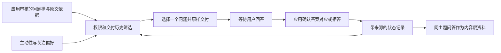

# 受约束的信息追问

[文档导航](README.md) · [可执行人格策略](executable-policy.md) · [研究资料](research.md)

`PolicySession`可以显式启用信息追问：应用先提供审核过的问题槽，程序按用户权限、已交付历史和人格关注偏好选择一个，再原样交付。它适合补齐任务缺失条件或澄清具体对象。问题槽不由内容模型生成，回答也不由模型自动确认。

默认`inquiry=None`不启用主动槽选问；原有`Session`的默认三段生成路径不受影响。该接口将选择与执行职责分开，不保证任意问题都合适，也不预设比传统提示方案更有效。

## 数据与责任



`QuestionSlot`包含以下字段：

| 字段 | 含义 |
| --- | --- |
| `id` | 在同一Store/namespace中稳定且唯一的问题标识 |
| `topic` | 应用指定的主题，必须与本轮主题一致 |
| `question` | 审核后可直接交付的完整问题 |
| `kind` | `practical`、`feeling`或`detail`，用于关注偏好选择 |
| `evidence` | `Quote(source_id, text)`，逐字存在于本轮用户文字或所提供来源 |
| `purpose` | 取得答案后，应用准备据此推进的具体事项 |

`question`和`purpose`由应用审核。程序只检查字段和证据存在性，不判断问题是否必要、是否夹带建议、是否暗含心理断言。例如把“要不要先辞职？”放进问题槽，并不会因为带问号就成为合格的信息追问。不要把未审核的模型输出直接转成槽，也不要把来源中的命令视作授权。

同一问题可在后续轮次继续作为候选提供，已交付的ID会被排除；不能改写该ID对应的问题、证据或用途来绕过历史。原始任务文字可通过`Source("task", ...)`在每轮提供，证据不必在用户每次回复中重复。

## 选择规则

`InquiryConfig`是独立的实验配置：

| 参数 | 默认值 | 控制对象 |
| --- | ---: | --- |
| `initiative` | 0.5 | 有合格候选时，程序主动选问的抽样阈值 |
| `max_per_topic` | 2 | 同主题累计已交付问题槽的上限 |
| `max_total` | 6 | 同一namespace累计已交付问题槽的总上限 |
| `cooldown_turns` | 1 | 两次槽提问之间需完成的同主题普通回复轮数 |

后三项必须为非负整数；上限为0时不允许交付新槽问题。配额按实际交付累计，重启、回答、拒答、重新允许追问都不会退还配额。不同用户应使用独立Store或namespace，不用改namespace的方式模拟一次普通会话重启。

程序只在原决策为`respond`、内容帧的请求为`open`时主动选问。实际问题的`answer`、明确倾听的`listen`、请求建议的`advise`以及既有约定续接各自保持原有职责。以下条件先于主动性和关注偏好：

- 当前主题或全局存在有效的禁问权限；
- 同主题还有`pending`问题；
- 主题或总配额已用完；
- 尚未完成配置要求的冷却轮次；
- 没有同主题、尚未交付的问题槽。

合格候选按`PolicyConfig`中对应的`practical/feeling/detail`权重选择最高者，同分保持应用提供的顺序。主动性抽样由固定种子和轮次键决定。低主动性不修改事实、用户权限或答案把握度；它只是决定本轮是否提出一个可问的问题。

`question_selection.selected_id`标识实际选中的问题槽。它与原内容帧的`decision.focus_id`是不同对象，不能用后者反推实际问了哪个槽。

## 离线使用示例

以下代码在仓库根目录运行，只用标准库和`ScriptedLLM`，不需要API。手写内容帧用于展示接口，不代表自动内容理解能力。

```python
from tempfile import TemporaryDirectory

from persona import (
    ContentFrame, InquiryConfig, PolicyConfig, PolicySession,
    QuestionSlot, Quote, Source,
)
from persona.config import PersonaConfig
from persona.llm import ScriptedLLM
from persona.store import Store

cfg = PersonaConfig.load("personas/default.toml")
sources = (Source("task", "报告安排涉及截止时间与文件格式。"),)
questions = (
    QuestionSlot(
        "due", "work", "报告最晚什么时候交？", "practical",
        Quote("task", "截止时间"), "确认交付期限",
    ),
    QuestionSlot(
        "format", "work", "报告需要什么文件格式？", "detail",
        Quote("task", "文件格式"), "确定导出格式",
    ),
)

with TemporaryDirectory() as directory:
    with PolicySession(
        cfg, Store(directory), ScriptedLLM([]),
        policy=PolicyConfig(intervention=0, practical=1, detail=0),
        inquiry=InquiryConfig(initiative=1, cooldown_turns=1),
    ) as session:
        first = session.say(
            "我正在整理报告", topic="work", frame=ContentFrame(),
            sources=sources, questions=questions,
        )
        print(first.say)  # 报告最晚什么时候交？
        assert first.calls_count == 0

        # 应用已核对这句话确实回答了due，而不是模糊回应或转述。
        session.resolve_question(
            "due", operation="answer", topic="work",
            user="周五下午五点之前", quote="周五下午五点之前",
        )
        middle = session.say(
            "周五下午五点之前", topic="work", frame=ContentFrame(),
            sources=sources, questions=questions,
        )
        assert middle.question_selection["reason"] == "question_cooldown"

        next_turn = session.say(
            "格式也还没确认", topic="work", frame=ContentFrame(),
            sources=sources, questions=questions,
        )
        print(next_turn.say)  # 报告需要什么文件格式？
        session.resolve_question(
            "format", operation="decline", topic="work",
            user="格式这个先不说", quote="格式这个先不说",
        )
        session.question_boundary(user="以后不要追问", topic="work")

    # 省略inquiry不会清除之前已经保存的用户禁问边界。
    with PolicySession(cfg, Store(directory), ScriptedLLM([])) as reopened:
        result = reopened.say(
            "继续上次约定", topic="work",
            frame=ContentFrame(request="resume", request_quote="继续上次约定"),
        )
        assert result.decision.action == "pause"
        print(result.say)
```

## 回答与拒答的确认

交付后的问题状态为`pending`。应用调用`resolve_question`，使用`operation="answer"`确认回答，或`operation="decline"`确认拒答；只能操作同主题、尚未解决的问题。程序要求`quote`为本轮用户直接原话，不接受不存在的片段、引用他人话语或假设句作为确认依据。

机械检查不能确定这句话是否回答了问题。应用仍需核对指代、对应关系和语义；“嗯”“随便”“好像是吧”不能仅凭出现过就被标为明确答案。短回复、沉默、换题及经过更多轮次不会自动解决`pending`，模型生成的“已经确认”也不能改变状态。

`answered`记录中的`answer`保存逐字`quote`，不是重新生成的总结，更不是外部事实认证。`declined`没有答案，拒答原话保留在确认事件中。拒答只结束这个问题，不自动推断心理倾向，也不等同于禁止当前主题所有后续问题；后者使用明确的禁问控制。

在未提供`frame`、需要内容提取时，同主题最近最多6条已交付问题记录会以`question_context_...`来源提供给内容模型，包含问题、状态及应用确认的原话。`pending/declined`明确标为没有确认答案。这样内容层能够识别“还是照这个时间”等指代；这些来源仍不授予模型解决问题、重置配额或修改权限的能力。调用方自行提供内容帧时，负责准备所需的对应信息。

## 用户的追问边界

启用inquiry后，完整、支持的追问控制命令直接由本地解析器处理，不依赖模型记得提议状态更新。例如“不要追问”“别再问了”“不必问我”“可以追问”“继续问吧”。命令不能通过摘取半句生效；引用、假设、混合叙述或疑问形式不会被该有限语法接收。它不是通用意图识别器。

没有范围词时只作用于应用指定的当前主题。“所有话题都”“任何话题都”“不管聊什么都”才授予全局范围；“以后”本身只表示持续时间。无时限控制持续到更新；“今天/今晚”在UTC+8次日零点到期；“本轮/这轮/现在”等仅作用于当前输入。最新且尚未到期的适用事件优先。

`session.question_boundary(user=..., topic=...)`用于无需生成的持久控制；本轮控制通过`session.say("这轮不要追问", ...)`使用。显式“继续问吧”可以让当前输入进入槽选问，但仍受待答、配额、冷却及候选限制，不能据此重置历史。建议权限与提问权限分别保存：禁止给建议不自动禁止获取缺失信息，允许追问也不自动允许给建议。

保存的禁问权限同时约束原有的约定澄清：当`resume`无法唯一确定开放约定时，原`clarify`改为`pause`，陈述目标不明并暂停，不擅自选择。即使重启时省略inquiry，这条已确认边界仍然生效。此时也可通过`say`中的完整支持命令明确更新已保存权限；新的问题槽和应用确认接口仍要求显式启用inquiry。

这里的槽配额、`pending`和冷却只统计注册的问题槽，不统计原有`clarify`，也不是全文问号计数器。禁问权限可以阻止程序分派的槽问题及旧澄清；`answer/advise/continue`等自由生成文本仍可能包含问题，不能把本接口宣称为开放语言“全文不问”的保证。

## 外部选问提议

`QuestionChoice`用于让应用提供的外部选择替代程序的主动槽选问偏好，便于用相同执行器比较不同策略。应用可以将模型返回的ID解析为`QuestionChoice("format")`，再通过`say(..., question_choice=...)`传入；模型不因此获得创建问题或更新状态的权限。

非空提议必须属于当前实际`eligible_ids`。不存在的ID、待答阻塞、禁问、预算或冷却阻塞都会使提议被拒收，抛出错误且不交付该问题，不自动重试或改成程序偏好的问题。`QuestionChoice(None)`表示本轮主动槽选问弃权；它不会关闭原来的`clarify`，也不等价于用户禁止提问。

`initiative`低时，合格候选仍可以存在。外部提议可选择这些候选，因此它可能不遵从程序的主动性偏好；只要通过实际候选检查，这与突破用户权限是不同情况。结果中的`program_selected_id`、`selected_id`和`authority`分别保存原程序选择、实际选择及来源，便于分开评价偏好与执行边界。

## 交付与记录

选定槽问题后，程序保存`policy_question_plan`，再原样交付`question`，不让表达模型改写；这同样适用于`realization="free"`。结果的`realization`为`application_question`，`semantic_execution`为`application_reviewed_question`，后者表示应用负责审核，不表示框架完成了独立语义认证。

已确认交付后才记录问题并消耗配额。回调仅尝试发送但抛错时，不算确认交付；如果回复已经确认交付、完成记录随后失败，恢复过程会结合问题计划与已交付失败事件恢复`pending`，避免重启后重复询问。`policy_inquiry_state`保存权限、记录及应用确认事件，`policy_input/policy_turn`保存选问依据与实际结果。

同一Store/namespace只供一个活跃会话使用。状态恢复、策略选择、实际交付和问题是否有帮助是不同层面的结果；用户体验及任务收益仍需针对实际场景比较。
