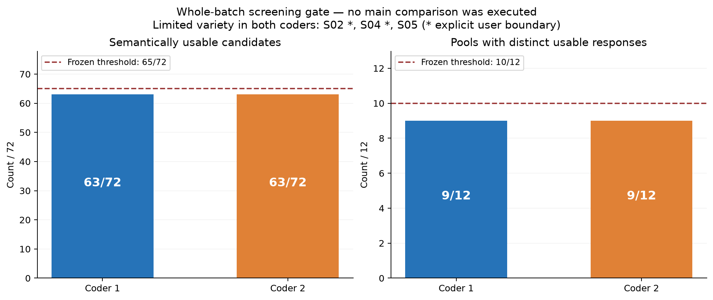
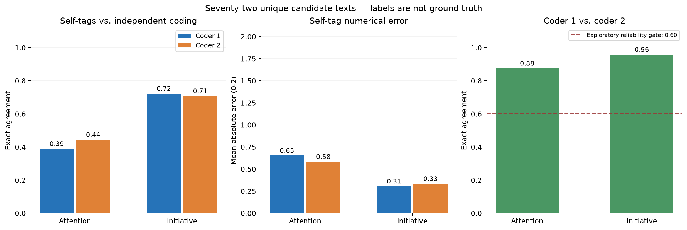
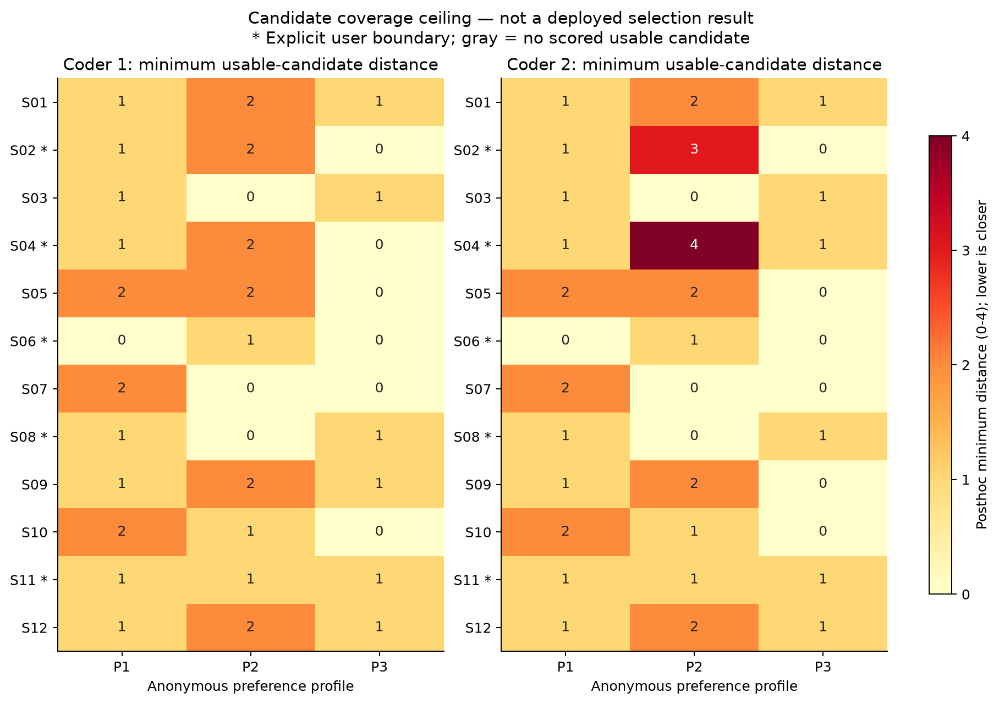
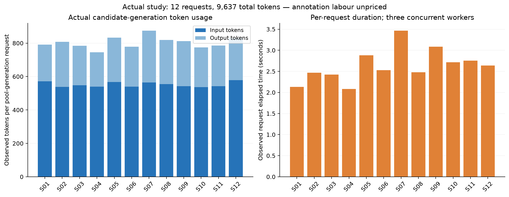

# 自然回复候选能否承载显式行为偏好？一项在预检阶段停止的小规模研究

[材料与复现](README.md) · [冻结方案](protocol.md) · [原始候选](pools/results.json) · [研究总览](../../research.md)

**研究日期：**2026年11月7日。**研究类型：**合成情境、事前冻结方案的开发性可行性试验。**评价来源：**两套独立Codex任务编码，非人类受试者评价。

## 摘要

人格工程需要解释偏好如何进入实际互动，而不仅是记录参数或动作标签。本研究考察一种最小实现：目标人格不可见的模型生成完整自然回复候选，程序依据行为自标签选择，并逐字输出，以减少再次生成造成的动作偏移。方案预先安排程序选池、强提示选相同池、强提示直接回复和随机选池四条件；主对照须先通过候选可用性与语义取舍预检。十二个合成中文社交情境各生成六条候选，共12次请求、72条候选。两套独立匿名编码均判定63/72条候选可用、9/12个池具有至少两种适切语义取舍，低于预设的65条和10个池门槛。因此研究在候选阶段停止，未执行主对照，也未追加或替换候选。候选自然度均分为4.47与4.63（满分5分）；关注点自标签与两套编码的一致率仅为38.89%与44.44%。结果提示，自然语言候选可以较流畅，但其多样性与自标签尚不足以直接作为本实现的可靠选择接口。停止结论仅适用于本次门槛、生成规范和评价，不能证明候选选择路线不可行，也不能据此判断框架相对传统提示的优劣。

**关键词：**人格工程；行为偏好；自然语言候选；匿名评价；可行性试验；停止规则。

## 1. 研究背景与问题

Persona-Duplex将人格关注点、介入倾向、表达选择与事实证据标准分开设计。既有[可执行策略研究](../executable_policy_2026_11_07/paper.md)观察到，程序选定动作后，自由生成仍可能偏离；[有限组合研究](../composed_expression_2026_11_07/paper.md)则未观察到预期的自然度改善。这使得“完整自然回复先生成、人格随后选择”成为值得检验的候选机制。

本研究的可操作对象是两维匿名行为偏好，不将其等同于完整人格。相关研究已将角色评价扩展到心理访谈[1]，也通过角色匿名化考察名称线索的影响[2]。本研究采用去除名称和口癖的实际文本编码，直接观察回复关注什么、是否推进互动；不使用角色自述或心理访谈得分替代这些行为观察。

研究问题依次为：（RQ1）一次生成是否提供足够多适切且语义取舍不同的候选？（RQ2）模型给候选标注的行为属性与独立文本编码是否一致？（RQ3）在前两项具备可用基础时，程序选择相对强提示和随机选择是否带来实际偏好、质量或成本收益？本次实际执行回答前两项；由于预检停止，第三项仍未检验。

## 2. 方法

### 2.1 情境、偏好与信息条件

研究使用12个合成单轮情境，庆祝、吐槽、温和分歧和无目的分享各3个。历史为0—1条用户发言，当前发言及研究者整理的事实、边界对所有方法相同。三个情境明确禁止某类建议，两个明确不愿继续被问；其余七个无明确行为禁令。不涉及医疗、法律、金融或危机场景。

三种配置分别偏向体验与轻量邀请（P1）、具体事情与主动推进（P2）、兼顾事情和体验后留白（P3）。它们同时改变两个维度，因此整体差异不能解释为单参数因果效应。attention取0、1、2分别代表事情主导、兼顾和体验主导；initiative取0、1、2分别代表留白、一次轻量邀请和主动推进。这些是工程操作化类别，其等距关系未经心理测量验证。

| 配置 | attention目标 | initiative目标 | 简要偏好 |
| --- | ---: | ---: | --- |
| P1 | 2 | 1 | 关注体验，给一次可不回答的分享机会 |
| P2 | 0 | 2 | 关注事情，主动带入相关角度 |
| P3 | 1 | 0 | 兼顾事情与体验，接住后留白 |

生成候选的模型不接收三种配置或其目标，只接收共同的聊天规则、行为定义和情境。它被要求产生六条自然且有不同语义取舍的完整回复，再估计每条的两个属性。这里的“目标人格不可见”不意味着模型推理没有任何先验风格或已实现人格与判断的因果隔离。

### 2.2 原定四方法对照

程序选池按自标签与目标的等权绝对距离选择，同分按候选ID升序：

$$
D(c,p)=|a_c-a_p|+|i_c-i_p|.
$$

该公式只是可复算的选择规则；当自标签有误时，正确执行公式也不能保证选择了预期行为。强提示选择器获得相同候选、事实、边界、配置和距离规则，但允许根据实际文本纠正标签、优先选择更适切的回复，或在无合适候选时弃选。直接回复条件接收相同资料和偏好但不看候选。随机条件按固定种子选池。三个选择条件均逐字保留被选文本，不经过新的表达模型。

原定主对照为12情境×3配置×4方法，共144条件，其中36次强提示选择、36次直接生成需要新请求；程序和随机选择无需新增生成。候选阶段12次请求加主对照72次，请求上限84。本次仅执行候选阶段，144个主对照条件均未运行，不能计为成功、失败或缺失回复样本。

### 2.3 冻结、模型与停止规则

首次请求前以SHA-256在本地冻结情境、配置、提示、代码、codebook和方案；这不等同于第三方登记的预注册。接口请求模型为`deepseek-chat`；12次实际响应的模型字段均为`deepseek-flash`。temperature为0.7，候选调用输出上限2400 token，超时90秒，三并发，不指定服务端随机种子。不重试、不补写、不调用在线裁判；完整请求响应均归档。

继续主对照须满足：12个池全部通过严格JSON解析；两套编码各自至少65/72条候选可用，并各自至少10/12个池具有两种以上适切语义取舍。按整批决定，不删除差候选后继续，也不重新生成到通过。这是工程筛查门槛，不是统计显著性、安全标准或心理测量阈值。

### 2.4 匿名评价与统计单位

两名独立启动的Codex编码任务仅阅读共同事实、边界、匿名实际文本和评价规则，不读取目标配置、自标签、方法映射或另一份标签。每条唯一的“情境、文本”组合编码一次。两套任务属于同类模型辅助评价，不代表独立模型家族或人类评价，分歧完整保留。

实际关注点和主动性编码为0、1、2，难以判别时允许null；自然度与适切性各为1—5分；无来源断言和明确边界违规分别为布尔标签。候选初审另外判断单条是否可直接用于当前情境，以及每池是否至少有两种适切语义取舍。普通比喻、玩笑和社交评价不按字面误判为事实错误。候选自标签从不提供给编码者。

本次统计单位为12个池及其中72条候选，池内候选相关，不把72条视为72个独立场景。只报告描述统计和编码一致性。尚未执行的程序、提示和直接生成不补出均值、显著性或胜率。主对照原定的配对bootstrap亦未作为已完成比较报告。

## 3. 结果

### 3.1 实际执行与候选预检

12次请求均以`stop`完成；12个响应全部通过固定结构校验，共72条不同的同场候选。没有服务错误、重试、候选替换或语义筛除。

| 指标 | 编码者1 | 编码者2 | 继续门槛 |
| --- | ---: | ---: | ---: |
| 可用候选 | 63/72（87.50%） | 63/72（87.50%） | 各至少65/72 |
| 有至少两种适切语义取舍的池 | 9/12（75.00%） | 9/12（75.00%） | 各至少10/12 |
| 自然度均分 | 4.47/5 | 4.63/5 | 候选阶段不设均分门槛 |
| 适切性均分 | 4.31/5 | 4.33/5 | 候选阶段不设均分门槛 |
| 被编码为有无来源断言的候选 | 9/72 | 9/72 | 单条可用性的一部分 |
| 明确边界违规 | 0/30个有边界候选 | 0/30个有边界候选 | 单条可用性的一部分 |

两套初审均未达到门槛，研究停止。两项门槛的差距分别只有2条候选、1个池；这不是大范围失效或统计确定性证据。三个被判缺乏充分取舍的情境为S02（拼图庆祝）、S04（排队售罄吐槽）、S05（播放器更新吐槽）。前两个有禁建议边界，适切回应收敛有其合理性；预检没有按边界状态调整多样性门槛，因而可能较为保守。

*图1. 整批候选预检与冻结门槛。两个编码任务分别报告；柱高相同不代表具体标签完全一致。主对照未执行。*

### 3.2 自标签与实际文本编码

| 行为维度 | 自标签与编码者1一致 | 自标签与编码者2一致 | 两编码者一致 |
| --- | ---: | ---: | ---: |
| attention | 28/72（38.89%） | 32/72（44.44%） | 63/72（87.50%） |
| initiative | 52/72（72.22%） | 51/72（70.83%） | 69/72（95.83%） |

这里的一致率是逐类别精确匹配，不是真值正确率。模型把49/72条候选标为attention=1；两套文本编码分别仅把16/72和15/72条归入此类。自标签中的“兼顾”与实际文本评价存在系统性的分类差异。两位编码者也可能共享同类偏差，高一致率不能消除这一限制。

例如S07-C04（匿名ID T010）的回复为：“说得太满这一点挺关键，解释把线索都收好了，却也把观众从参与的位置挪到了听讲的位置。”模型标为attention=1，两编码者均标为0，认为其主要讨论叙事结构与观众位置。S02-C02（T006）则由模型标为1、两编码者均标为2，评价重点是完成拼图时的体验。这些分歧发生在不需重写的完整文本上，说明按标签算距离与按实际语言识别取舍是两个不同步骤。

主动性方面，两套编码分别将59/72与56/72条归为留白，6/72条归为轻量邀请，7/72与10/72条归为主动推进。实际候选空间偏向接话后收尾；没有理由把每池“六条不同文字”视为六种不同互动选择。

*图2. 自标签与各套编码的精确一致率、操作化数值的平均绝对差，以及两套编码之间的一致率。右图虚线是方案中的探索性评价可靠性门槛，不是真值标准；中图使用未经心理量表验证的等距编码。*

### 3.3 可用候选的目标覆盖

为了区分“选择器没有选好”和“池里没有对应选择”，依据已完成的盲编码，事后计算每个池中可用候选与配置目标的最小距离。该诊断使用单条初审`semantic_usable`集合；它没有改变任何候选，也不是程序选择或提示选择的实际运行成绩。

七个无明确边界情境的精确目标覆盖如下。一次“覆盖”指至少存在一条被对应编码者判为可用、且两维编码均与目标相同的候选：

| 配置 | 编码者1：有精确对应候选的情境 | 编码者2：有精确对应候选的情境 |
| --- | ---: | ---: |
| P1：体验＋轻量邀请 | 0/7 | 0/7 |
| P2：事情＋主动推进 | 2/7 | 2/7 |
| P3：兼顾＋留白 | 3/7 | 4/7 |

偏好是软目标，未精确命中不等于回复不适切，更不能由此诊断人格失败。这个结果只表示：在本次操作化和候选集合下，即使事后获得这些编码，选择器也不能在每个情境中找到所有目标的精确对应项。有边界情境的完整结果单列于图3和[统计数据](summary.json)，不要求为了命中人格目标违反用户要求。

统计数据还按方案保存100组固定种子的离线随机选池敏感性计算。这些计算仅重新索引已有候选和编码，不产生新增语言样本，也不构成已执行的主对照；本研究不据此报告程序或模型的方法胜率。

*图3. 可用候选的事后覆盖诊断。数值是编码距离的最小值，越小表示在该操作化下越接近目标；星号为有明确用户边界的情境。此图不是已部署选择器的表现。*

### 3.4 事实边界与成本

两套编码各标记9条无来源断言，具体条目并不完全相同。这些标签反映规定证据口径下的评价。例如S12-C01（T059）的“磨圆的边角也说明它跟着你读过不少书”，将磨损直接解释为具体阅读经历；材料只说明书签边角磨圆。部分标记涉及日常语言中的合理推断边界，不能把全部标签都当作无争议的事实错误。

明确禁止建议或提问的五个情境共30条候选，两套编码均未标记边界违规。这个结果与“候选池未通过继续门槛”同时成立，后者不能解释为普遍违反用户边界。样本规模和情境范围也不足以证明一般边界安全。

候选阶段实际使用输入6620 token、输出3017 token，共9637 token；每池平均803.08 token。端点调用耗时平均2.64秒，中位数2.58秒。每池六条候选的生成成本不能除以六后当作一次实际回复成本，除非应用确实复用整个池且明确报告该使用方式。主对照未执行，故没有本次直接回复或提示选择的实测成本，不能使用既往实验的数字替代同条件比较。Codex编码劳动另行存在，平台未提供本研究可单独导出的token和费用，不计作零成本。

*图4. 十二次候选生成的实际token和端点调用耗时。运行器使用三并发，右图不表示包含等待、编码和研究调度的端到端时间。*

## 4. 讨论

### 4.1 可以得到的结论

候选文本在两套评价中的自然度较高，说明本次无需依赖固定有限句式也能产生较流畅的表达。但自然度、候选之间的行为差异和标签可靠性并非同一指标。尤其在attention上，自标签与独立编码不一致，使程序即使完全执行其距离公式，仍可能选择与实际偏好不同的回复。

本次支持的工程判断是：当前候选生成规范与自标签接口未通过事前可行性门槛，因此不扩大到主对照或作为默认功能。这个判断没有建立框架相对传统提示的优势，也没有建立其劣势；强提示选择器是否能纠正标签、直接提示是否有更好的质量与成本，都仍待真正执行的公平对照回答。

### 4.2 局限与后续条件

首先，12个开发情境、一次采样、单一服务模型不足以说明新场景、多轮互动或长期人格稳定性。其次，关注点和主动性只是局部行为操作化，不能代表完整人格；其距离权重也未经验证。第三，评价来自两个Codex任务而非真实用户，事实推断边界和“足够不同”的标准具有主观性。第四，多样性门槛没有为有边界情境预先设不同要求，可能惩罚合理收敛。第五，事实和边界由研究者整理，未测量自动情境理解、RAG、候选审核或记忆维护的真实成本。

后续优先问题应是行为描述与实际文本能否可靠对应，以及开放情境中是否存在可重复的真实取舍。任何后续规范修订应使用新的冻结情境和新采样，分别报告有边界与无边界条件；不能回头修改本次阈值或不断补候选以改变结论。只有这一前提改善后，才有依据投入程序选择与强传统提示的完整对照。

## 5. 结论

本次以12次请求完成72条自然候选的可行性预检，并依预先冻结的标准停止。候选可以流畅，但语义取舍覆盖和行为自标签尚不足以支持当前选择接口。研究保留全部数据和评价分歧，未执行的主对照保持未检验状态；框架默认行为不作改变。

## 数据与复现

完整候选和请求响应、匿名输入、两套标签、冻结哈希与重算脚本见[材料说明](README.md)。图表由保存数据生成。归档重放只在完整请求逐字匹配后复用原响应，不产生新增样本。公开材料均为合成情境，不包含认证密钥。研究未进行人类受试者实验。

## 参考文献

[1] Wang, X., Xiao, Y., Huang, J., et al. (2024). [InCharacter: Evaluating Personality Fidelity in Role-Playing Agents through Psychological Interviews](https://aclanthology.org/2024.acl-long.102/). *Proceedings of ACL*, 1840–1873. DOI: 10.18653/v1/2024.acl-long.102.

[2] Peng, J.-L., & Chen, Y.-N. (2026). [Rethinking Role-Playing Evaluation: Anonymous Benchmarking and A Systematic Study of Personality Effects](https://aclanthology.org/2026.sigdial-1.15/). *Proceedings of SIGDIAL*, 205–218. DOI: 10.18653/v1/2026.sigdial-1.15.
