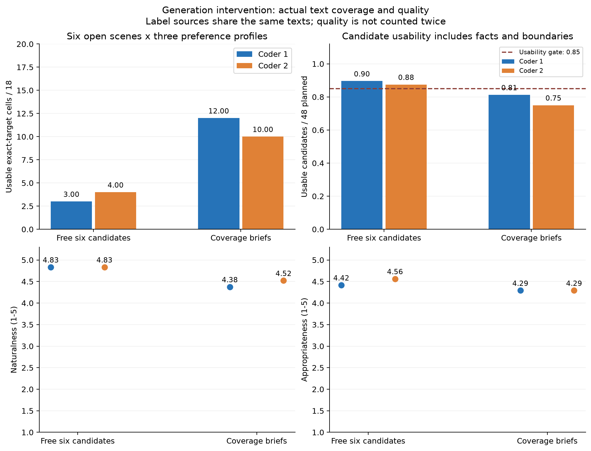
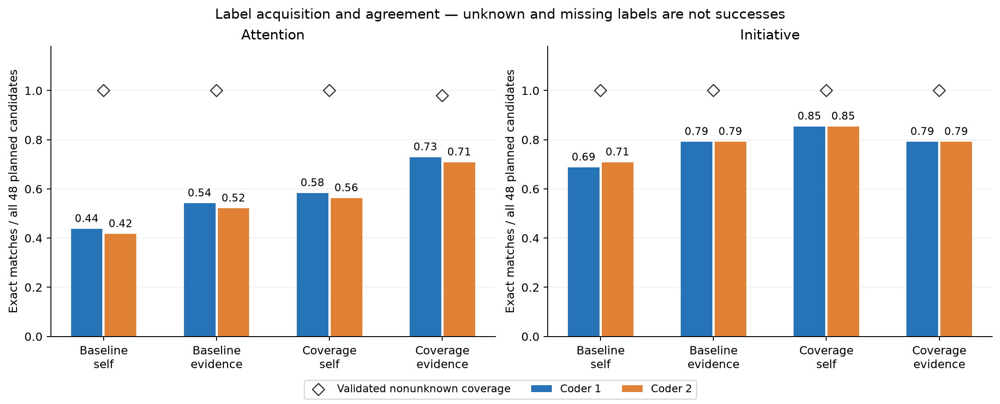
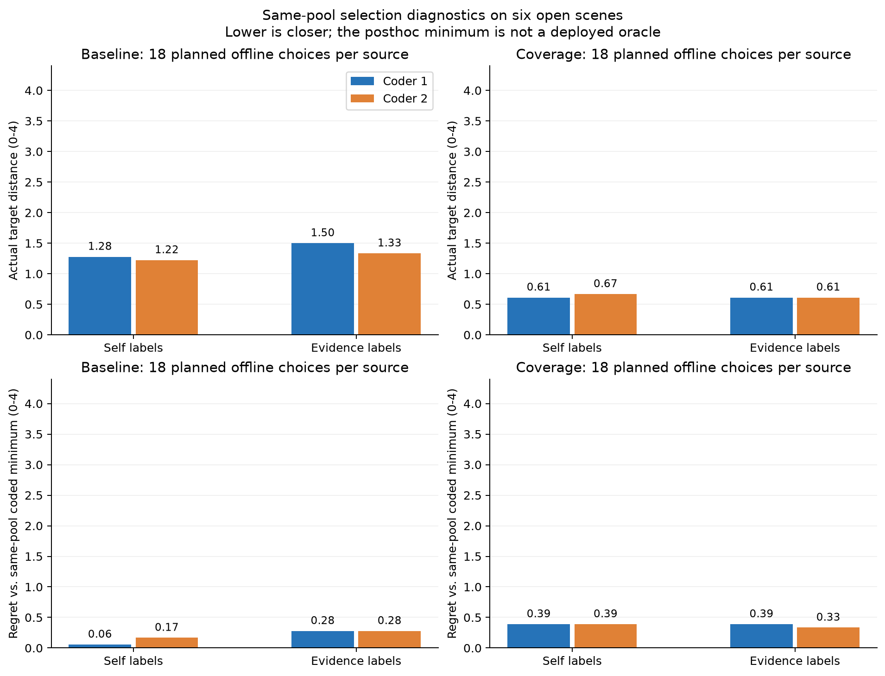
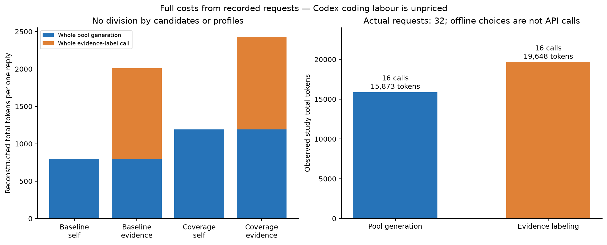

# 显式语义覆盖与证据标注能否改善人格候选接口？一项小规模配对验证

[研究材料](README.md) · [冻结方案](protocol.md) · [原始结果](run/results.json) · [研究总览](../../research.md)

**日期：**2026年11月7日。**设计：**生成规范×标签来源的两因素组件验证。**评价：**两套独立Codex文本编码，非人类受试者研究。

## 摘要

针对自然候选覆盖不足和行为自标签不可靠的问题，本研究实现显式语义覆盖计划与分离证据标注，并在八个新合成情境进行配对验证。原生成提示与覆盖计划各产生八池、每池六条候选；同一池同时保留生成自标签，并接受不见原标签和计划的文本再标注。共32次API调用、96条候选、96次零新增调用的离线选择，使用35521 token。两套匿名Codex编码显示，开放情境的可用目标覆盖由3/18、4/18提高到12/18、10/18，但自然度分别下降0.46、0.31分，可用比例降至81.25%、75.00%。在覆盖计划候选上，分离标注的关注点匹配均增加7/48条，主动性匹配却均减少3/48条；一次不合格关注点提议被保留为未知。两项组件均未达到完整的事前扩展门槛。结果支持“覆盖可以被定向改善、标签收益因维度而异”的局部观察，但不支持把更多候选方向或更高标签一致率直接等同于更好的人格互动。当前修订保留为可复现的实验原型，不扩大采样或更改默认框架路径。

**关键词：**人格工程；语义覆盖；行为标签；证据定位；配对试验；自然语言选择。

## 1. 背景与研究问题

前一轮[自然候选预检](../candidate_choice_2026_11_07/paper.md)发现，完整回复可以较自然，但候选之间的实际取舍不充分，生成模型的关注点自标签也与匿名文本编码存在较大差异。因此，按自标签执行距离规则并不能直接证明人格偏好进入了实际回复。

本研究对两个具体组件作修订。第一项是候选供给：由程序编译明确、互补、允许因用户边界收敛的语义意图，保留模型自由措辞。第二项是标签取得：用不见生成计划、自标签或目标人格的分离调用重读实际文本，返回类别与逐字证据；程序只校验结构和引用对应，无法判断时保留未知。

研究检验H1：覆盖计划提高可用候选的目标覆盖而不过度损害语言质量；H2：分离证据标注提高全候选中的可用标签匹配率，并检查这种改善是否反映在同池选择上。研究不检验完整框架相对强传统提示的优劣，也不以格式有效性代替人格效果。

## 2. 方法

### 2.1 情境与公平对照

八个新合成情境覆盖庆祝、吐槽、温和分歧和无目的分享，各两例。六个没有明确行为禁令；N02禁止建议，N06禁止提问。语义主题包括合唱、薄荷新叶、包装、衣物、桌游、街景摄影和日常物件，与上一轮具体实例不同，但仍属于相同类型的短中文社交情境。它们在看到上轮结果后设计，因此是新的冻结材料，不是先前预留的保留集。

每个情境提供相同历史、当前原话、事实和边界。`controls`由研究者根据明确用户原话确认，程序不从情绪推断禁令或授权。生成因素如下：

| 生成条件 | 行为 |
| --- | --- |
| baseline | 逐字复用上轮共同提示与自由六候选提示，在本轮新情境重新采样 |
| coverage | 使用相同共同规则，增加六项语义覆盖意图及适切性优先要求 |

coverage的六项意图为事情留白、体验留白、事情邀请、体验邀请、实质新角度、兼顾后留白。它们只规定互动取舍，不固定句式，不向模型提供人物名称或三个目标配置。禁问情境中的两项邀请改为不索取回答的回应；禁建议时禁止行动安排和以问句包装建议。意图是软提醒，用户边界和适切性优先于覆盖配额。

### 2.2 标签取得与验证

每个生成池有六条完整回复及生成时自标签（self）。同一池再接受一次evidence标注，仍提供相同完整语境，但打乱候选顺序并重编号，隐藏生成条件、原ID、计划、自标签和人格目标。标注模型按更详细的实际文本判据返回两个类别及引文。

关注点`attention`的0/1/2代表事情主导、实质兼顾、体验主导；主动性`initiative`的0/1/2代表留白、轻量邀请、实质推进。难以判断允许null。标签属于工程操作化，不是经验证的心理量表。

验证器检查ID、字段类型和引文是否逐字出现在相应文本中。attention=1需至少两段不同的逐字引文，并分别声明content与experience类型；initiative=0需引用全文，因为缺少新方向是全篇判断，不能用任意局部片段证明。验证器不证明引文与声明类型在语义上对应，也不认证事实正确性。不合格维度保留为unknown，不回退self，不重试或补写。原始提议及拒收原因均保存。

该标签干预同时改变调用分离、判据详细度和证据格式，因此本试验不能把效果单独归因于其中一项。同一服务模型参与生成和分离标注；“分离”不等同于独立真值来源。

### 2.3 四条件与离线选择

G×L形成baseline/self、baseline/evidence、coverage/self、coverage/evidence四个条件，但实际只有16个池、96条生成文本。两标签来源共享候选，因此自然度与候选质量只按两个生成条件统计，不能翻倍计算样本。

三个匿名偏好目标沿用上一轮，分别为体验＋轻量邀请P1=(2,1)、事情＋推进P2=(0,2)、兼顾＋留白P3=(1,0)。生成与标注均不见这些配置。程序仅在两维均有标签的候选中选择最小距离者，同分按原候选ID升序：

$$
D(c,p)=|a_c-a_p|+|i_c-i_p|.
$$

选中文本逐字保存，不经过新的表达调用；无可用标签时弃选。共8情境×2生成×2标签×3配置=96次离线选择，它们不是96次新生成或用户交互。程序不会使用后续盲评的质量标签过滤候选。

### 2.4 运行与冻结

首次请求前本地冻结方案、情境、提示、源码和codebook的SHA-256，非第三方预注册。对照的共同与生成提示同上一轮文件逐字一致。排程用固定种子随机排列，三并发；服务端seed不设，temperature=0.7，生成上限2400输出token、标注上限3000，超时90秒。每池先生成再标注，不自动重试或JSON修复。完整请求、原始响应和实际耗时归档。

本轮实际执行16次生成和16次标注，共32次请求；请求标识均为`deepseek-chat`，响应标识均为`deepseek-flash`，全部以`stop`完成。三次服务/生成错误停止新调用的规则未触发。

### 2.5 匿名实际文本评价

两名新启动、无本研究历史的Codex编码任务只读取共同codebook及匿名文本材料，不读条件、标签、计划、目标配置、结果或另一套编码。96个唯一的“情境、文本”组合各编码一次。attention/initiative为0/1/2或null，自然度和适切性各1—5分，无来源断言和明确边界违规分别为布尔值。两套编码独立保留，不合成真值；它们不代表不同模型家族或人类体验评价。

本轮事前将“可用”明确操作化为自然度≥3、适切性≥4、无无来源断言、无边界违规。这不回写上一轮单独初审的semantic_usable结果。六个开放情境×三个配置构成18个目标覆盖单元：池中至少存在一条可用候选，其两维实际编码等于目标，即记覆盖。有边界情境单列，不为匹配目标而要求违规。

标签指标同时报告验证后非unknown覆盖率、已取得标签中的精确一致率，以及全部计划候选中的精确匹配取得率（每生成条件48条，unknown/无效/缺失不计成功）。评价者无法编码时不猜中间值，也不能记为成功。四条件的实际选择另外报告目标距离、弃选、质量、事实/边界和同池选择差距。后者定义为被选文本的实际编码距离减去同池可编码文本的最小距离：

$$
R(c,p)=D_{\mathrm{coded}}(c,p)-\min_{j\in C_{\mathrm{coded}}}D_{\mathrm{coded}}(j,p).
$$

该最小值是使用事后编码得到的诊断参照，不是运行时可获得的最优选择器，也不保证候选适切。标签与事实边界指标分别报告。

### 2.6 事前判断与成本

H1的扩展门槛要求两套编码各自满足：至少四个开放情境的可用覆盖数提高，18单元合计增加至少4；coverage整体可用比例≥85%；自然度与适切性均不下降超过0.25分；有边界coverage候选零违规。

H2要求在coverage的48条计划候选上，两套编码各自满足：attention全分母精确匹配较self提高至少10个百分点且达到70%；initiative匹配率降低不超过5个百分点；两维标签覆盖均≥90%。baseline的同类结果也完整报告。H2通过不自动意味着实际选择改善或成本值得；两组件分别决定是否扩大验证。

所有门槛是探索性的工程筛查，不是显著性或非劣效标准。配对差异按情境汇总，固定种子下做5000次情境级bootstrap描述区间；不将候选、配置和两种标签来源当独立场景。不因结果增删池或追加请求。

通常部署一次self选择承担一次完整池生成成本，一次evidence选择承担完整池生成加标注成本；不按六候选或三个配置摊薄为单次回复成本。两阶段耗时相加是重构量，不代表真实用户端到端时延。Codex评价劳动另计，平台未单独导出其token费用，不视为零成本。

## 3. 结果

### 3.1 执行完整性与评价一致性

16个生成池全部通过结构解析，96条候选均为不同的同场文本。16次标注调用正常返回，但不等于所有维度均通过验证：N08-coverage/C05提出attention=1，其两个引文条目却均声明为content，缺少experience类型，程序因这一结构缺项将attention保留为null；其initiative仍有效。没有重试、回退或替换候选。全部96次离线选择有可选文本，无弃选。

两套Codex编码的精确一致率为attention 88/96（91.67%）、initiative 92/96（95.83%）。两套任务可能共享模型偏差；这些比例不是人类真值可靠性或人格效度。以下所有主结果分别报告两套编码。

### 3.2 覆盖收益与语言质量

表1按生成条件统计，两个标签来源共享候选，不重复计算质量样本。

| 指标 | baseline：编码1／编码2 | coverage：编码1／编码2 |
| --- | --- | --- |
| 开放情境可用目标覆盖 | 3/18／4/18 | 12/18／10/18 |
| 全部候选可用数 | 43/48／42/48 | 39/48／36/48 |
| 可用比例 | 89.58%／87.50% | 81.25%／75.00% |
| 自然度均分（1—5） | 4.83／4.83 | 4.38／4.52 |
| 适切性均分（1—5） | 4.42／4.56 | 4.29／4.29 |
| 无来源断言标记 | 3/48／4/48 | 5/48／8/48 |
| 有边界候选中的违规标记 | 0/12／0/12 | 0/12／0/12 |

覆盖计划使两套编码分别有6/6、4/6个开放情境的覆盖数提高，合计增加9和6个目标单元，满足预设的覆盖增益要求。然而可用比例低于85%；自然度分别下降0.4583、0.3125分，均超过允许的0.25分。编码2的适切性下降0.2708分，也略超过门槛。因此H1的覆盖部分得到观察支持，整体扩展条件未通过。修订回复的平均自然度仍超过4分，不能把相对下降写成全部回复不自然。

*图1. 开放情境覆盖、全部候选质量与可用性分别呈现。覆盖的分母是6情境×3目标，候选质量的分母为每生成条件48条；两套编码不是额外的独立场景。*

定性观察与这一取舍相符。N08-coverage/C03（R018）在接住胶带圈住回车键的画面后，继续询问键盘其他角落是否也被占用，两位编码者认为邀请略显刻意；N08-coverage/C05（R037）为提供新角度，转向解释各按键用途，被认为关联牵强。它们显示“写出一个额外分支”可以完成局部动作要求，却未必是当前闲聊最自然的延续。

另一些问题涉及事实来源。例如N05-coverage/C06（R046）将“双方没有闹别扭”扩展成“把差异说开”“互相知道对方在意什么”；N07-coverage/C04（R056）把一次拖鞋事件扩展成“每天”“每次”。两位编码者均将这些新增经历或关系状态标为无来源断言。这些是实际文本问题，不能用候选意图标签合规来消除。

### 3.3 标签可靠性与unknown

表2的分母始终为每生成条件48条计划候选，unknown不能算作精确匹配。数字表示与编码1／编码2一致的条数，不是真值正确率。

| 生成条件与标签来源 | attention精确匹配 | initiative精确匹配 | attention／initiative非unknown覆盖 |
| --- | --- | --- | --- |
| baseline / self | 21/48／20/48 | 33/48／34/48 | 48/48／48/48 |
| baseline / evidence | 26/48／25/48 | 38/48／38/48 | 48/48／48/48 |
| coverage / self | 28/48／27/48 | 41/48／41/48 | 48/48／48/48 |
| coverage / evidence | 35/48／34/48 | 38/48／38/48 | 47/48／48/48 |

在coverage池上，分离标注使attention精确匹配均提高7/48，即14.58个百分点，达到72.92%与70.83%，满足H2的关注点要求。按非unknown子集计算则为35/47与34/47；本研究不以更小的分母替代主指标。

initiative则由41/48降为38/48，减少3条，降幅6.25个百分点，超过事前允许的5个百分点，因此H2未通过完整标签筛查。这一停止差距较小，不足以证明一般性退步。相同标注器在baseline池上反而提高了两个维度的匹配，说明标签来源与候选风格存在本次样本中的交互，不能笼统认定再标注总是更可靠或总是更差。

*图2. 全计划分母下的标签精确匹配与标签取得覆盖。被拒收的一个关注点标签仍计入48条分母。逐类混淆矩阵与条件一致率保存在[summary.json](summary.json)，不只报告更有利的非unknown子集。*

### 3.4 实际离线选择

表3使用六个开放情境，每条件3配置，共18次选择；数值越小表示在本操作化下越接近目标。全部条件均有18/18次输出，无弃选。

| 生成／标签 | 目标距离均值：编码1／编码2 | 可用选择数：编码1／编码2 |
| --- | --- | --- |
| baseline / self | 1.278／1.222 | 16/18／16/18 |
| baseline / evidence | 1.500／1.333 | 16/18／16/18 |
| coverage / self | 0.611／0.667 | 14/18／14/18 |
| coverage / evidence | 0.611／0.611 | 16/18／16/18 |

扩展候选供给使目标距离下降，但分离标注的附加收益不稳定：在coverage池上，编码1的平均距离不变，编码2下降0.0556；六情境配对差异的95%描述性bootstrap区间分别为[-0.500, 0.611]和[-0.500, 0.444]。样本很小，区间不构成精确总体估计或非劣效结论。baseline池在再标注后距离反而上升，尽管其整体标签匹配率提高。

分离标注也并非没有有利变化：coverage条件中的可用选择由14/18提高到16/18，两套编码一致；自然度均值分别从4.111到4.278、4.389到4.667。因此，标签匹配、偏好距离和选择质量不能互相替代。全部八情境、有边界子集、同池选择差距及原始条件记录在数据中完整保留。

*图3. 同一池在两类标签下的确定性选择，使用实际文本盲编码评价。选择复用了已有候选，不是新生成或真实用户多轮互动。*

### 3.5 成本

32次实际调用使用输入24115、输出11406、合计35521 token。16次池生成合计15873 token，16次再标注合计19648 token。表4由完整实际请求核算通常一次回复承担的成本，未按候选数或配置数摊薄。

| 路径 | 调用数/次选择 | 平均完整token/次选择 | 请求耗时重构均值（秒） |
| --- | ---: | ---: | ---: |
| baseline / self | 1 | 794.00 | 2.30 |
| baseline / evidence | 2 | 2010.50 | 4.50 |
| coverage / self | 1 | 1190.13 | 2.41 |
| coverage / evidence | 2 | 2429.63 | 4.55 |

coverage的证据标注路径约为其self路径的2.04倍token。该成本增加不能仅凭关注点匹配率上升就认定值得；选择距离改善有限，但部分选择质量指标改善，需要在后续用户体验或独立任务评价中权衡。这里不比较货币价格，也不把三并发下的请求耗时之和当作真实用户端到端时延。

*图4. 实际研究调用量与按完整池核算的单次路径成本。成本来自已归档请求，标注任务在Codex侧的不可取得费用不计为零。*

## 4. 讨论

### 4.1 改进成立的范围

覆盖计划确实改变了实际候选供给，收益不只存在于生成意图或自标签中。但更完整的行为坐标覆盖伴随刻意延伸、无来源关系解释和自然度下降，表明当前六意图计划没有充分区分“能够生成”与“当前情境值得展开”。软化提醒和明确边界调整仍不足以消除这一问题。

分离证据标注改善了关注点匹配，并让一个不满足引用结构的提议显式保持未知。这说明接口可以记录和拒收部分无效提议；程序验证并不能使语义标签成为确定事实。主动性效果随生成条件变化，且标签总体匹配提高未必降低最终选择距离。人格工程仍需要直接检查选出的语言行为，而不是把正确执行距离公式视作效果验证。

### 4.2 扩展决定与限制

按事前规则，H1因可用性与自然度未达要求，H2因主动性下降超出允许范围，均不扩大当前完整机制。两组件的局部收益保留，不回改门槛，也不补采样直到通过。默认框架路径没有新增证据标注调用，研究原型与全部材料独立保留。

局限包括：仅八个结果启发后设计的短合成情境、单次采样、单一服务模型；两套编码来自同类Codex任务，不是人类体验研究；行为坐标及等距权重未经心理测量验证；事实和边界由研究者提供，自动语境理解与RAG成本未测；计划具体槽位、固定同分顺序和候选风格未做独立泛化检验。新增标签调用同时包含详细判据和证据格式，无法隔离各项贡献。

此外，本轮不含强提示直接回复或强提示选池条件。生成规范的改进本身包含提示设计，不能由此证明框架优于传统提示工程。对“更自然”“更像同一个人格”“更值得部署”的结论，都仍需相应的独立评价。

下一项更集中的问题是如何只在当前情境存在合理空间时展开可选分支，以及能否按维度使用标签证据而避免覆盖全部标签。它们是本次结果形成的新假设，尚未在本轮验证；不能把事后选取更有利的组合写成已通过的改进。

## 5. 结论

本轮完成了可执行的候选覆盖和证据标签修订，并在32次调用的小规模配对试验中检验。候选覆盖与关注点标签均有明确的描述性提升，但自然度、可用性、主动性标签和额外成本形成了不同取舍，两组件均未达到完整扩展门槛。当前结果支持继续研究情境适配和标签分工，不支持扩大当前完整管线或改变默认框架。

## 数据、代码与复现

完整材料见[README](README.md)。冻结方案、原始请求响应、96条候选、全部标签提议与验证错误、96次离线选择、匿名评价输入、两份编码及统计绘图脚本均公开保留。图表从保存数据重算；归档重放严格匹配完整请求，零新增网络调用，不构成新的实验重复。全部情境为合成材料，没有真人受试者或API密钥进入发布数据。

## 相关研究材料

[1] Persona-Duplex. [自然回复候选能否承载显式行为偏好？一项在预检阶段停止的小规模研究](../candidate_choice_2026_11_07/paper.md). 2026-11-07.

[2] Persona-Duplex. [可执行策略与受限表达研究](../executable_policy_2026_11_07/paper.md). 2026-11-07.
