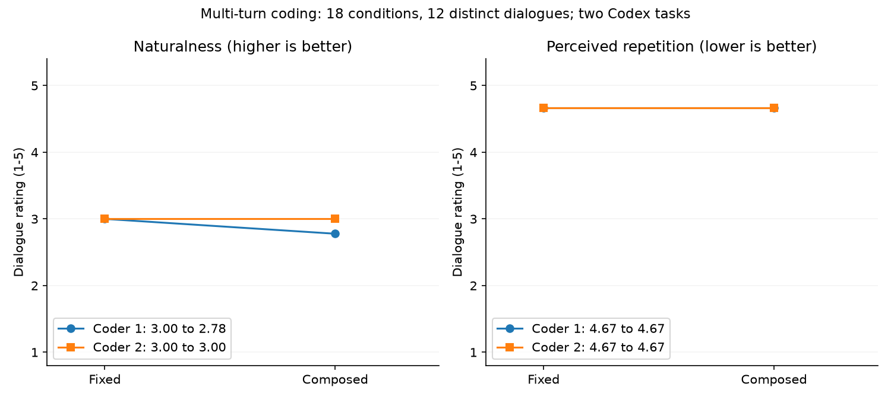
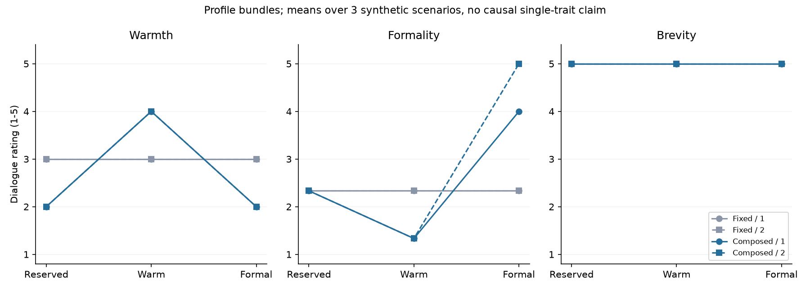
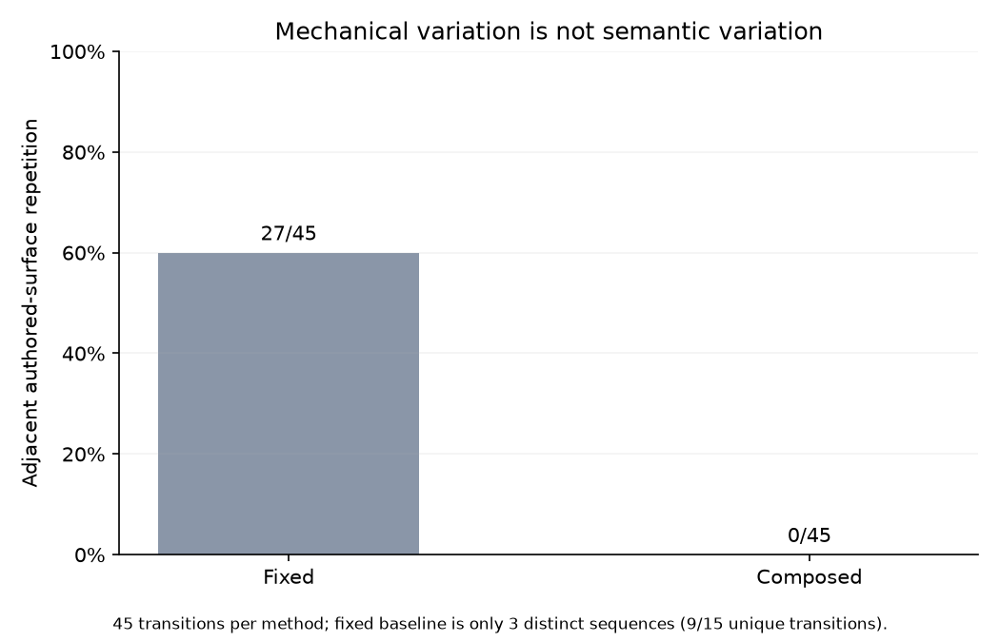

# 有限措辞变化能否改善多轮自然度？可执行人格表达的离线匹配研究

**研究日期：**2026-11-07  
**研究类型：**确定性系统对照与两套 Codex 辅助编码；不含新增在线模型生成或人类受试者。  
**材料：**[方案](protocol.md) · [逐轮数据](results.json) · [统计汇总](summary.json) · [复现入口](README.md)

## 摘要

可执行人格框架将行动选择和语言表达分开，但有限表达可能以可控性换取机械感。本研究比较固定倾听句式与按亲和度、正式度、简短度组合有限语句的实现。三个合成场景、三个表达参数组合、两种方法各生成六轮对话，共18个条件、108条主输出；由于固定实现忽略表达参数，实际只有12份不同的完整对话。所有条件使用匹配的手写内容帧和已确认建议边界，另作108条不中断重放核验，不增加独立样本或API调用。

两套隐藏方法映射的Codex编码均未发现新建议或无依据断言。新组合使亲近与正式语气出现可辨识差异，并将相邻新撰句式的机械重复从27/45降至0/45；然而多轮重复感评分均保持4.67/5，自然度由固定方案的3.00变为2.78和3.00。结果不支持通过有限措辞变化改善本批多轮自然度。该候选保留为显式实验选项，不替换默认表达；工程可复算性、表面风格差异和人格体验分别报告。

**关键词：**人格工程；有限表达；行动策略；多轮对话；负结果；可复现研究

## 1. 研究问题

[前一项研究](../executable_policy_2026_11_07/paper.md)发现，程序记录“不主动建议”并不能保证后续自由生成遵循该动作；程序直接组合有限语句可以在特定样本中避免新增建议，但也限制了表达空间。本研究针对固定回复反复使用“我先听你说”的局限，检验三个问题：

1. 表达层变化能否保持原有行动、关注点、状态权限及交付一致性？
2. 参数化有限句式能否产生可辨识的表达差异？
3. 表面措辞变化是否同时改善整段对话的自然度和重复感？

第三个问题不能由句式数量或模板ID变化直接回答。本研究也没有加入传统提示工程对照，因此不能据此宣称框架具有整体效果或成本优势。

## 2. 实现

两方法共享内容帧、程序策略和已有状态。所选动作、关注点与语言表达的关系可记作：

$$
(a_t, f_t) = P(c_t, s_t, \theta), \qquad
y_t = G(a_t, f_t, e_t, \phi, h_t).
$$

其中，$c_t$为内容帧，$s_t$为已确认状态，$\theta$为行动与关注偏好，$e_t$为原文证据；$\phi$为表达配置，$h_t$只记录已确认交付的句式历史。固定方法与组合方法改变$G$，不改变$P$。

固定方法使用旧版`bounded_reply`：有关注点时输出归属引用和固定倾听收尾；无关注点时使用简短倾听句；澄清时询问开放承诺目标。新方法`composed`将代码维护的确认收到、引文归属和倾听收尾组合为不可变计划。正式度达到0.65时选择正式句式；其余情况下亲和度低于等于0.35为克制、高于等于0.65为亲近、中间为普通口语。简短度低于0.5时可追加尚未出现的倾听收尾，绝不截短引文。这是离散的工程映射，不是经验证的连续人格量表。

每个风格与表达类型组合有三个句式候选。候选选择排除最近两次确认交付中用过的ID，由固定种子与轮次确定剩余选择。计划在交付前记录版本、句式、选择键、最近交付ID与逐段来源；未确认交付的尝试不推进历史。重启恢复来自同namespace账本。

代码库不接受模型提供的新句式，不直接插入身份故事或voice。respond/listen不添加行动建议或追问；clarify只询问既有开放承诺，不自行选择、执行或完成。其他动作仍走原自由表达，本研究不将其语义正确性纳入有限表达保证。

原文引号只说明来源，不能证明引文真实或完整表达了用户立场。纯文本转义也不等于应用中的HTML/Markdown安全处理。

## 3. 方法

### 3.1 条件和材料

场景包括工作倾诉、社交失落、资料记录与约定澄清，每个六轮。前两类包含明确感受和倾听请求；第三类包含带条件的资料片段、无关注候选的输入及两项已确认约定的歧义续接。完整内容见[cases.json](cases.json)。

| 参数组合 | 亲和度 | 正式度 | 简短度 |
| --- | ---: | ---: | ---: |
| 克制 | 0.20 | 0.20 | 0.85 |
| 亲近 | 0.90 | 0.15 | 0.20 |
| 正式 | 0.50 | 0.90 | 0.35 |

三个参数一起构成表达配置，不能将配置差异解释为单一参数的独立因果效应。行动偏好固定，不主动建议；情绪和细节关注权重相同，候选由手写内容帧给定。这排除了提取模型的随机性，也意味着结果不覆盖自动理解能力。

18个条件各生成六轮，共108条主输出。每个条件在第三轮后重启会话；另以不中断方式重放同六轮，逐字及逐计划比较。重放的108条只验证恢复等价，不作为新体验样本。固定方法在三个表达配置下输出完全相同，因此旧方法9个条件实际上只有3份不同对话；组合方法有9份，总计12份不同对话。

### 3.2 预先固定与编码

方案、代码快照、输入、配置、生成脚本和[编码规则](review_codebook.md)在主输出产生前写入哈希清单。匿名ID与排列由固定种子生成。两套Codex任务只读取规则和完整匿名对话，不读取方法映射、程序决策、参数或另一份标签；台词本身可能暴露方法，因而不宣称实现了严格盲法。它们也不是独立人类评价。

逐轮编码新建议和无依据断言；每段对话分别评价自然度、重复感、亲近程度、正式程度与简短程度，均为1—5分。自然度高分更好，重复感高分更重复。编码者按语义评价重复，不能把换词直接计为改善。两套原始标签及分歧分别保留。

### 3.3 统计口径

报告条件均值、分子分母与编码一致数，不进行显著性检验或给出总体置信区间。场景仅三个，同段六轮相关；旧方法的重复副本不产生额外独立基线证据。旧副本在本次两套标签内的评分一致，平衡设计的条件平均与按唯一场景平均相同。

机械重复先将归属引文与承诺文本替换为类型占位符，再比较相邻回复的新撰文字结构：

$$
R_{\mathrm{surface}} = \frac{\sum_{d}\sum_{t=2}^{6}\mathbf{1}[u_{d,t}=u_{d,t-1}]}{5D}.
$$

$u$表示替换后的结构，$D=9$为每方法条件数。旧方法45次条件内相邻比较对应15次不同序列中的相邻比较。该指标只测量文字结构，不能代表语义重复或人格表现。

## 4. 结果

### 4.1 执行与状态

全部108条主输出交付一致，未调用内容或表达模型；108条恢复核验输出与对应主输出相同。九组方法配对的输入、内容帧、动作、关注点和已确认策略状态（PolicyState）均一致。新方法54条表达计划均可由归档代码重算，计划先于完成记录保存。材料分析共790项检查通过，检查对象是归档材料之间的对应关系，不是790个独立实验。

两套编码对两方法的54条输出均给出新建议0/54、无依据断言0/54，也没有unclear建议标签。这只能描述这些已知句式和合成输入，不是对所有用户文本、引文内容或自由动作的普遍保证。

### 4.2 多轮体验没有改善

| 指标 | 固定句式：编码1 | 组合表达：编码1 | 固定句式：编码2 | 组合表达：编码2 |
| --- | ---: | ---: | ---: | ---: |
| 自然度↑ | 3.00 | 2.78 | 3.00 | 3.00 |
| 重复感↓ | 4.67 | 4.67 | 4.67 | 4.67 |
| 亲近程度 | 3.00 | 2.67 | 3.00 | 2.67 |
| 正式程度 | 2.33 | 2.56 | 2.33 | 2.89 |
| 简短程度 | 5.00 | 5.00 | 5.00 | 5.00 |

表中每格是九个条件的描述性平均；其中固定方法仅三份不同对话。亲近、正式和简短程度不是越高越好的质量分。平均亲近程度下降主要反映克制和正式配置的取向，不宜直接解释为质量下降。

**图1.** 两套Codex编码分别呈现。新组合未提高自然度，且没有降低感受到的语义重复。两套编码在自然度上16/18一致，重复感18/18一致；不将编码一致误称为人类一致或外部效度。

### 4.3 可辨识的表达差异

| 组合表达配置 | 亲近程度：编码1／2 | 正式程度：编码1／2 | 自然度：编码1／2 |
| --- | ---: | ---: | ---: |
| 克制 | 2.00／2.00 | 2.33／2.33 | 3.00／3.00 |
| 亲近 | 4.00／4.00 | 1.33／1.33 | 3.00／3.00 |
| 正式 | 2.00／2.00 | 4.00／5.00 | 2.33／3.00 |

各格为三个场景平均。亲近与正式语气能够区分，但简短感受全部为5.00，未体现所设简短度差异。正式措辞在部分口语倾诉中显得生硬；编码1将工作和社交场景的正式组合自然度评为2，而编码2为3。这类差异保留在原始标签中。

**图2.** 仅显示配置组合与评价的关系，不证明完整角色身份、稳定人格或单参数连续响应曲线。亲近程度编码18/18一致，正式程度15/18一致，简短程度18/18一致。

### 4.4 机械避重与语义重复分离

新撰文字结构相邻重复从固定方法的27/45（60%）下降为0/45；固定方法去除配置副本后为9/15，比例相同。回复均长由16.22字变为17.48字，按Python字符串长度计数，不是token数。

**图3.** 机械避重执行成功，与图1中重复感不变同时成立。两种结果不矛盾：语句可以换词，却仍连续只做摘引和确认倾听。

例如工作场景的亲近组合连续使用“嗯嗯，你提到…，我听着呢”“你刚才说到…——嗯，我在这儿听”“嗯，你说…。嗯，我在这里听你说”。引用内容不同、句式ID不同，但回应的语义功能变化很小。这一解释来自具体文本和编码理由，不是独立的机制因果检验。

## 5. 讨论与限制

本研究支持一个局部工程结论：代码维护的表达组合可以改变可感知语气，同时保留相同动作、证据及状态；但不支持其改善多轮自然度。机械可控性、表达风格和对话质量需要不同测量，不能相互替代。

原文引用承担了保持证据边界的职责，也限制了语义回应空间。扩大同义句库或增加轮换次数，仍可能只改变表面。本批结果因此不足以将composed推广为默认路径。它作为可检查的对照实现保留；已有bounded、free及默认Session行为不因此改变。

进一步研究应先扩展有明确依据的交流选择，并检验它们是否对后续互动产生不同效果，再讨论更自由的实现方式。若重新使用模型改述，必须将其实际语义另行评价，不能继承有限原子组合的保证。对应用动作、用户边界和承诺权限可以继续作程序控制；开放语言效果则仍需比较和反例检验。

本研究的主要限制是三个研究者设计场景、手写内容帧、六轮长度、同类Codex辅助编码和表达配置整体变化。没有自动内容理解、真实用户、长期关系、传统强提示基线或开放事实问题，不能推断人格工程的总体优劣。零API调用来自本批不需要模型的确定性任务，不代表完整产品没有模型成本。前项研究的单轮评分与本项多轮评分的题目和尺度使用情境不同，不直接作跨研究效果比较。

## 6. 结论

有限表达组合实现了可审计的表面变化和风格区分，但没有解决本批对话的语义重复。对人格工程而言，可控句式是局部执行工具；它不能单独提供更自然的人格互动。该负结果与成功的状态及交付检查一并公开，后续机制研究应避免继续用表面多样性替代体验证据。

## 材料与复现声明

输入、方案、冻结实现、生成脚本、原始账本、匿名对话、两套标签、分析脚本与三幅图均在[同目录](README.md)。重新生成使用冻结实现和新输出目录；离线结果应逐字一致，账本中的运行ID和实际写入时间允许变化。标签是对发布文本的评价，若改变文本需重新编码。源码与数据快照不含认证信息；本研究不需要API密钥。
