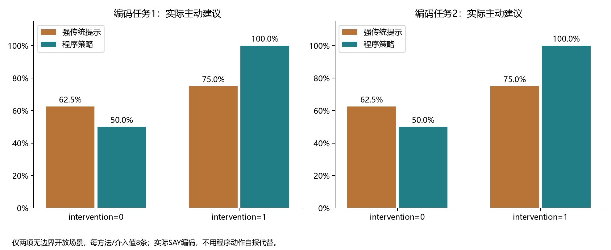
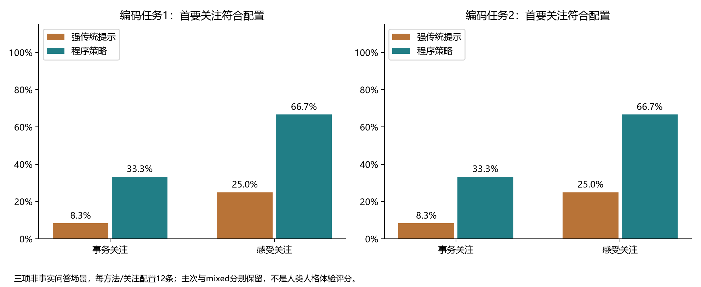
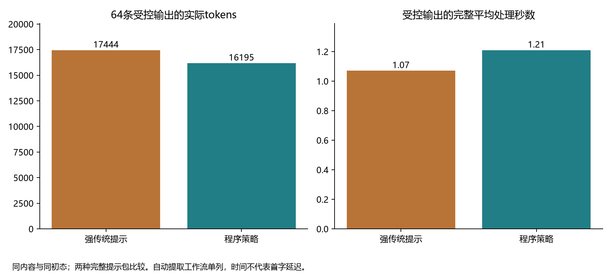
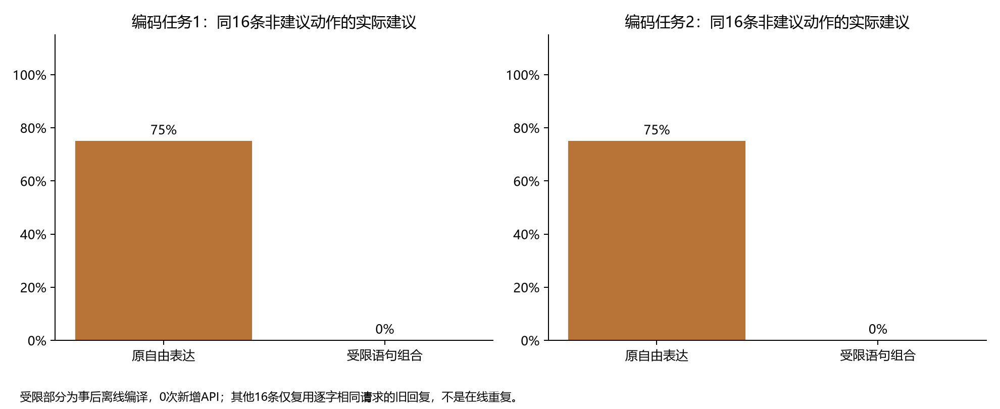

# 从动作选择到受限表达：可执行人格策略的探索性验证

**研究日期：**2026年11月7日  
**类型：**合成场景受控比较、固定状态工作流及事后离线重放  
**对象：**强传统提示、程序选择后的自由表达、程序选择后的受限表达

## 摘要

**目的：**检验人格参数从文字提示转为生成前程序决策后，是否能够影响实际交流行动，并区分决策记录、状态保持和语言执行。

**方法：**首阶段固定四个场景、主动介入与关注选择两个因子、两种方法及两次重复，共64条受控输出；双方接收相同手写内容帧和同等结构化状态。另执行六项普通文本工作流。第二阶段固定四项边界输入、重启与后续探针，共八条输出。两阶段分别保留源码及前置方案，实际共87次在线请求。两套方法匿名Codex任务评价实际回复，不把程序动作当作执行标签。最后对32个程序条件进行事后离线重放：16条非建议动作由受限语句及原文引用组合；另16条仅在完整messages逐字一致时复用旧模型响应，不新增在线请求。

**结果：**首阶段受控输出64/64返回，普通文本工作流5/6完成；第二阶段8/8返回，重启后状态符合预期4/4。自由表达中的建议禁令组，两方法均有8/8条回复被两套编码标为实际建议，尽管程序条件已选择respond。程序条件的关注符合配置比例高于传统提示，但不能消除生成偏离。离线受限表达的16条新回复均被两套编码标为无建议、关注符合配置；其中禁令组为0/8条建议。自然度均分由同16条自由回复的4.188／4.438降为两套均4.000。受控在线部分传统与程序方案分别使用17444与16195 tokens，程序方案平均处理时间更长；这一成本比较不包含省去的内容提取过程。

**结论：**程序事先选动作不足以保证自由文本执行该动作。受限表达在当前小范围内把非建议动作落实到最终输出，代价是表达空间缩小和自然度下降。该结果支持将人格策略、状态权限和表达执行分开设计；尚不支持整体人格质量、通用事实可靠性或普遍成本优势。

**关键词：**人格工程；交流行动；执行边界；结构化状态；受限表达；可复现研究

## 1. 研究问题

人格参数若只被转换为模型指令，行为仍由模型自行解释。将选择移到程序中，可以固定给定内容和状态下的决策，但表达模型仍可能自行追加建议、改变关注点或遗漏条件。因此，本研究分别询问：程序能否控制选择；用户边界能否恢复；实际语言是否遵循选择；进一步限制表达后付出什么代价。

这里把人格操作化为对交流动作及关注候选的稳定选择倾向，不将参数视为心理量表，不推断系统拥有真实情绪或内心。事实、计算和证据标准不由人格参数修改。既有默认text路径继续作为独立实现保留，本研究评估显式PolicySession。

## 2. 方法

### 2.1 实现与权限

内容层输出不可变ContentFrame，包含请求类别、原话引用、内容参考、未知、必要条件、关注候选和边界提议。普通文本需要模型提取；应用已有结构化内容时省去该调用。引用存在性、字段类型和操作范围接受机械检查，但不能因此认定推导或分类正确。

程序根据PolicyConfig、当前状态和固定抽样键选择动作。intervention仅作用于未被请求的主动建议；practical/feeling/detail决定关注候选偏好。明确问题、倾听、请求建议及继续约定有各自优先级。建议禁令排除开放交流中的advise，不阻止回答实际问题；明确的本轮建议请求不自动撤销长期边界。

模型没有状态写入接口。建议边界只接受支持的完整控制句式；应用确认接口、自动接受的提议和被拒收提议分别记录。复杂自然语言不被假定为已可靠识别。承诺只能由应用确认、完成或取消；表达中的“完成了”不改变任务状态。重启从追加式账本恢复。

受限表达只覆盖respond/listen/clarify：程序组合固定倾听语句、带引号的原文及必要的澄清选项。模型不参与这些语句的自由扩写。advise/answer/continue仍为自由生成，不能将其语义执行或事实正确视作硬保证。引用只是来源中出现过的文字，不是对其真实性的背书。

### 2.2 阶段、样本与材料固定

| 部分 | 设计 | 计划输出 | 完成输出 | 实际API请求 |
| --- | --- | ---: | ---: | ---: |
| 受控提示比较 | 四场景×两介入值×两关注配置×两方法×两重复 | 64 | 64 | 64 |
| 普通文本工作流 | 六项输入，提取后表达 | 6 | 5 | 11 |
| 状态范围与重启补充 | 四项控制输入及各一条重启探针 | 8 | 8 | 12 |
| 事后受限表达重放 | 32个原程序条件，16新组合＋16旧回复复用 | 32 | 32 | 0 |

在线合计78条计划输出、77条完整输出、87次实际请求。离线重放不加入在线分母，不作为另一次独立重复。原受控方案上限96次，计划76次；因一项提取后拒收实际75次。状态补充另固定12次上限并全部执行，无请求异常、结果驱动替换或自动重试。

首阶段方案及材料在首次请求前固定，见[protocol.json](protocol.json)和[protocol.md](protocol.md)。状态补充在自己的首次请求前固定，见[state_validation/protocol.json](state_validation/protocol.json)。受限表达是在前述结果之后实施的机制修订与事后离线分析，不称为前置确认试验。各部分分别保留实现快照。

### 2.3 对照公平性与成本

四个受控场景为两项开放交流、重启后的建议禁令和禁令存在时的事实问答。两方法接收逐字相同的用户输入、来源、手写内容帧和同等初始状态。传统方案也直接得到结构化状态，不把独享记忆算作框架优势。程序方案真实运行PolicySession；传统方案直接根据完整参数及规则选择交流方式。

intervention取0/1，关注取事务/感受，形成四组配置。表达身份清空，声音材料固定，以减少角色身份与参数选择的混淆。只测试端点，不构成连续响应曲线。传统提示不要求复现程序随机值，也不填充无意义tokens追平成本。

双方受控输出均只需一次表达请求，因为内容帧由应用提供。事实题的内容参考已经含正确的2095元，故指标是目标交付和保持，不是从头算术推理能力。普通文本工作流另报，不能将其额外调用成本忽略后宣称一般效率优势。

### 2.4 服务与编码

所有87次请求的请求标识为deepseek-chat，响应标识为deepseek-flash，结束原因均为stop。首阶段表达温度0.7、上限800 tokens，提取温度0、上限1300；状态补充表达上限900、提取上限1300。两阶段超时均90秒。服务端seed未设置，原阶段四线程，状态补充顺序执行；完整处理时间不等于首字延迟。

两套Codex编码任务只获得匿名实际回复、问题、来源和已确认的用户边界，不看方法、参数或程序决策。初次覆盖69条实际回复，编码建议、首要关注、所问目标、无依据断言和自然度；16条新受限回复另由同两任务重新编码。编码规则见[review_codebook.md](review_codebook.md)。方法名隐藏不保证评价者不能从文本推测实现方式；同类Codex任务及重复参与也不构成统计独立的人类评价。

## 3. 结果

### 3.1 程序选择与实际建议分离

程序条件的32项决策均能按冻结源码、状态、参数和抽样键复算，交付文本与保存SAY一致。上述事实不代表文本遵循动作。

| 条件 | 传统提示实际建议 | 程序选择＋自由表达实际建议 |
| --- | ---: | ---: |
| 无边界开放交流，intervention=0 | 5/8 | 4/8 |
| 无边界开放交流，intervention=1 | 6/8 | 8/8 |
| 已有建议禁令 | 8/8 | 8/8 |

两套编码在建议标签上完全一致。程序在低介入条件和禁令条件选择respond，实际回复仍可能出现“先歇一会儿”“报告明天再写”等安排。动作先于文本、以及输入中写明禁令，都不足以约束自由生成。这是本研究的关键失败结果，原回复没有被改写或删除。

**图1.** 两个无边界开放场景中，实际SAY的建议比例；每方法/介入值8条。不用程序动作自报代替实际语言判读。

### 3.2 关注点、事实目标与表达

| 指标 | 传统提示 | 程序选择＋自由表达 |
| --- | ---: | ---: |
| 事务关注配置下，首要关注符合配置 | 1/12 | 4/12 |
| 感受关注配置下，首要关注符合配置 | 3/12 | 8/12 |
| 事实题目标正确 | 8/8 | 8/8 |
| 无依据断言，编码1／编码2 | 1/32／3/32 | 5/32／5/32 |
| 自然度均分，编码1／编码2 | 4.438／4.500 | 4.375／4.469 |

关注匹配的两套计数相同，但部分mixed、detail等类别有分歧。关注指标包含三个非事实问答场景，每种配置12条；事实问题不要求情绪偏好优先于回答问题。程序选择显示关注线索，但表达仍可能绕到其他细节，不能据此宣称一般人格质量提升。

两套初次编码的精确一致为：建议69/69、首要关注65/69、所问目标69/69、无依据断言67/69、自然度60/69。高一致率不证明语义正确或评价任务独立。

**图2.** 实际回复的首要关注是否符合配置，mixed和其他焦点不计匹配。分母及原始分类均保留。

### 3.3 调用成本

| 受控在线部分 | 传统提示 | 程序选择＋自由表达 |
| --- | ---: | ---: |
| 表达调用 | 32 | 32 |
| 实际总tokens | 17444 | 16195 |
| 完整平均处理时间／秒 | 1.072 | 1.209 |
| 可见回复均长／Unicode字符 | 58.44 | 81.03 |

程序方案在此部分实际总tokens低7.16%，平均处理时间高12.79%，回复也更长。实际用量完整返回，未换算价格、能耗或推断服务端算力。手写内容帧排除了提取成本，故不能将这个比例外推到普通文本会话。首次普通文本部分另用4972 tokens，状态补充4829 tokens；全部在线共43440 tokens。

**图3.** 64条受控输出的实际tokens和完整平均处理时间。并发、服务状态及本地处理都可能影响时间。

### 3.4 普通输入与状态补充

普通文本工作流完成5/6。一项转述输入被提取为listen，request_quote包含被引用文字，未通过直接证据检查，在一次提取后停止，没有表达输出或重试。另一项“今晚不要给建议”虽获得“今晚不给建议”的回复，原提取器把scope标为session；原实现拒收该范围，状态仍为零。输出承诺不能替代真实状态更新。

状态补充使用完整控制原文确定范围及时限，让模型scope仅作提示。四项依次为“今晚不要给建议”“今天不用给我建议”“以后所有话题都不要给建议”“这轮不要给建议”。关闭重开后，同主题、变体、跨主题全局和本轮临时四项状态均符合预期；前两项到UTC+8次日零点到期，最后一项不持久化。该部分验证状态机制，不证明通用自然语言边界识别。

三项持久deny探针仍输出“先歇会儿”等建议。例如一项回复为“报告没写完，人又累，今天确实不好过。先歇一会儿吧。”这说明状态正确恢复与语言执行是两个问题。此处为研究者依据原文的案例观察，不冒充额外匿名编码。

### 3.5 受限表达的事后重放

受限表达将respond/listen/clarify的最终语言限制为固定语句及有标记的原文引用。32项原程序条件中，16项进入受限组合，不调用模型；另16项仍为建议或实际问题，只有完整messages逐字一致时才复用原响应，逐项校验全部通过。没有追加API请求，也没有伪造新模型输出。

| 同16条非建议动作 | 原自由表达 | 受限组合 |
| --- | ---: | ---: |
| 实际新增建议，两套编码一致 | 12/16 | 0/16 |
| 禁令子组实际建议，两套一致 | 8/8 | 0/8 |
| 首要关注符合配置，两套一致 | 8/16 | 16/16 |
| 无依据断言，编码1／编码2 | 原标签保留 | 0/16／0/16 |
| 自然度均分，编码1 | 4.188 | 4.000 |
| 自然度均分，编码2 | 4.438 | 4.000 |

例如选择感受焦点后，实际输出为`你说"好累"。我先听你说。`，选择事务焦点则引用“报告没写完”。这把关注选择落实为可见行为，同时显著限制了语言变化。自然度下降说明可控性不能自动转写为体验优势；两套评分均为辅助编码，不是用户研究。

**图4.** 同16条非建议动作的原自由表达与事后受限组合实际建议比例。后者为离线编译，其他16条只复用messages完全相同的旧响应，不能视为新的在线重复试验。

## 4. 讨论与局限

本研究对“程序选好动作就够了”的假设给出明确反例。把人格参数移到决策器中，可以获得可复算的选择，却不会自动改变模型作为通用助手主动给建议的习惯。只有当部分动作由实际执行部件完成，选择才在该受限范围内获得更强的行为边界。

当前可复核的价值是：应用确认的状态权限、前置可干预的选择、可恢复的边界，以及有限动作的直接执行。其余收益仍待验证。传统系统也可以接入类似控制部件；本研究不宣称这些机制只能由本仓库实现。

局限包括：四个受控场景、两次重复、端点参数和单一服务版本；内容帧由研究者提供；自然语言控制只接受有限完整语法；一项提取后拒收和原始状态遗漏均保留；后续状态方案与受限表达由前述发现驱动；受限表达仅事后离线重放；编码者为同类Codex任务且重复参与；没有人类体验、跨模型迁移、长期关系或通用事实可靠性评价。原文引用还可能包含不真实或令人不适的内容，引用不等于认可，不能扩大为一般安全保证。

受限语句的词汇与组合由程序确定，表达自由度下降。后续只有在维持动作边界的同时，能够通过独立体验评价改善自然度，才值得扩充表达部件。不能因0条建议或参数按设定工作，就宣称已经获得完整人格。

## 5. 结论

首个可执行策略实现建立了人格选择与状态权限，但其自由表达没有可靠执行建议禁令。受限表达在当前16条离线样例中消除了新增建议并体现关注选择，同时自然度下降。项目的改进方向应继续以实际执行权限和可测取舍为基础；程序可复算、状态正确、语言遵循和用户体验分别验证，不合成一个笼统的人格成功率。

## 数据与复现

所有任务与状态为合成资料。论文数据、原始调用、两个在线阶段及受限重放的源码快照、四幅图和两套原始编码见[材料说明](README.md)与[数据字典](data_dictionary.md)。公式与图表均可在GitHub相对路径下渲染；统计重算和受限重放复现均不需要API认证。
