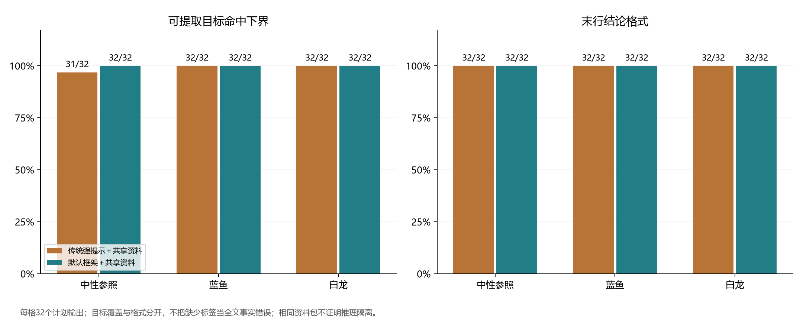

# 共享资料下的强传统提示对照

本研究在给两方法提供相同人格语义、事实规则和资料包的前提下，比较强传统人格提示与persona-duplex默认三段协议。研究于2026年11月7日执行，共224次生成；不预设框架优于传统方案。

**主要结果：**两方法的蓝鱼、白龙条件均命中全部32个事实目标，两个方法匿名编码任务也未发现人格条件目标差异。唯一自动目标错误发生于传统中性条件，不能解释为框架的人格条件优势。两套角色一致性评分偏向框架，总体偏好接近平衡，蓝鱼自然度方向不一致。两方法各调用112次，框架实际总tokens为传统方案的2.723倍。完整结论及适用范围见[论文](paper.md)。



## 阅读入口

| 内容 | 文件 |
| --- | --- |
| 完整论文 | [paper.md](paper.md) |
| 前置研究方案 | [protocol.md](protocol.md)、[protocol.json](protocol.json) |
| 字段与分母说明 | [data_dictionary.md](data_dictionary.md) |
| 自动生成结果表 | [result_tables.md](result_tables.md) |
| 机器可读汇总 | [summary.json](summary.json) |
| 方法匿名评价规则 | [review_codebook.md](review_codebook.md)、[review_protocol.json](review_protocol.json) |
| 独立材料审计 | [audit.py](audit.py)、[audit_report.json](audit_report.json) |
| 发布材料完整性清单 | [artifact_manifest.json](artifact_manifest.json) |

## 数据与执行材料

| 材料 | 文件 |
| --- | --- |
| 16个事实问题、4个开放问题及金标 | [cases.json](cases.json) |
| 120份合成来源 | [corpus.json](corpus.json) |
| 20个实际共享资料包及哈希 | [retrieval.json](retrieval.json) |
| 224个预定试次 | [execution_plan.json](execution_plan.json) |
| 三种表达配置和传统提示模板 | [configurations.json](configurations.json)、[traditional_prompts.json](traditional_prompts.json) |
| 人格文件 | [蓝鱼](personas/blue_whale.toml)、[白龙](personas/white_dragon.toml) |
| 完整SAY、自动评分与交付记录 | [results.json](results.json) |
| 实际请求、原始增量、响应模型和用量 | [raw_calls.json.gz](raw_calls.json.gz) |
| 在线执行器及运行快照 | [benchmark.py](benchmark.py)、[runner_snapshot.py](runner_snapshot.py) |
| 框架实现快照及源码哈希 | [implementation_snapshot/manifest.json](implementation_snapshot/manifest.json) |
| 离线分析与绘图环境 | [analysis_environment.json](analysis_environment.json) |
| 固定左右分配与方法解码 | [pair_assignment.json](pair_assignment.json)、[pair_key.json](pair_key.json) |
| 匿名编码输入 | [review_contexts.json](review_contexts.json)、[pair_inputs.json](pair_inputs.json) |
| 两套原始编码 | [pair_ratings_1.json](pair_ratings_1.json)、[pair_ratings_2.json](pair_ratings_2.json) |

人工辅助编码环节只向评价任务提供编码规则、`review_contexts.json`与`pair_inputs.json`；`pair_key.json`和完整结果在解码分析时使用。两套Codex任务的原始标注分别保留，不合并为事实真值，也不替换自动分数。

## 离线复现

在仓库根目录使用Python运行。统计与导出使用标准库；PNG绘图依赖固定在[requirements.txt](requirements.txt)中，中文字体需由系统提供。

```powershell
python -m pip install -r docs/validation/fair_rag_2026_11_07/requirements.txt
```

以下命令读取现有数据并写入独立目录，不调用模型：

```powershell
python -B -X utf8 docs/validation/fair_rag_2026_11_07/analyze.py --out data/fair-rag-reanalysis
```

只计算统计、不绘图：

```powershell
python -B -X utf8 docs/validation/fair_rag_2026_11_07/analyze.py --out data/fair-rag-reanalysis --no-plots
```

分析会核查冻结输入、配置、运行快照、原始调用及实际资料包，复算自动分数，再分别解码两套评价。`--data`可指定研究材料目录；`--export-pairs`按已冻结的左右分配导出匿名材料，已有材料不一致时拒绝覆盖。`--out`只改变统计与图表位置，配对导出仍写入`--data`所指材料目录。

[audit.py](audit.py)独立核查冻结材料、逐次实际请求、协议流重放、方法匿名输入和原始标注，并在发布清单存在时核查相应文件哈希：

```powershell
python -B -X utf8 docs/validation/fair_rag_2026_11_07/audit.py
```

`analyze.py`的2091项分析一致性检查与`audit.py`的独立检查属于不同层次，具体审计项及计数见[audit_report.json](audit_report.json)，不相加为行为验证次数。审计通过不等于证明目标判断或评价标签正确。

## 同证据重新采样

[reproduce.py](reproduce.py)将冻结实现、执行器和材料复制到仓库`data/`下的新目录，默认只准备隔离副本，不访问网络：

```powershell
python -B -X utf8 docs/validation/fair_rag_2026_11_07/reproduce.py --out data/fair-rag-rerun
```

只有显式加`--run`才会执行新一轮在线生成；该轮计划调用224次，需要进程环境中的`PERSONA_API_KEY`，也可以由执行器交互读取。目标目录必须尚未存在，已有归档结果不会被覆盖。服务端模型和采样结果可能变化，无法保证新回复逐字相同；新输出也需要新的匿名编码，不能沿用原标注。修改任务或提示属于新研究，应另行固定设计。API认证不属于复现材料。

## 图表

| 图 | 内容 |
| --- | --- |
| [图1](figures/fig1_target_and_format.png) | 目标可提取命中与格式 |
| [图2](figures/fig2_neutral_reference_interaction.png) | 各方法相对自身中性的配置交互 |
| [图3](figures/fig3_tokens_and_latency.png) | 实际输入、生成tokens和处理时间 |
| [图4](figures/fig4_exploratory_role_ratings.png) | 两套探索性人格表达评分 |
| [图5](figures/fig5_exploratory_pair_preferences.png) | 配对偏好及语义边界编码 |

资料检索在每个实体的六份文档中返回全部六份，且两方法收到相同顺序；本研究不评估RAG检索质量、压缩优势或长上下文上限。中性参照是0.5参数的操作化配置，两套Codex评分属于探索性辅助评价。结果不证明人格质量非劣或判断的硬隔离。
