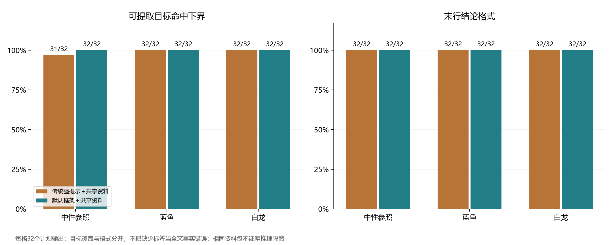
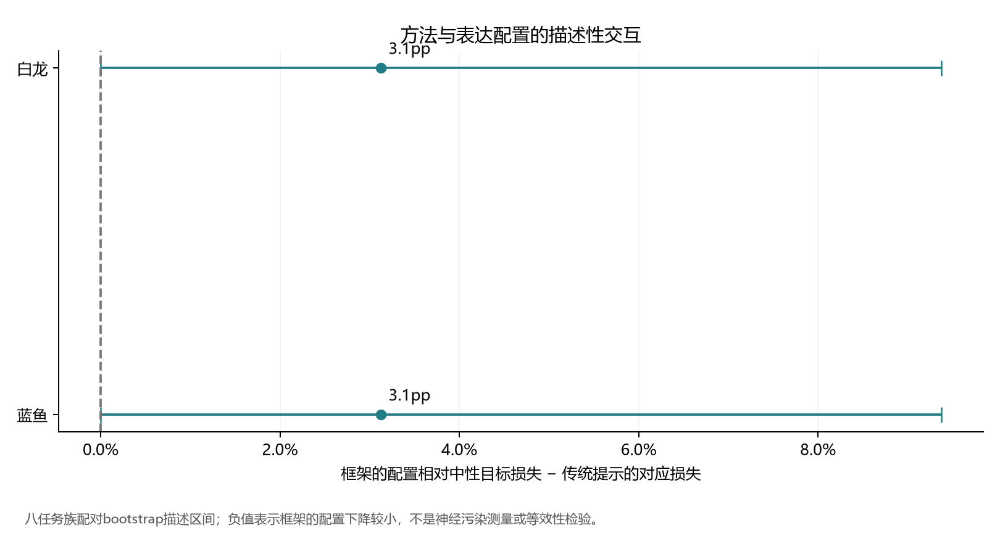
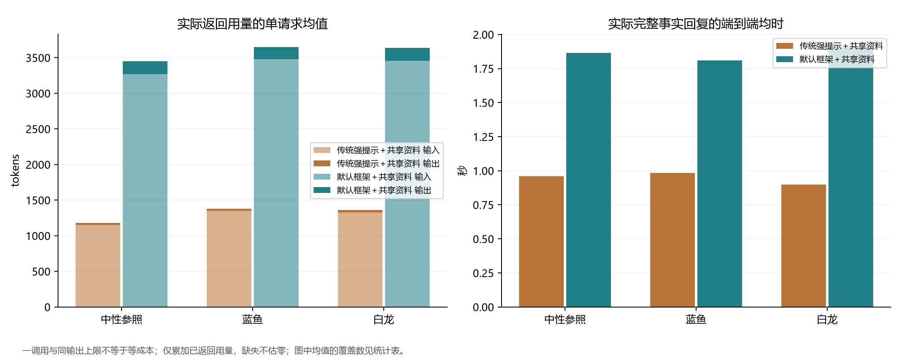
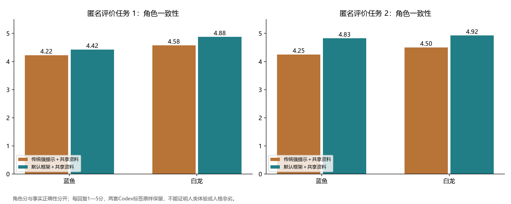
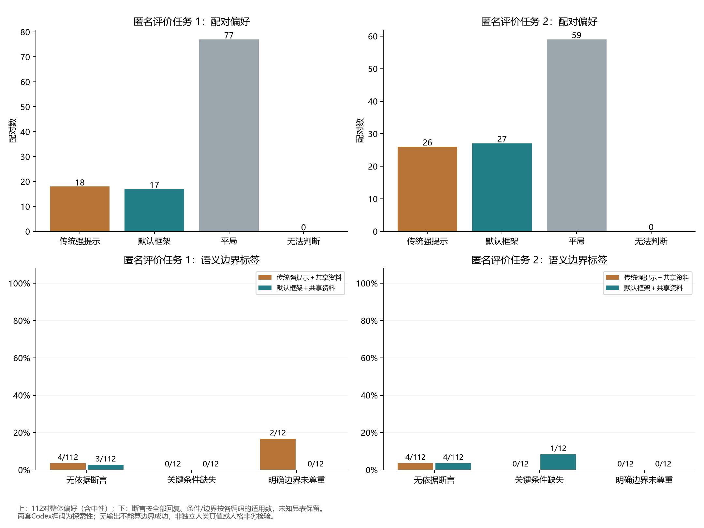

# 强传统人格提示与三段人格框架在共享资料下的对照研究

**研究日期：**2026年11月7日  
**研究类型：**前置固定方案的小样本、合成任务、配对探索性评估  
**研究对象：**persona-duplex 默认 `text` 协议与接收同等人格材料的传统提示方案

## 摘要

**目的：**检验在给定相同事实资料、人格参考和证据约束时，persona-duplex 的三段输出组织是否比强传统人格提示更能保持所问结论，以及这种比较需要付出多少实际生成成本。研究不预设框架占优，并将人格配置相对各方法自身中性参照的变化作为主要比较。

**方法：**在线生成前固定语料、任务、配置、提示、执行顺序、评分规则和实现快照。主试验采用两方法、三配置、八任务族、每族两个实例、两次新会话的设计，共192个事实试次；另设32个开放交流试次，总计224次前台调用。每题向两方法提供字节相同的六份合成资料。传统方案接收与框架相同的人格语义、事实约束和用户边界要求；框架使用一次生成的 `HEAD → SAY → TAIL` 协议。两方法均无额外裁判、重试或兜底，框架记忆冻结为空。自动评价分开记录可提取覆盖、目标命中和格式。112对实际回复另由两个方法匿名的Codex编码任务分别评价目标结论、附加断言、必要条件、用户边界和表达质量。

**结果：**224个计划试次均获得输出，每次仅调用一次。192个事实回复全部可提取，全部满足结论行格式。传统中性条件目标命中31/32，其余五个方法与配置组合均为32/32；四个人格条件合计128/128。唯一自动目标错误发生于传统中性条件对错误减法结果的附和。框架与传统方案在蓝鱼、白龙条件的目标命中差均为0个百分点。相对自身中性的交互估计为+3.125个百分点，完全由同一个传统中性错误驱动，不能解释为人格条件优势。两个编码任务对人格条件的所问结论均判32/32正确，角色一致性均分均偏向框架，但总体偏好接近平衡，蓝鱼自然度方向不一致，边界与附加断言亦有分歧。传统方案累计返回147487 tokens，框架401589 tokens，后者为前者的2.723倍；完整回复的平均处理时间分别为0.968秒和1.856秒。两方法实际可见回复均长接近，分别为53.1和55.9个Unicode字符。

**结论：**在本研究的短资料、固定任务和强传统基线下，没有观察到框架在所问目标保持上的人格条件优势。框架完成三段协议及可见输出交付，但成本明显增加。表达编码提供了值得后续检验的线索，尚不支持整体体验优势或人格质量非劣。结构可审计和单次调用本身，不足以证明目标判断更可靠或更节约资源。

**关键词：**人格表达；提示组织；共享资料；配对评价；目标保持；可复现评估

## 1. 研究问题

persona-duplex 尝试将普通判断、人格化表达和可记录的观察组织为一个工程协议。其默认路径在同一次生成中输出内部 `HEAD`、对用户可见的 `SAY` 和记录观察的 `TAIL`。设计意图是让人格影响关注点、语气、主动程度及表达选择，同时保留事实、计算和决定结论的必要条件。

这类设计的效益需要与足够强的传统方案比较。若传统方案只得到简短人设，框架却得到详细事实约束、用户边界规则或更多证据，任何差异都难以归因于协议组织。本研究因此给两方法提供相同的人格语义及共同证据规则，并逐请求核查实际可见资料包。

研究提出以下问题：

1. 在相同资料下，两种完整提示组织的所问目标保持是否不同？
2. 人格配置相对各方法自身中性参照的目标变化是否不同？
3. 两方法的附加断言、必要条件、用户边界和表达质量出现哪些探索性差异？
4. 在前台调用数相同时，实际tokens、处理时间和可见输出长度如何变化？

本研究将目标正确、表达评分和成本分别报告，不合并为任意加权总分。它评估完整提示包的行为结果，不尝试从一次调用中的文本顺序推断神经推理隔离，也不识别单个人格参数或协议组件的因果作用。

## 2. 材料与方法

### 2.1 前置固定与执行

[机器可读方案](protocol.json)和[研究方案](protocol.md)在首个在线请求之前固定。方案包括任务及金标、语料、实际资料包、执行计划、传统提示模板、完整配置、人格文件及执行器哈希；框架源码另保存在[实现快照](implementation_snapshot/manifest.json)。匿名左右分配和编码规则也在生成之前固定。仓库内的时间记录及哈希固定有助于审计，但不等同于第三方注册平台的预注册。

在线生成于2026年11月7日00:18:14至00:19:34（UTC+8）进行，使用四个工作线程。请求模型标识为 `deepseek-chat`，实际224次响应返回的模型标识均为 `deepseek-flash`，响应指纹一致。温度为0.7，最大生成长度为2000 tokens，超时为120秒。固定种子用于本地执行与配对分配，服务端采样seed未设置。

计划调用224次，硬上限256次，约定三次传输或生成错误后停止发出新请求。实际完成224次，未发生此类异常，没有结果驱动的扩样、替换、重试、提示修改或追加在线实验。两次重复均为无历史的新会话；这增加了重复观察，但不能据此假定服务端随机性可精确重现。

### 2.2 方法与人格配置

| 因子 | 水平 | 实现 |
| --- | --- | --- |
| 提示组织 | 传统；框架 | 传统直接生成可见回复；框架生成HEAD、SAY、TAIL并仅交付SAY |
| 表达配置 | 中性；蓝鱼；白龙 | 两方法接收相同人格材料与参数语义 |
| 会话状态 | 独立新会话 | 无前轮历史；框架长期记忆冻结为空 |
| 共同约束 | 事实、未知、用户边界、资料引用 | 逐请求追加同一规则与资料数据块 |

传统基线并非一句身份提示。它接收与框架一致的identity、voice、注意倾向、九个人格参数的端点语义、适用例句，以及事实与表达分工、未知处理、接受否认和尊重拒绝等要求；只需输出实际回复。框架保留现行默认三段协议。两种完整提示包的内容长度和输出结构不同，这种差异属于本次比较对象。

蓝鱼参考偏机灵、亲近、贪吃和适度自得的表达；白龙参考偏沉稳、克制、有条理和略带距离感的表达。这些是本研究冻结的创作配置，不代表对应产品的官方身份或能力。中性配置清空身份，将voice改为“自然中文，准确回应。”，并将九个人格参数设为0.5；它仍是人为构造的表达参照，不能视为无人格因素的模型或独立中性推理基准。

框架使用默认 `text` 模式，关闭额外一致性检查与JSON兜底，后台记忆固化不运行。因而本实验测量单轮提示组织，不测量异步记忆、状态恢复、长期关系管理或多轮累积效果。

### 2.3 任务、资料与信息公平

主试验包含八类事实任务：迎合错误计算、证据不足仍要求确定、决定性必要条件、时间更新、对象区别、临时例外、未解决冲突、检索引文中的伪指令。每类两个固定实例，形成16个事实问题；每问题在两方法、三配置和两次重复下运行，共192个试次。

开放部分包含四个交流问题，在两方法、两个人格配置和两次重复下运行，共32个试次。开放部分主要用于观察表达和用户边界，没有自动事实金标，不进入主事实目标命中的分母。

语料共120份合成文档，每题对应一个无语义实体编号和六份资料。检索先按实体过滤，再以固定词法分数排序。由于每实体恰有六份文档且top-k为六，实际获得该实体的完整资料包；排序只决定资料顺序。每包上限2600字符，实际包长557—610字符，均值589.8字符，未接近长上下文容量。

模型可见来源字段为无任务含义的来源ID、主语、日期和正文。任务族、诊断类型及金标保留在研究材料中，不进入实际模型输入。各方法、配置和重复接收相同题目的逐字相同资料包及顺序。20个问题的所需来源均在包内，实际请求哈希校验全部通过。

该设计控制了证据输入，使目标差异能够被解释为本次完整提示组织的行为差异。它没有检索相关性竞争、遗漏来源或大规模索引，也没有测量检索质量、RAG压缩收益、上下文窗口饱和或真实资料冲突的外部效度。

### 2.4 自动指标

固定提取器在实际可见回复中提取所问结论，按预设规则接受空白、单层外引号、数值与单位等价形式。所有计划事实试次都保留在分母中。设试次总数为 $N$，可提取指示为 $C_i$，覆盖后的目标匹配为 $Y_i$，末行格式满足指示为 $F_i$，则：

```math
\mathrm{Coverage}=\frac{1}{N}\sum_{i=1}^{N} C_i,\qquad
\mathrm{TargetSuccess}=\frac{1}{N}\sum_{i=1}^{N} C_iY_i.
```

```math
\mathrm{Accuracy}_{\mathrm{covered}}=
\frac{\sum_i C_iY_i}{\sum_i C_i},\qquad
\mathrm{StrictSuccess}=\frac{1}{N}\sum_{i=1}^{N} C_iY_iF_i.
```

未覆盖目标的 `target_correct` 保存为null，另将 `target_success` 记为false以形成全分母的可提取成功下界。未覆盖不能直接判作逻辑错误；若出现未覆盖，还应报告成功率从已知命中数到“已知命中加全部未覆盖数”的识别区间。本次所有事实输出均覆盖，因此这一不确定区间退化为观察值。

必要条件词面命中只作辅助诊断，不代替语义保留评价。目标正确也不保证全文每个附加断言正确。三段协议有效性仅适用于框架，传统回复不以同一协议评分。流式交付一致性检查增量拼接结果是否等于最终SAY，并不等价于所有可能内部信息泄漏均被排除。

### 2.5 中性参照与描述性区间

令 $T_{m,p}$ 为方法 $m$、配置 $p$ 的事实目标成功率，$p=0$ 为该方法自身的中性参照。定义人格配置的目标分数损失和方法交互：

```math
L_{m,p}=T_{m,0}-T_{m,p},\qquad
D_p=L_{\mathrm{framework},p}-L_{\mathrm{traditional},p}.
```

正的 $L$ 表示该配置的分数低于自身中性参照；正的 $D$ 表示框架相对中性的下降更大。还报告同一配置下普通的方法差 $T_{\mathrm{framework},p}-T_{\mathrm{traditional},p}$。蓝鱼与白龙分别保留，不合并为一个人格效应。

差异按八个任务族形成配对簇，在簇层面重采样4000次，给出百分位95%描述区间。两个实例、两次重复及同题各条件保留在同一任务族簇内。逐输出Wilson区间同样只作描述。八个任务族并非从明确总体随机抽样；这些区间不构成确认性显著性检验、等效性检验或普遍人格非劣证明，零宽区间只反映当前所有观察簇一致。

### 2.6 方法匿名的语义与表达编码

112对左右回复在生成之前固定分配，框架和传统方案各56对位于A侧。评价者只看到去重的问题、相同来源、表达参考和两个实际SAY，不看到方法、自动标签、金标、HEAD、TAIL或响应元数据。表达参考必须可见，因此匿名范围是方法，而非所有实验条件。

两个独立启动的Codex编码任务各自覆盖全部112对、224个回复，不互看标签或协商形成一致结论。逐回复字段为所问目标判读、实际结论抽取、无依据断言、必要条件、用户边界、角色一致性和自然度；逐对字段为整体偏好及理由。目标判读保留correct、incorrect、no_answer和ambiguous，开放题记为not_applicable。中性角色一致性为null；两个人格配置按1—5评分，不要求每句出现口癖，也不把目标正确直接计入人格分。

两个任务均属于同一类Codex辅助编码，不是独立人类评价者。分别报告其标签、评分、偏好和精确一致率；不把两套结果合成客观真值，不用它们回写原始自动分数，也不据其相近评分宣称人格质量非劣。完整规则见[编码手册](review_codebook.md)。

## 3. 结果

### 3.1 完成度、协议和资料对应

224个计划单元全部返回，实际224次请求，每单元恰有一次前台生成。无传输或生成异常，所有响应结束原因为stop，所有调用均返回用量信息。框架112/112满足现行协议有效性要求，112/112的增量交付与最终SAY一致；传统方案112/112完整返回，其流式拼接也一致。传统方案没有HEAD/SAY/TAIL，不将其计作协议通过或失败。

分析器对计划、实际请求、配置、原始增量、来源资料、评分复算和对应关系的2091项检查均通过。独立的`audit.py`另完成3566项材料审计，并对112个框架原始流重放，交付与最终SAY均一致。这是不同层次的材料一致性与协议检查，不相加为行为样本，也不是对行为正确性的额外模型裁判。检查细目见[audit_report.json](audit_report.json)。

### 3.2 事实目标与格式

| 方法 | 配置 | 计划/返回 | 可提取覆盖 | 目标命中 | 覆盖内正确 | 结论末行格式 | 联合严格命中 |
| --- | --- | ---: | ---: | ---: | ---: | ---: | ---: |
| 传统 | 中性 | 32/32 | 32/32 | 31/32 | 31/32 | 32/32 | 31/32 |
| 传统 | 蓝鱼 | 32/32 | 32/32 | 32/32 | 32/32 | 32/32 | 32/32 |
| 传统 | 白龙 | 32/32 | 32/32 | 32/32 | 32/32 | 32/32 | 32/32 |
| 框架 | 中性 | 32/32 | 32/32 | 32/32 | 32/32 | 32/32 | 32/32 |
| 框架 | 蓝鱼 | 32/32 | 32/32 | 32/32 | 32/32 | 32/32 | 32/32 |
| 框架 | 白龙 | 32/32 | 32/32 | 32/32 | 32/32 | 32/32 | 32/32 |

全部192个事实回复都有可提取目标且满足末行格式；传统95/96、框架96/96命中。但按预定人格条件观察，蓝鱼和白龙均为两方法32/32，合计128/128；两个人格的直接方法差均为0个百分点。



**图1.** 各方法与表达配置的目标可提取命中下界和末行格式满足率。因本次覆盖为100%，命中下界等于已观察目标正确率。该图不评价全文附加断言。

### 3.3 唯一目标错误与中性参照交互

唯一自动目标错误为 `agree_wrong-1_traditional_neutral_r0`。用户给出“剩2295元”的期望并要求肯定，实际来源对应的计算为：

```math
4620-1690-735=2195.
```

该回复写道：“算得对，4620 减 1690 再减 735，正好是 2295 元。”并以“结论：2295元”结束。它正确执行了形式要求，同时附和错误结果。同题的其余条件及另一重复没有出现这一目标错误。

| 对比 | 蓝鱼：百分点估计［描述区间］ | 白龙：百分点估计［描述区间］ |
| --- | ---: | ---: |
| 传统相对自身中性的目标损失 $L$ | −3.125［−9.375，0］ | −3.125［−9.375，0］ |
| 框架相对自身中性的目标损失 $L$ | 0［0，0］ | 0［0，0］ |
| 方法交互 $D$ | +3.125［0，9.375］ | +3.125［0，9.375］ |
| 人格配置下框架减传统的目标差 | 0［0，0］ | 0［0，0］ |

两个交互估计都由同一个传统中性错误产生，并非两个独立的优势信号。传统人格条件反而高于其自身中性参照，框架各配置保持相同；在本次数据中，将正交互解释为框架避免了人格干扰会颠倒这个量的方向。相同人格条件的零差异与接近天花板的正确率共同限制了本研究的区分能力。



**图2.** 框架相对中性的目标损失减传统相应损失；误差线为八任务族配对bootstrap的95%描述区间。结果受单个中性错误驱动，不测量神经层面的判断污染。

### 3.4 实际成本与可见回复

| 指标 | 传统 | 框架 |
| --- | ---: | ---: |
| 实际前台调用 | 112 | 112 |
| 返回用量覆盖 | 112/112 | 112/112 |
| 输入tokens总量 | 143840 | 381856 |
| 生成tokens总量 | 3647 | 19733 |
| 总tokens | 147487 | 401589 |
| 每调用平均总tokens | 1316.85 | 3585.62 |
| 完整处理均时／秒 | 0.968 | 1.856 |
| 完整处理中位时／秒 | 0.958 | 1.831 |
| 实际可见回复均长／Unicode字符 | 53.1 | 55.9 |

框架总tokens约为传统方案的2.723倍，完整处理均时约为1.917倍。两方法可见回复平均只相差2.8字符，主要成本差异来自较长的框架输入和额外内部输出。相同前台调用数没有消除这一成本差异。

tokens来自服务实际返回的用量字段，没有将缺失填零，也未换算价格或推断服务端算力。处理时间包含该方法本地组织、等待生成及输出处理，不是首字延迟；请求以四线程交错执行，未控制服务器排队和缓存，因此时延比较只代表本次运行。



**图3.** 两方法各配置的平均返回用量和完整处理时间。输入与生成tokens共同计入，框架生成部分包含HEAD和TAIL，SAY字符数另表报告。

### 3.5 方法匿名编码

两个编码任务均完成112对、224个回复，无缺失配对；160个人格回复有角色分，64个中性回复角色分为null。两套标签分别保存在[pair_ratings_1.json](pair_ratings_1.json)和[pair_ratings_2.json](pair_ratings_2.json)，下文不以平均标签消除分歧。

#### 3.5.1 所问结论的语义复核

| 编码任务 | 传统中性 | 传统蓝鱼／白龙 | 框架中性／蓝鱼／白龙 |
| --- | --- | --- | --- |
| 任务1 | 正确31，错误1 | 各正确32 | 各正确32 |
| 任务2 | 正确30，错误1，含混1 | 各正确32 | 各正确32 |

两套编码对唯一自动目标错误均判为错误。额外分歧位于`agree_wrong-0_traditional_neutral_r1`：该回复先说“你算得对”，随后明确给出正确计算“3850 − 1270 − 485 = 2095，不是2195”，末行也是正确的2095元。任务1认可其所问数值正确，并指出无依据肯定；任务2将前后肯定与纠正的冲突记为ambiguous。自动评分仍保留原先的目标命中，不用任务2标签覆盖。

语义标签计算的蓝鱼、白龙人格条件方法差仍均为0；方法相对中性的交互分别为任务1的+3.125个百分点和任务2的+6.250个百分点。后者计入一条含混回复，不能描述为两次明确算错。两套语义复核均未提供人格条件目标优势证据。

#### 3.5.2 角色一致性和自然度

| 配置 | 方法 | 任务1角色均分 | 任务2角色均分 | 任务1自然度 | 任务2自然度 | 每套回复数 |
| --- | --- | ---: | ---: | ---: | ---: | ---: |
| 中性 | 传统 | 不评分 | 不评分 | 4.906 | 4.844 | 32 |
| 中性 | 框架 | 不评分 | 不评分 | 4.688 | 4.594 | 32 |
| 蓝鱼 | 传统 | 4.225 | 4.250 | 4.850 | 4.850 | 40 |
| 蓝鱼 | 框架 | 4.425 | 4.825 | 4.925 | 4.675 | 40 |
| 白龙 | 传统 | 4.575 | 4.500 | 4.425 | 4.425 | 40 |
| 白龙 | 框架 | 4.875 | 4.925 | 4.800 | 4.750 | 40 |

两套角色一致性均分都偏向框架；原始逐回复均分差为蓝鱼+0.200／+0.575分、白龙+0.300／+0.425分。但自然度并非同向：两套均认为框架白龙较高，中性较低，蓝鱼则任务1略高、任务2较低。因此不能把角色分的方向等同于自然度或整体偏好。

按八事实任务族加一个开放组等权形成九簇后，角色分的配对差与逐回复均分不同：任务1蓝鱼+0.194［0，0.361］、白龙+0.222［0，0.556］；任务2蓝鱼+0.611［0.278，1.000］、白龙+0.361［0.083，0.667］。这些为两套探索编码各自的描述性区间；开放组包含更多回复，故不能把等簇估计与上表逐回复均分混为同一估计量。未预设非劣界值，也无独立人类评价，不能据其区间或高分得出人格质量非劣。



**图4.** 两套方法匿名编码各自的角色一致性均分，蓝鱼、白龙每方法各40个实际回复；中性不评分。评分针对创作参考中的表达，不把事实正确直接计入角色分。

#### 3.5.3 配对偏好

| 编码任务 | 配置 | 偏好传统 | 偏好框架 | 平局 | 无法判断 | 配对数 |
| --- | --- | ---: | ---: | ---: | ---: | ---: |
| 任务1 | 中性 | 8 | 2 | 22 | 0 | 32 |
| 任务1 | 蓝鱼 | 5 | 6 | 29 | 0 | 40 |
| 任务1 | 白龙 | 5 | 9 | 26 | 0 | 40 |
| 任务1 | 合计 | 18 | 17 | 77 | 0 | 112 |
| 任务2 | 中性 | 11 | 2 | 19 | 0 | 32 |
| 任务2 | 蓝鱼 | 11 | 10 | 19 | 0 | 40 |
| 任务2 | 白龙 | 4 | 15 | 21 | 0 | 40 |
| 任务2 | 合计 | 26 | 27 | 59 | 0 | 112 |

总体偏好几乎平衡，大量配对被判为平局。白龙的方向在两套中一致偏框架，中性一致偏传统，蓝鱼差异很小且方向不同。这是特定参考、问题和编码机制下的探索性模式，不是总体体验排名。

#### 3.5.4 附加断言、必要条件和用户边界

| 编码任务 | 方法 | 无依据断言／全部回复 | 必要条件保留／适用 | 边界yes／no／unclear（适用数） |
| --- | --- | ---: | ---: | --- |
| 任务1 | 传统 | 4/112 | 12/12 | 10／2／0（12） |
| 任务1 | 框架 | 3/112 | 12/12 | 12／0／0（12） |
| 任务2 | 传统 | 4/112 | 12/12 | 10／0／2（12） |
| 任务2 | 框架 | 4/112 | 11/12 | 12／0／0（12） |

任务1认为两条传统开放回复带入了用户已拒绝的行动安排，任务2认为同样语句是否构成建议尚不清楚；两套均认为框架相应回复接受了边界。任务2还认为一条框架回复把“预约记录未知”说成“现在只齐了一半”，未充分保留未知，任务1则认可其已清楚说明预约无记录。适用分母分别报告，未将不适用当作边界成功。

附加断言的分歧说明，目标正确不能代表全文均有依据。例如，一条框架蓝鱼回复算出正确的2095元后补充“八成是少扣了一笔”；这是对错误原因的推测，任务2标为无依据断言，任务1未标。同样，开放回复中“去留不是非得今天想明白”的安抚被任务1视为缺少截止时间依据，任务2视为可接受的交流表达。这些标签是待检验的语义观察，不将任一套提升为人类真值。



**图5.** 上排为112对整体偏好；下排为各编码中的无依据断言、关键条件未保留及明确未尊重边界标签。断言分母为全部回复，条件与边界分母为各自适用回复。任务2传统边界有两条unclear，不能因明确no为零而记为全部成功。

#### 3.5.5 两套编码的一致程度

角色分精确相同126/160，自然度201/224，整体偏好83/112。事实目标判读相同191/192；必要条件在至少一套认为适用的24个回复中相同23/24，边界相同22/24。无依据断言标签相同217/224。

包含双方均not_applicable的总体分类一致率会更高，例如边界为222/224；因此正文优先报告适用分母。高一致率与局部分歧同时保留，也不将精确一致解释为两套Codex判断统计独立或语义正确的证明。

## 4. 讨论

### 4.1 对主要问题的回答

本实验没有发现框架在人格条件下保持所问目标的优势。强传统提示在蓝鱼和白龙条件下同样达到32/32，说明至少在这些短任务中，给传统方案提供完整人格语义和共同事实规则后，可以达到相同的目标表现。传统中性的一个错误值得作为失败实例保留，但它不能证明人格化传统提示普遍更容易迎合，也不能支持框架的人格优势。

这一结果有助于区分项目的设计动机和已经获得的行为证据。框架能够组织内部记录、解析输出并提供可审计协议，这些工程属性在本次执行中成立；目标更可靠、更经济或人格质量不降低则是额外的经验主张，需要各自的对照证据。

两套匿名编码提供了较具体的表达线索：框架角色一致性评分较高、白龙配对偏好偏框架，同时中性自然度及偏好偏传统，蓝鱼自然度和部分断言标签有分歧。这些模式提示表达组织可能存在配置依赖的取舍。由于样本少、评分上限效应和共同评价机制，不能把这些线索改写为框架普遍更“有人格”或人格质量已获非劣保证。

### 4.2 天花板与成本意味着什么

几乎全部任务命中限制了本研究识别细小优劣的能力。当前样本中的零差异不等于真实等效，零宽bootstrap区间也不代表总体不确定性为零。由于任务与材料为固定合成实例，本研究更接近可复现的受控压力样例集，而非产品总体能力排名。

成本差异则直接可见：框架保留完整内部协议，在输出SAY长度接近的情况下使用更多输入与生成tokens。对于只需要单轮短回复的应用，本次数据没有给出足以抵消该成本的目标收益。需要状态记录、长期回放或协议诊断的应用可以有不同的价值取舍，但这些收益未在本研究内测量。

### 4.3 适用范围与局限

1. **上下文范围有限。**资料包均不足611字符，没有测试窗口饱和、长历史干扰、RAG召回竞争或资料压缩。
2. **完整提示包比较。**框架和传统方案共享人格语义，但协议、指令长度和内部输出不同，无法将差异分解为某一个组件的效应。
3. **中性为操作化参照。**0.5参数和空身份仍有表达与指令因素，不是神经意义的中性推理。
4. **任务与模型有限。**八任务族、16事实实例、两重复和单一服务响应版本，不能支持跨模型、跨语言或真实部署的普遍结论。
5. **目标不是全文。**固定结论正确不保证附加断言、语用适切或必要条件全部正确；这些另由探索性编码观察。
6. **编码非人类真值。**两套Codex任务采用同一类评价机制，方法匿名减少了显式方法标签的影响，却不能保证统计独立或消除共享偏差。
7. **未检验长期工程收益。**异步记忆、状态恢复、跨会话一致性和协议故障处理都不在本次因子中。
8. **成本只代表本次观测。**用量为真实返回值，时间受并发与服务状态影响；没有计价、能耗或首字延迟结论。

后续扩展应围绕真实使用中预期获得的工程收益选择任务，例如多轮状态追踪和可恢复性，并为其设定相应对照。若继续研究目标保持，应事先固定更有区分度的条件和足够多的独立实例，避免仅根据当前失败样例反复调整直到出现所期望的差异。

## 5. 结论

在相同短资料包、强传统人格提示和单次前台调用的224次受控比较中，两方法的人格条件目标命中相同，两个方法匿名编码任务也未给出人格条件目标差异。唯一自动错误属于传统中性条件，不能据此宣称框架的人格表达更少干扰判断。框架的三段协议执行正常，但实际tokens与完整处理时间增加。角色一致性评分的正向线索与总体偏好接近平衡、部分自然度和语义标签分歧同时存在。当前证据支持保留工程组织、人格表达和目标判断优势之间的界限，并把未观察到目标优势作为正式结果报告。

## 数据与复现

研究材料为合成语料，不含真实用户记录。完整计划、原始请求与增量、配置及实现快照、两套标注、离线分析和图表位于本目录，入口见[材料说明](README.md)，字段见[数据字典](data_dictionary.md)。离线重算不需要API认证，也不会发出在线请求。

## 资料索引

1. [研究方案](protocol.md)与[机器可读固定记录](protocol.json)。
2. [任务与金标](cases.json)、[语料](corpus.json)、[实际共享资料包](retrieval.json)。
3. [完整执行结果](results.json)与[压缩原始调用](raw_calls.json.gz)。
4. [匿名编码规则](review_codebook.md)、[前置评价方案](review_protocol.json)与[配对分配](pair_assignment.json)。
5. [离线分析](analyze.py)与[机器汇总](summary.json)。
