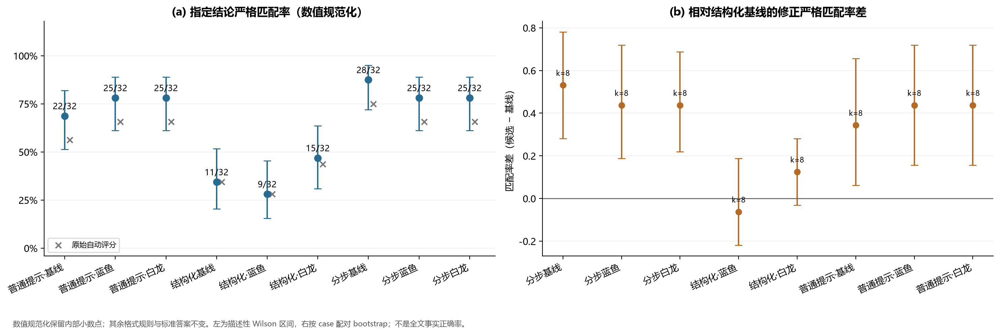
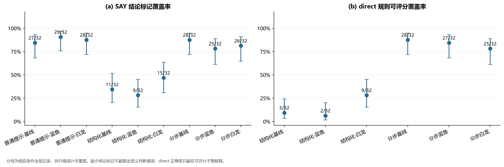
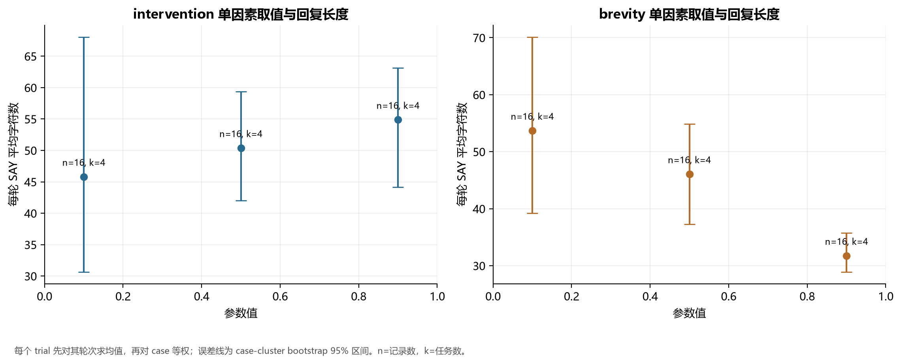
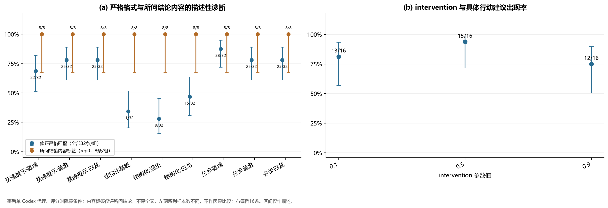
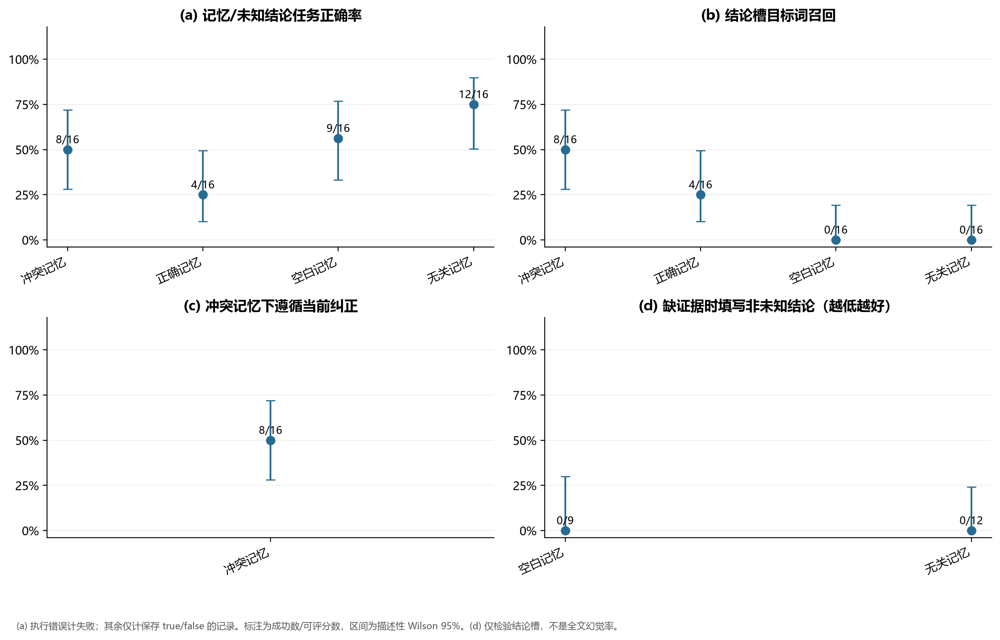
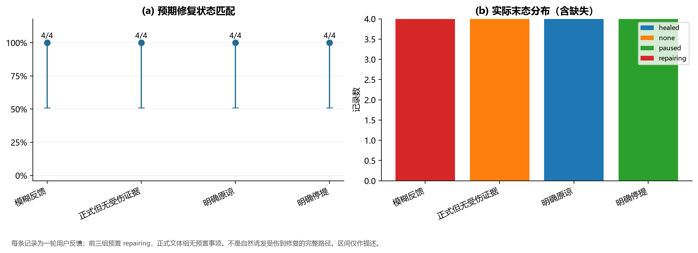
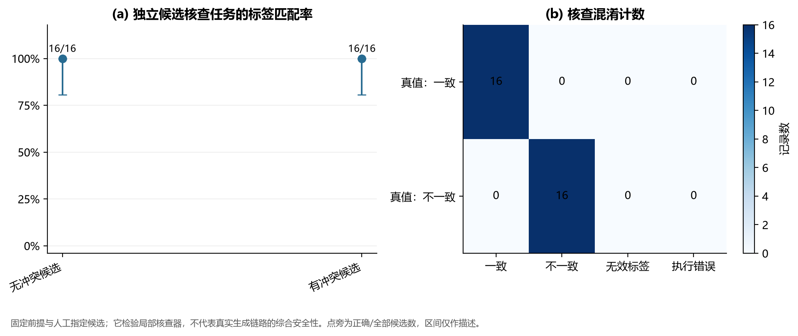
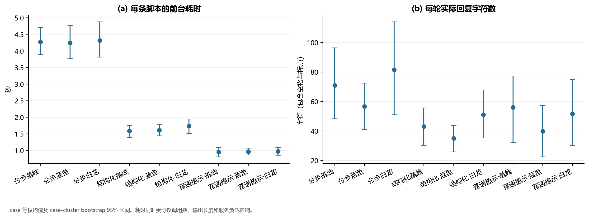
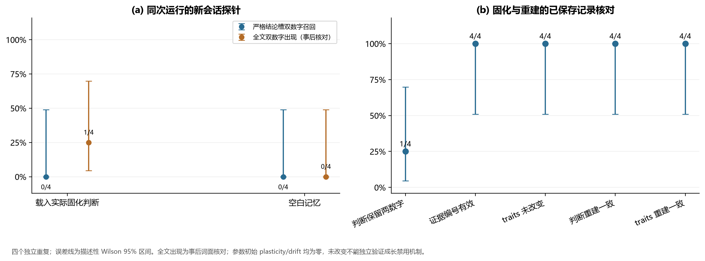

# Persona-Duplex 的重复对照与边界验证：指定答案交付、表达参数和记忆固化的在线研究

研究日期：2026-11-05。本文为仓库内的可复核实验报告；主实验方案在请求执行前固定，补充实验与事后分析分别标注。

本文数据对应[归档的研究实现](./implementation_snapshot/manifest.json)。框架后续修订的定向验证另见[独立材料](../framework_revision_2026_11_05/README.md)，不改写本研究的统计与结论。

## 摘要

Persona-Duplex 将判断参考、人格表达及跨轮观察组织为可检查的工程职责。为进一步检验先前初步研究中未覆盖的重复采样、单因素控制和记忆边界，本文在同一实际模型上执行六组主实验，共 **528 个单元、496 条对话输出、716 次 API 请求**；另执行真实记忆固化补充实验，包含 **4 个独立重复、20 条对话输出、28 次请求**。正式主实验与补充材料合计保存 **516 条对话输出和 744 次请求**。

事实任务采用三种生成方式与三套表达配置的九条件设计，每条件八道题、四次重复。本文保留原始自动评分，并以统一数值规范化后的严格匹配作为主要结果：普通提示三组为 **22/32、25/32、25/32**，默认 `text` 三组为 **11/32、9/32、15/32**，`persona` 三组为 **28/32、25/32、25/32**。这些数字衡量指定结论格式及答案的联合交付，不等同于全文事实正确率。事后条件遮蔽的单 Codex 代理标注将每条件第一次重复中的八条所问结论均标为正确，同时发现所问结论正确的回复仍可能包含附带的无依据断言。

单因素实验中，提高 `brevity` 伴随字符长度下降；提高 `intervention` 伴随长度上升，但具体建议出现率为 **13/16、15/16、12/16**，未随参数单调增加。受控记忆注入可改变答案槽的使用，真实固化补充则仅在四次中的一次将精确数字保留在判断记忆中；载入组严格结论槽召回为 **0/4**，全文双数字出现的事后词面核对为 **1/4**。工程边界检查得到本地协议有效 **383/400**、主实验流式交付与最终记录一致 **495/496**，并保存了一条有效样本仍出现交付与记录不一致的反例。

结果表明，当前系统的表达选择、格式交付、记忆抽象和状态检查需要分别测量。此次小任务集支持配置响应与工程路径的描述性结论，尚不能证明判断与人格的因果独立、一般任务上的架构优越性或长期人格成长。

**关键词：** 人格化对话；判断与表达分工；重复对照；结构化输出；记忆固化；可复现评估

## 1. 引言

人格化对话既需要处理事实与逻辑，也需要决定关注点、亲疏、介入时机和表达取舍。Persona-Duplex 的设计允许人格影响是否建议、如何提问以及哪些内部想法不说出口，同时要求实际断言、计算和现实操作遵循证据与适用条件。因而，评价不应要求 `SAY` 逐项复述 `direct`，也不能把回复变短、核查通过或输出结构正确直接当成判断可靠性的证据。

[先前研究](../validation_study_paper.md)记录了 65 条输出及若干功能样例，同时指出单次轨迹、缺少匹配对照和评估覆盖不足等限制。本研究新增重复运行与单因素条件，并分别考察以下问题：

1. 在确定答案任务中，普通提示、一次生成的 `text` 和分步生成的 `persona` 如何交付指定结论？格式遵循与所问结论内容能否被区分？
2. 固定其余设置时，`brevity` 与 `intervention` 是否表现出可观察的响应？长度变化是否对应建议行为变化？
3. 已保存记忆、当前更正及模型真实固化出的判断，分别如何影响新会话的回答？
4. 修复反馈、位移枚举、局部核查器以及实际流式交付是否在所测边界下按记录工作？

本研究的估计对象是当前实现、当前任务集与当前模型服务中的可观察行为。三套人设均由服务实际返回的 `deepseek-flash` 执行，不构成 DeepSeek 与 ChatGPT 底层模型的比较。

## 2. 系统与实验条件

### 2.1 判断参考与人格表达的分工

默认 `text` 在一次前台生成中依次产生 `HEAD`、`SAY`、`TAIL`。`HEAD.direct` 是内容参考，`baseline` 是当前人格常态表达，`displace` 标记相对常态的额外变化；`SAY` 为实际交付；`TAIL` 提出结算、关系增量及可选的 `pending`。`direct → baseline` 属于普通人格化，`baseline → SAY` 才是额外位移。`none` 是正常状态，不表示缺少人格。

`persona` 将基础判断、人格表达和观察分为独立步骤，正常路径为三次前台调用。此次实验关闭生成链路的额外一致性核查、JSON 格式兜底、自动重试及异步语义判定；固定长期判断为空，受控记忆条件除外。默认记忆提炼属于后台异步链路，常规间隔为 300 秒；真实固化补充单独调用 `Consolidator.run_once()`，不把它计为每轮回复必须等待的步骤。

普通提示条件接收同一事实任务及相应身份、voice、参数语义参考，但不使用 `HEAD/SAY/TAIL`。各生成方式的提示结构、约束和调用阶段同时存在差异，因此组间比较不单独识别某个结构组件的因果贡献。默认同次生成仍可见人格配置，分步方式也不能保证基础模型判断正确。

### 2.2 人设来源与操作化

表达条件包括中性基线、蓝色大肥鱼、白色龙娘。蓝鱼采用亲切、俏皮、愿意帮忙的方向；白龙采用平静、礼貌、较克制的成人角色方向。中文社区来源、可访问性、署名与研究者自行设定的部分见[人设来源说明](./persona_sources.md)，具体配置为 [blue_whale.toml](./personas/blue_whale.toml) 和 [white_dragon.toml](./personas/white_dragon.toml)。

这两套配置是依据可访问二创资料编写的实验表达条件，不代表唯一社区原设或官方人格。数值、耐心程度和条理化表达由研究者操作化，未从视觉形象推断真实心理。各组 `bias=0`、`attention="subtle"`、`legibility_max=2` 相同；人格比较中的身份参考、voice 和多项表达参数联合改变。所有参数的 `plasticity` 与 `drift` 均为零，以固定实验中的人格状态。单因素实验另将身份置空、voice 固定，只改变目标参数。

### 2.3 模型、采样与运行条件

请求模型标识为 `deepseek-chat`，统一 `temperature=0.7`、请求超时 120 秒，主实验并发线程数为 8。适配器默认输出预算为 `max_tokens=1800`；`persona` 的基础判断工具将预算覆盖为 1400，观察工具覆盖为 500，实际覆盖值随每次请求保存。主实验 716 次及补充 28 次响应元数据均返回 `deepseek-flash`。本文以该可观测响应标识描述实际模型，不推断提供方未公开的内部版本或路由。

四次重复不设置远端随机种子；本地任务顺序用 `20261105` 随机化，实际开始、完成时间及调用轨迹另存。并发、服务负载、缓存与输出长度均可能影响耗时，故耗时不是协议固有成本的无混杂估计。

源码与配置的逐文件哈希、运行器哈希、方案哈希、设置和任务顺序保存在[正式结果清单](./experiment_results.json)与[执行计划](./execution_plan.json)。主实验源码集合摘要为 `9c9eeb5970bfb63b28021a436469b9fe811dc90cfeba69f3a3b949306d5bb329`；对应实现保存在[研究源码快照](./implementation_snapshot/README.md)，后续框架改进不改变本文所评估的版本。Git 提交标识仅作为其中一项来源信息，实际执行内容以逐文件哈希为准。

## 3. 研究设计与测量

### 3.1 主实验与独立补充

主实验的[固定方案](./protocol.md)及[机器可读方案](./protocol.json)在正式请求前保存于仓库，没有第三方平台注册。新增真实固化实验使用独立的[补充方案](./supplement_protocol.md)，事后内容标注和评分器修正分别另列。

| 实验 | 条件与任务 | 重复 | 分析单元 | 对话输出 | API 请求 |
| :--- | :--- | ---: | ---: | ---: | ---: |
| 指定结论任务 | 3 种生成方式 × 3 套表达配置 × 8 题 | 4 | 288 | 288 | 476 |
| 单因素参数 | 2 参数 × 3 取值 × 4 场景 | 4 | 96 | 96 | 96 |
| 受控记忆注入 | 4 记忆条件 × 4 偏好题 | 4 | 64 | 64 | 64 |
| 修复反馈 | 4 个反馈条件 | 4 | 16 | 16 | 16 |
| 额外位移探针 | 2 人设 × 4 场景 | 4 | 32 | 32 | 32 |
| 局部核查器 | 4 题 × 正确/错误候选 | 4 | 32 | 0 | 32 |
| 主实验合计 | 六组实验 | — | 528 | 496 | 716 |
| 独立真实固化补充 | 每次 3 轮学习、1 次固化、2 个新会话探针 | 4 | 4 个完整重复 | 20 | 28 |

事实题覆盖预算扣减、涨跌百分比、3/8 比例、跨日时间、集合逻辑、城市信息更正、已吃饭的历史事实，以及信息不足的概率。答案预先固定，分别为 300 元、1152 元、37.5%、次日 00:25、不能推出、苏州、已吃、不可确定。含历史的两题使用固定合成事实及助手确认，属于外生输入，不冒充此前真实生成。

每个任务单元使用独立存储和初始状态。修复实验前三组预置同一 `repairing` 事项，随后仅输入一轮明确原谅、明确停提或“嗯”；正式文体条件从空事项开始，并明确声明没有不高兴。它检验反馈分支，未检验自然语言诱发受伤到完整修复的全过程。

局部核查实验直接提供正确前提和人工指定的正确/错误候选，四题涉及已吃饭、预算、未知概率和城市更正；不经过人格生成。受控记忆实验的判断由研究者注入，真实固化补充则由实际缓冲事件和模型生成判断，再向历史为空的新会话导入这些判断。两者分别测量记忆使用和固化后保留情况。

### 3.2 指定结论严格匹配与数值规范化

主方案要求末行提供“结论：”及指定金额、标签或时间。主指标要求同时出现可评分的结论槽和正确值；缺标记、格式不符及执行失败计不匹配。该指标覆盖答案格式和内容的联合交付，不能从失败直接推出模型不会计算或判断错误，也不能由匹配推出全文所有断言正确。

数值规范化保留内部小数点，仅去掉末尾英文句号；标准答案、尖括号及其他格式的接受范围保持原规则。例如 `<37.5>%` 仍不匹配，`375%` 仍错误，`37.5%` 与 `37.5。` 可按原定数值标准评分。保存的运行时自动评分将内部句点作为标点清除，因此本文同时列出该原始评分与统一规范化后的结果，原始 `evaluation` 不作改写。

[评分修正清单](./scoring_amendment.json)记录规范化规则、代码哈希、输入数据哈希和全部 **25 条**受影响记录的原/新布尔评分。该评分校正属于事后分析，原始匹配数作为敏感性结果保留，不作为预先注册的发现。

`direct` 未被强制使用同样的末行答案格式。仅当其中的结论可由同一规则评分时才报告其匹配情况，并同时报告覆盖率；未覆盖部分保持未评分。其匹配子集不是对全部判断质量的无偏估计。

### 3.3 表达、记忆与工程指标

字符长度采用 Python `len(str)`，含空格、标点与换行；不等于 token 数。参数实验每次只改变 `intervention` 或 `brevity` 的取值 0.1、0.5、0.9，其他设置固定。参数会经当前提示生成逻辑译成自然语言，并有离散阈值，因此实验检验该实现的响应，不证明连续心理维度。

记忆主指标按预定答案或“未知”评分；`recall` 仅指结论槽的目标词召回。空白/无关记忆下的 `unsupported_claim` 仅在有结论槽时检查是否填写非未知答案，缺标记单列；它不评价全文幻觉。局部核查匹配人工已知候选标签，不以模型自评当独立真值。

本地协议有效性来自解析和字段检查；流式一致性比较实际回调片段拼接与最终保存的 `SAY`。两者单独报告，并保存差异原文。位移仅描述已导出的枚举，没有独立语义正负样本真值。

### 3.4 统计方法

设某条件在第 k 个任务、第 r 次重复的严格匹配为 Y，先对同一任务的四次重复求均值，再对任务等权平均：

```math
\bar{Y}_{gk}=\frac{1}{R}\sum_{r=1}^{R}Y_{gkr},\qquad
\hat{p}_g=\frac{1}{K}\sum_{k=1}^{K}\bar{Y}_{gk}.
```

各条件重复数相同时，该值等于匹配数除以分配记录数。记录级比例附 Wilson 95% 区间 [1]。以 z=1.95996 计算：

```math
\mathrm{CI}_{W}=
\frac{\hat p+\frac{z^2}{2n}\;\pm\;
 z\sqrt{\frac{\hat p(1-\hat p)}{n}+\frac{z^2}{4n^2}}}
 {1+\frac{z^2}{n}}.
```

同一任务的重复输出存在相关性，故这些区间仅作记录级描述，不解释为严格满足独立二项抽样的总体覆盖保证。组间差值按任务配对：

```math
\hat\Delta_{g,b}=\frac{1}{K}\sum_{k=1}^{K}
 \left(\bar Y_{gk}-\bar Y_{bk}\right).
```

分析对 case 均值块有放回重采样 4,000 次，以 2.5% 与 97.5% 分位数给出差值或长度区间，随机种子固定为 `20261105`。重采样保留任务内重复的聚合关系，采用 bootstrap 的基本思想 [2]；它主要呈现已观测任务构成的敏感性，八道或四道目的性选择的任务不足以代表所有对话任务。本文不报告确认性 p 值、不作多重比较后的优越性宣称。

### 3.5 事后条件遮蔽标注

为诊断格式失败与内容回答的差异，固定选取每个事实条件的 `replicate=0`，共 72 条，另对全部 48 条 `intervention` 回复标注具体行动建议。条目随机匿名化并在评分时隐藏条件，每项标注任务由一位 Codex 子代理依据用户任务与回复评定；事实与建议任务分别由不同子代理完成，随后映射回原条件。条目、标签及证据见[标注汇总](./annotation_summary.json)。

事实标签只判断所问结论属于 `correct / incorrect / no_answer / ambiguous`，不评价全文每条断言；建议标签区分具体行动建议与只作澄清的提问。这是事后单代理诊断，不是人类受试实验，也没有第二评审者或一致性估计。内容可能透露表达风格，条件遮蔽不保证完全不可推知条件。

### 3.6 分析样本与材料核验

本文的分析集由一轮独立完整的 528 单元主实验及独立补充构成，没有按结果替换样本；未完整采集的预备执行不纳入分母，其排除信息保留在机器可读元数据中。正式主实验和补充的请求均无已记录的执行错误。

独立[审计程序](./audit_results.py)及[审计结果](./audit_report.json)使用研究源码快照核对任务、引用、源码、请求、回调和记录。“审计通过”表示材料可以对应，不代表每条输出的协议有效或交付一致。

## 4. 结果

### 4.1 指定结论交付：格式与内容不能混算

**表 1　九条件的严格匹配与结论标记覆盖。** 每组均为八题、四次重复，分母 32；数值规范化保留内部小数点，其他格式要求与标准答案不变。

| 条件 | 原实现匹配数 | 校正匹配数 | 校正严格匹配率 | Wilson 95% 描述区间 | SAY 结论标记覆盖 |
| :--- | :--- | :--- | ---: | :--- | :--- |
| 普通提示·中性 | 18/32 | 22/32 | 68.75% | [51.43%, 82.05%] | 27/32 |
| 普通提示·蓝鱼 | 21/32 | 25/32 | 78.12% | [61.25%, 88.98%] | 29/32 |
| 普通提示·白龙 | 21/32 | 25/32 | 78.12% | [61.25%, 88.98%] | 28/32 |
| text·中性 | 11/32 | 11/32 | 34.38% | [20.41%, 51.69%] | 11/32 |
| text·蓝鱼 | 9/32 | 9/32 | 28.12% | [15.56%, 45.37%] | 9/32 |
| text·白龙 | 14/32 | 15/32 | 46.88% | [30.87%, 63.55%] | 15/32 |
| persona·中性 | 24/32 | 28/32 | 87.50% | [71.93%, 95.03%] | 28/32 |
| persona·蓝鱼 | 21/32 | 25/32 | 78.12% | [61.25%, 88.98%] | 25/32 |
| persona·白龙 | 21/32 | 25/32 | 78.12% | [61.25%, 88.98%] | 26/32 |



默认 `text` 的指定结论严格交付在当前任务中较低，主要伴随结论标记缺失。普通提示、`text`、`persona` 的外部用户要求相同，但系统提示组织及阶段数不同，不能把表中排名解释为某一种架构实现了更好的基本判断。

**表 2　可评分 direct 的覆盖与子集匹配。** 普通提示不产生该字段；其余组的覆盖差异很大。

| 条件 | direct 可评分/全部记录 | 校正后匹配/可评分 |
| :--- | :--- | :--- |
| text·中性 | 3/32 | 3/3 |
| text·蓝鱼 | 2/32 | 2/2 |
| text·白龙 | 9/32 | 8/9 |
| persona·中性 | 28/32 | 28/28 |
| persona·蓝鱼 | 27/32 | 25/27 |
| persona·白龙 | 25/32 | 24/25 |



**表 3　相对 text·中性的配对任务均值差。** 以下均使用修正严格匹配；每项配对任务数为八，区间仅描述此次任务集的敏感性。

| 相对 text·中性的条件 | 修正严格匹配率差（百分点） | 配对 case bootstrap 95% 区间（百分点） |
| :--- | ---: | :--- |
| text·蓝鱼 | -6.250 | [-21.875, +18.750] |
| text·白龙 | +12.500 | [-3.125, +28.125] |
| persona·中性 | +53.125 | [+28.125, +78.125] |
| persona·蓝鱼 | +43.750 | [+18.750, +71.875] |
| persona·白龙 | +43.750 | [+21.875, +68.750] |

较大的严格匹配差不能直接解释为事实能力差异。事后 72 条内容标签均为 `correct`，各组为 8/8；它与同一子集的严格格式评分存在明显差异。

**表 4　全部重复与事后内容子集的分母。** 内容标注仅覆盖第一次重复，不能替代全部 288 条回复的语义评价。

| 条件 | 全部四次重复的校正严格匹配 | rep0 相同子集校正严格匹配 | rep0 所问结论内容标签 correct |
| :--- | :--- | :--- | :--- |
| 普通提示·中性 | 22/32 | 5/8 | 8/8 |
| 普通提示·蓝鱼 | 25/32 | 6/8 | 8/8 |
| 普通提示·白龙 | 25/32 | 7/8 | 8/8 |
| text·中性 | 11/32 | 4/8 | 8/8 |
| text·蓝鱼 | 9/32 | 2/8 | 8/8 |
| text·白龙 | 15/32 | 3/8 | 8/8 |
| persona·中性 | 28/32 | 7/8 | 8/8 |
| persona·蓝鱼 | 25/32 | 6/8 | 8/8 |
| persona·白龙 | 25/32 | 6/8 | 8/8 |

尽管所问结论得到正确标签，`facts_structured_base_unknown_r0` 在正确回答概率不可确定之外还说“最多只能说不是 0 也不是 1”。题目未给抽样机制，这个附加范围断言没有足够依据。因此“所问结论正确”也不能升级为“全文事实正确”。

### 4.2 单因素响应：长度变化与建议行为不同步

**表 5　参数取值、字符长度与事后建议标注。** 每档四场景、四次重复，共 16 条；长度为 case 等权均值。

| 单独改变的参数 | 取值 | SAY 均长（字符） | case-cluster bootstrap 95% 区间 | 事后具体建议标签 |
| :--- | ---: | ---: | :--- | :--- |
| brevity | 0.1 | 53.6875 | [39.1875, 70.1250] | 未标注 |
| brevity | 0.5 | 46.0625 | [37.2500, 54.8750] | 未标注 |
| brevity | 0.9 | 31.7500 | [28.8750, 35.7500] | 未标注 |
| intervention | 0.1 | 45.8125 | [30.6250, 68.0625] | 13/16 |
| intervention | 0.5 | 50.3750 | [42.0000, 59.3750] | 15/16 |
| intervention | 0.9 | 54.8750 | [44.1250, 63.1250] | 12/16 |



`brevity` 从 0.1 提高到 0.9 时，平均字符数由 53.6875 降至 31.7500；`intervention` 对应长度由 45.8125 增至 54.8750。在这四个场景中存在方向一致的长度变化，但场景数很少，不能据此估计一般连续响应曲线。

具体建议标签为 13/16、15/16、12/16，未随 `intervention` 单调上升。某些回复虽然变长，仍主要澄清卡点；低取值也常给出“先只翻一页”“先收一小块”等行动。故“干涉度越高、回复越长”不等于已经证实“越倾向给建议”。单评审者的二元标签还可能受建议边界定义影响。



图 9 左侧同时显示全部 32 条的严格匹配与 8 条子集的内容标签，样本数明确标出；两系列不作同分母因果比较，表 4 提供相同子集对照。

### 4.3 受控记忆：目标信息使用与未知答案

**表 6　四种记忆注入条件。** 每组四题、四次重复，共 16 条。

| 记忆条件 | 指定结论主任务匹配 | 结论标记覆盖 | 目标词槽召回 | 当前纠正遵循 | 缺证据时非未知结论 |
| :--- | :--- | :--- | :--- | :--- | :--- |
| empty | 9/16 | 9/16 | 0/16 | 不适用 | 0/9 |
| correct | 4/16 | 4/16 | 4/16 | 不适用 | 不适用 |
| irrelevant | 12/16 | 12/16 | 0/16 | 不适用 | 0/12 |
| contradictory | 8/16 | 8/16 | 8/16 | 8/16 | 不适用 |



正确记忆组的严格主任务为 4/16，旧记忆被当前明确更正组为 8/16；这些结果同时受结论标记缺失影响，不能直接写为记忆使用准确率。空白和无关组的“未知”结论为 9/16、12/16，已出现结论槽的记录中没有非未知填写，分别为 0/9、0/12；其余缺槽记录保持未评价。这里没有对全文无依据断言作完整标注。

该实验将研究者预先编写的判断注入上下文，不能验证固化器是否会从对话中保留所需信息。真实固化在第 4.7 节单独报告。

### 4.4 修复反馈与额外位移

四类反馈各四次均到达指定末态：明确原谅为 `healed` 4/4，明确停提为 `paused` 4/4，含糊“嗯”为 `repairing` 4/4，正式且明确未受伤为无事项 4/4。全部 16 条末态记录均无新增雷区。原谅和含糊组各有一条生成输出的本地协议无效，但基于实际用户反馈的状态判定仍可独立进行；状态正确与本轮生成协议有效分开统计。



该结果支持所选明确反馈及含糊反馈的分支处理，未测量自然对话中疑似受伤检测的准确率或多轮修复效果。

全主实验中 399 个已导出 `HEAD.displace` 均为 `none`，另有一条结构化输出缺少 HEAD；普通提示的 96 条不适用该字段。专门的蓝鱼/白龙探针 32 条也全部为 `none`，其中两条本地协议无效。没有独立位移语义真值，结果既可能与常态表达相容，也可能反映机制未被激活或漏报，不能据此评价分类准确率。

### 4.5 局部核查器

给定已知前提和人工指定候选时，正确候选有 16/16 判为 `consistent`，错误候选有 16/16 判为 `inconsistent`；未出现其他标签或请求错误。每组 Wilson 95% 描述区间为约 [80.64%, 100%]。



这说明核查器能处理此次四题中显式给定的冲突。它没有同时承担从长历史找证据、检出生成中的未列出断言和验证遗漏风险的任务，不能消除先前研究中的上下文事实核查失败，也不支持把核查默认加入每轮交付。

### 4.6 本地协议、流式交付与耗时

主实验 400 条采用框架协议的对话中，本地有效 **383/400**；普通提示 96 条没有相同协议校验，不能纳入该分母。全部 496 条对话的回调拼接与最终 SAY 一致 **495/496**。

唯一不一致为 `facts_persona_dragon_city_correction_r0`。其回调实际交付为“按你最后的更正，B公司现在在苏州。成都那条已作废。\n<苏州>”，最终保存的 SAY 清洗掉末行 `<苏州>`，本地 `validity` 仍为真。该例直接表明，本地有效标记不能保证实际交付与保存文本一致；按落账文本评分时还需单列这种交付差异。

**表 7　事实条件中的前台交付开销与表达长度。** 原始流式数据和响应元数据可与每条记录的调用引用对应。

| 条件 | SAY 均长（字符） | 平均前台耗时（秒） | 记录调用数 / 记录数 |
| :--- | ---: | ---: | :--- |
| 普通提示·中性 | 56.03 | 0.95 | 32/32 |
| 普通提示·蓝鱼 | 39.88 | 0.97 | 32/32 |
| 普通提示·白龙 | 51.69 | 0.98 | 32/32 |
| text·中性 | 43.06 | 1.59 | 32/32 |
| text·蓝鱼 | 34.97 | 1.61 | 32/32 |
| text·白龙 | 51.06 | 1.73 | 32/32 |
| persona·中性 | 70.91 | 4.27 | 94/32 |
| persona·蓝鱼 | 56.75 | 4.25 | 95/32 |
| persona·白龙 | 81.56 | 4.32 | 95/32 |



默认 `text` 的 96 条事实任务均为一次前台生成。`persona` 的 96 条中有 92 条执行三次、4 条执行两次；后者因表达阶段的重复标记而跳过后续观察，未补发请求。总调用数为 284，不应将所有样本直接记为固定三次。不同路径输出长度也不同，表 7 的耗时差无法单独归因于判断分工。

### 4.7 真实固化补充：具体数字的丢失与格式失败

四个独立重复都先在真实缓冲中记录三轮用户陈述：“17 分钟专注、3 分钟休息”为个人固定偏好，再运行模型固化。每次固化后，分别建立历史为空、存储独立的载入与空白新会话；载入组仅导入本次实际产生的判断，不传递原训练历史或陪伴记录。

四次共生成五条判断，数量分别为 2、1、1、1。所有判断的证据编号均可追溯到实际三条训练轮次，但只有 `replicate=2`（索引从 0 起）的判断保留了两个精确数字，其余将其抽象为“固定学习节奏”“反复确认”。这是信息在提炼阶段丢失的直接材料，并非仅由探针失败反推。

| 指标 | 载入实际固化判断 | 空白记忆 |
| :--- | :--- | :--- |
| 严格结论槽双数字召回 | 0/4 | 0/4 |
| 严格“未知”结论 | 0/4 | 3/4 |
| 结论标记覆盖 | 0/4 | 3/4 |
| 全文双数字出现：事后词面核对 | 1/4 | 0/4 |
| 新会话历史确为空 | 4/4 | 4/4 |

载入组 `replicate=2` 明确说“你之前说过：专注17分钟，休息3分钟”，但未使用指定结论标记。因此，严格召回 0/4 包含格式交付失败；全文出现 1/4 是事后词面核对，亦不能升级为一般语义召回率。其余三次载入的判断已不含目标数字，回复未报出数值。空白组另一条也在正文承认看不到依据，但缺少结论标记。



全部四次固化前后 traits 的已保存值相同，判断和 traits 的重建前后结构化值也分别相等 4/4。该重建实际清除派生视图并调用 `rebuild_views`，比较材料保存在[补充结果](./supplement_results.json)。参数初始 `plasticity=0`、`drift=0`，故未改变的观察不足以单独验证自动成长是否禁用，更不构成成长有效性证据。重建一致只覆盖这四次保存数据，不代表任意断电、损坏或并发写入下的保证。

补充的 20 条对话均本地有效、流式一致；正式主实验和补充合计流式一致为 **515/516**。这是同次运行中的跨会话试验，没有实际跨日保持或长期记忆衰减的证据。

## 5. 讨论与有效性边界

### 5.1 对核心设计的含义

当前数据最明确地揭示了测量目标的差异：模型可能给出正确的所问结论，却没有满足指定交付格式；内容判断步骤可能正常，而最后清洗改变了实际交付与保存的一致性；记忆写入和证据链接可能正常，但将具体偏好抽象成倾向会丢失新会话所需的细节。将这些结果汇总成一个“正确率”会混淆不同工程问题。

`brevity` 的长度响应和 `intervention` 的建议标签未呈相同规律，支持对每个参数分别检查其目标行为。当前提示中同时包含数值、语义端点与阈值行为指令，尚需更细的阈值附近取值、反事实任务和独立内容标注，才能判断哪些变化来自何种提示组件。

结果也未证明默认一次生成可以隔离人格对判断的影响。相反，最稳定的可观察差异首先是格式与表达；要检验因果独立性，需要固定事实任务、表达条件、判断提示与历史输入，系统地改变人格入口，并对全部现实断言及必要条件进行独立评分。

### 5.2 主要限制

1. **任务与模型范围有限。** 只有八道事实题、四个参数场景、四个记忆偏好题、四个核查题，均使用中文且没有领域代表性抽样；全部供应商响应来自同一实际模型标识。四次重复不能替代任务多样性。
2. **指标联合了格式与答案。** 严格匹配对工程交付有意义，但不能代替内容正确性。direct 的低覆盖导致条件选择偏差，72 条事后结论标签也不能代表全部回复或全文断言。
3. **部分分析是事后追加。** 小数点评分修正、内容标注、全文双数字出现核对均在查看执行结果后进行，已经分别保留原始值和修正规则，不作为确认性预注册发现。
4. **评价者有限。** 事后内容与建议标签分别由不同的 Codex 子代理给出，但每项任务都只有一位评审，无同项双评、人工真值复核与评审一致性估计；遮蔽标签不能完全阻止从文本风格推知条件。
5. **对照仍有混杂。** 普通提示、`text`、`persona` 同时改变系统提示与阶段结构，不能从组间严格匹配差证明架构优越性。核查实验是局部输入，不代表集成生成链路中的安全收益。
6. **记忆和状态范围有限。** 受控注入与实际固化是不同实验；真实补充只覆盖同次运行、单个精确偏好、四次重复。修复主要使用预置状态，位移没有独立语义真值，参数没有实际成长能力。
7. **复现有服务边界。** 没有远端采样种子保证，并发、缓存和提供方状态可能变化。哈希与原始请求支持核查本次材料，不保证未来在线请求逐字复现。

## 6. 结论

此次研究新增了正式主实验的 528 个单元和独立真实固化补充，公开逐任务记录、实际请求、响应元数据、交付片段、派生统计与图表。结果支持在当前实现中观察表达配置与长度响应，并验证指定反馈脚本、局部核查及部分存储重建路径；同时明确揭示了严格格式交付、流式与记录一致性、具体记忆保留方面的失败。

后续完善应优先围绕这些可定位的失败建立回归与匹配对照：既保持默认一次前台生成与后台记忆的设计，也分别测量实际判断、外显行为和保存状态。现有证据尚不足以宣布人格与判断因果独立、系统普遍安全或长期人格成长成立。

## 数据与复现材料

所有正文图表由 [analyze.py](./analyze.py)从保存材料生成，完整机器可读派生统计见 [summary.json](./summary.json)，分母与缺失明细见 [results_tables.md](./results_tables.md)。

| 材料 | 内容 |
| :--- | :--- |
| [protocol.md](./protocol.md)、[protocol.json](./protocol.json) | 正式主实验的固定方案与设置 |
| [execution_plan.json](./execution_plan.json)、[run_experiments.py](./run_experiments.py) | 精确任务、顺序和冻结运行器 |
| [experiment_results.json](./experiment_results.json)、[raw_calls.json.gz](./raw_calls.json.gz) | 正式逐单元记录、原始请求与响应 |
| [scoring_amendment.json](./scoring_amendment.json) | 小数点清洗的事后修正规则及受影响记录 |
| [supplement_protocol.md](./supplement_protocol.md)、[supplement_memory.py](./supplement_memory.py) | 真实固化补充方案与运行器 |
| [supplement_results.json](./supplement_results.json)、[supplement_raw_calls.json.gz](./supplement_raw_calls.json.gz) | 补充状态、记忆、探针和原始调用 |
| [annotation_summary.json](./annotation_summary.json) | 条件遮蔽的事后内容与建议标签及证据 |
| [audit_report.json](./audit_report.json)、[audit_results.py](./audit_results.py) | 独立离线材料对应检查与已保存反例 |
| [data_dictionary.md](./data_dictionary.md)、[artifact_manifest.json](./artifact_manifest.json) | 字段语义、统计边界与材料文件哈希 |
| [implementation_snapshot](./implementation_snapshot/README.md) | 本文评估的实现版本与逐文件哈希 |
| [persona_sources.md](./persona_sources.md)、[personas](./personas/) | 社区来源、署名及实验人设操作化 |
| [README.md](./README.md)、[reproduce.py](./reproduce.py)、[requirements.txt](./requirements.txt) | 分析复现与新增在线运行入口 |

保存材料的离线重算和新增在线实验应分别执行。在线重跑需要由进程环境提供密钥，使用新的输出位置；模型输出不保证逐字一致，事后内容标注也需要重新组织评分，不能直接复用现有标签。具体命令和依赖见本目录 [README](./README.md)。正文公式使用 GitHub 支持的 fenced math 语法 [3]。

## 参考资料

[1] Wilson, E. B. (1927). Probable Inference, the Law of Succession, and Statistical Inference. *Journal of the American Statistical Association*, 22(158), 209–212. [DOI:10.1080/01621459.1927.10502953](https://doi.org/10.1080/01621459.1927.10502953).

[2] Efron, B. (1979). Bootstrap Methods: Another Look at the Jackknife. *The Annals of Statistics*, 7(1), 1–26. [DOI:10.1214/aos/1176344552](https://doi.org/10.1214/aos/1176344552).

[3] GitHub Docs. [Writing mathematical expressions](https://docs.github.com/en/get-started/writing-on-github/working-with-advanced-formatting/writing-mathematical-expressions).

[4] Persona-Duplex. [人格判断与表达分工框架的初步实证研究](../validation_study_paper.md)；[社区人设参考与实验操作化](./persona_sources.md)。
