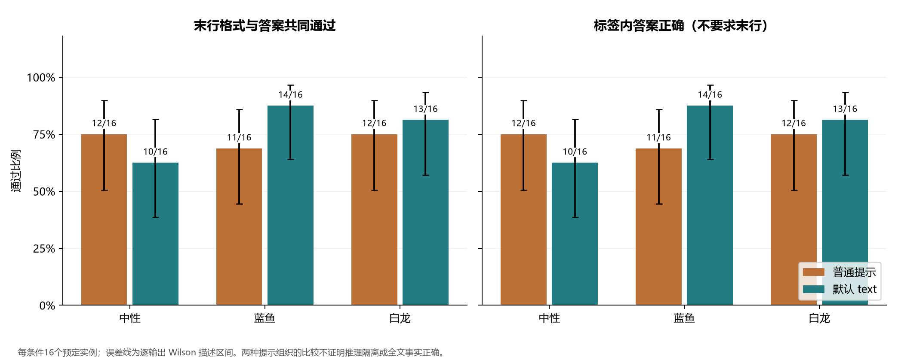
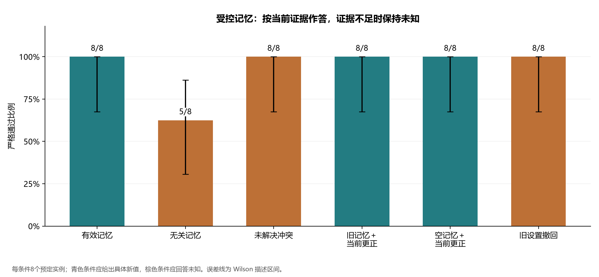
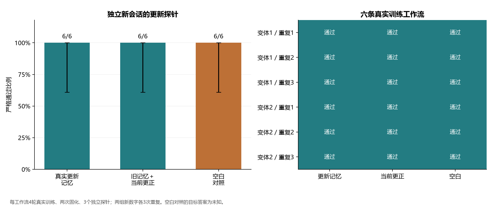
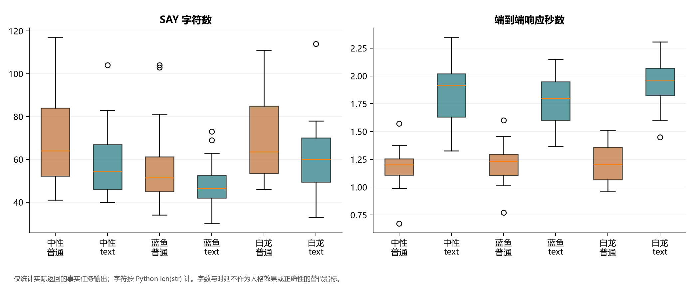

# 人格表达框架的新实例交付与记忆更新边界

## 前置固定任务集上的受控研究

**研究日期：**2026-11-06  
**研究对象：**persona-duplex 的现行默认 `text` 路径与受控普通提示基准  
**材料：**[固定方案](protocol.md) · [逐单元数据](run/results.json) · [原始请求与响应](run/raw_calls.json.gz) · [统计表](results_tables.md) · [复现说明](README.md)

### 摘要

人格表达工程需要同时检验内容判断、回答交付和记忆来源，而不能以协议有效或口吻变化代替全部效果。本研究在已有重复对照和框架修订验证的基础上，固定新的合成实例、评分规则、请求预算及源码快照，开展三个实验：六种提示与表达组合的新实例对照、六种受控记忆条件，以及包含真实固化与明确更新的独立工作流。150 个单元共生成 186 条对话输出，执行 210 次请求，无执行异常。事实任务的严格结论通过率在六条件间为 10/16—14/16；全部 24 条未通过的事实输出均未满足指定标签格式。事后条件匿名的单一 Codex 辅助复核认为这 24 条及另外三条记忆格式失败输出均表达了正确目标结论，但该复核不修改前定分数，也不评价全文全部断言。未解决冲突、更正和撤销条件各为 8/8；六条真实更新工作流的新会话均召回新数字，空白对照均回答未知。框架协议有效为 136/138，实际交付一致为 138/138。结果支持有限合成条件下的来源处理和更新链路，同时显示指定格式与完整协议仍不能由提示保证；结果不建立人格与判断的因果独立、一般人格效果或长期安全性。

**关键词：**人格表达；语言模型；证据引用；记忆更新；协议交付；受控评估

## 1. 问题与研究范围

persona-duplex 将按事实和逻辑形成的内容参考 `direct`、普通人格表达 `baseline`、实际外显回复 `SAY` 以及后续观察区分记录。默认路径在一次前台生成中按 `HEAD → SAY → TAIL` 产生这些内容，后台记忆另行固化。人格可以影响注意、站位、主动性和表达取舍，不能成为现实事实的依据，也不能使说出的计算和结论变错。内部建议不要求全部说出口。

[前期重复对照](../followup_2026_11_05/paper.md)暴露了结论格式、记忆细节与行为参数测量的限制；[修订定向验证](../framework_revision_2026_11_05/README.md)只在原有题组和相同17/3数字偏好上验证了部分改进。本研究不将这些历史结果当作同期对照，而提出三个新问题：

1. 在新数字与新实体上，默认框架能否完成指定答案与格式？它与包含相同表达资料的普通提示包有何描述差异？
2. 可见记忆无关、冲突、被当前更正或被撤销时，系统是否保留证据边界？
3. 旧设置经过真实训练和固化后再更新，新会话能否使用更新后的实际记忆，而不是依赖原对话历史？

本研究测量指定目标结论、交付与记忆状态，不直接评价人格自然度、陪伴体验、位移语义或建议行为。因此不从字符数推出人格效果，也不从同一次调用中的 `direct` 推出中性推理已经获得硬隔离。

## 2. 方法

### 2.1 前置固定、实现与执行

任务、答案、配置、执行顺序、评分器和预算在首个请求前保存于[运行方案](run/protocol.json)和[执行计划](run/execution_plan.json)，并归档 21 份核心源码及[运行器](run/runner_snapshot.py)。这属于仓库内的前置固定，不是第三方注册平台的预注册。所有单元在固定方案保存后执行，不按中途结果扩样、换题或替换失败。

请求使用 `deepseek-chat`，210 份响应均返回 `deepseek-flash`；服务指纹相同。温度为0.7、单请求最大输出1800 tokens、超时120秒、并发工作线程为4。请求无采样 seed；本地种子20261106只决定任务顺序及局部顺序，不构成远端采样控制。不同实验单元和新会话探针相互隔离，每条真实更新工作流的四轮训练共享其训练 Store。默认前台关闭额外检查、JSON 回退、语义裁判、请求重试和协议升级。

预算上限为210次请求，实际恰执行210次；其中186次为前台生成，24次为真实记忆固化。服务共返回452742个输入 tokens、25456个输出 tokens，总计478198；所有调用均有用量字段。服务用量不是实际账单，本研究不推算费用。

### 2.2 实验 A：新实例与六种提示组合

八种模板分别为预算扣除、连续百分比、跨日计时、集合逻辑、单位换算、显式更正、必要条件和信息不足。每种模板有两个固定的新实例，共16题。题目只依赖提供的封闭前提，答案可独立重算。例如预算题的目标为920/1515元，跨日题为01:03/00:27，路线长度为2750/2370米。两个实例包含不同数字或实体，不是同题的采样重复。

每题进入普通提示/默认 `text` 与中性/蓝鱼/白龙的2×3组合，共96条输出。人设沿用[原研究的社区参考操作化](../followup_2026_11_05/persona_sources.md)，仅作为表达配置，均使用同一服务模型，不是不同模型品牌的性能对比。中性配置清空身份资料，将九项行为参数统一为0.5。

普通提示包含相同的身份、语气和行为参数资料，以及事实和答案格式要求；默认框架还包含完整协议、情境、位移及状态指令。因此实验比较的是完整提示包，不能把观察差异归因于单一协议组件或判断隔离。两组都只进行一次前台调用；不给 `direct` 额外增加便于评分的结论模板。

### 2.3 实验 B：受控记忆

个人时长、启动文件名、热饮和例会房间四类设置，各两个实例，进入六种条件，共48条默认 `text` 输出。

| 条件 | 处理 | 目标 |
| --- | --- | --- |
| 有效记忆 | 来源和完整原话明确支持当前设置 | 支持值 |
| 无关记忆 | 仅有蓝色书签偏好，与所问设置无关 | 未知 |
| 未解决冲突 | 两条不一致记录，明确无更新先后和当前确认 | 未知 |
| 旧记忆＋当前更正 | 旧高置信度记忆，本轮明确改为新值 | 新值 |
| 空记忆＋当前更正 | 无旧记忆，同一当前更正 | 新值 |
| 旧设置撤回 | 旧记忆仍在，本轮撤销但新值未决定 | 未知 |

未解决冲突中，记录顺序与高置信度所在方组成2×2平衡，各组合两例，防止单靠位置或置信度取胜。更正组与空白更正组配对，考察旧记忆是否干扰当前输入。合成记忆明确标为 `synthetic_control`，不声称由模型学习得到。用户当前更正仍是用户提供的前提，不是对现实事实的外部核验。

### 2.4 实验 C：真实固化与更新

采用两套新数字：专注19/休息4分钟改为23/6分钟，以及11/2分钟改为31/7分钟；各运行三条独立工作流。每条包含两轮旧设置对话、一次实际固化、两轮明确更新对话和第二次实际固化，随后导出真实记忆进入三个没有原对话历史的新会话：更新后记忆、旧记忆加当前更正、空白对照。探针顺序随机化。

不手工改写固化判断、引用或更新关系。每条工作流最多七条输出和四次固化调用，六条共42条输出、66次请求。另检查实际判断视图重建、重新打开 Store 的读回、完整原话与来源的对应，以及人格参数是否保持不变。固化在固定阶段边界显式执行，避免后台计时竞争；本实验不检验默认300秒定时调度，也不声称经过真实数日。

### 2.5 指标、分母与统计

主指标要求正确的目标值及单位出现在末行结论标签内。令最后一个非空行为 `last`，最后一个可解析结论标签的值为 `answer`，则：

```math
S_i=\mathbf{1}\{\operatorname{last}(y_i)=\text{结论标签行}\}
\mathbf{1}\{\operatorname{answer}(y_i)\equiv g_i\}.
```

次指标 `labelled_content_correct` 只放宽末行位置，仍要求可解析结论标签。无标签正文不被自动认定为事实错或对，而是该指标没有覆盖。等价处理预先固定为 NFKC、空白、Markdown 强调和反引号、末尾标点及一层配对尖括号；数字以 Decimal 比较，不删除小数点，不忽略要求的单位。

结论评分分母为162条：96条事实、48条受控记忆和18条真实更新探针。24条训练输出没有结论金标，但计入全部186条输出及运行统计。框架协议和交付分母为138，排除没有内部协议的48条普通提示输出。普通提示自身的增量拼接相等不被当作独立框架验证。计划异常或缺失输出不从分母删除。

比例使用95% Wilson 描述区间，其中心与半宽按下式计算，其中 `z=1.959963984540054`：[1]

```math
\frac{\hat p+z^2/(2n)}{1+z^2/n}
\;\pm\;
\frac{z\sqrt{\hat p(1-\hat p)/n+z^2/(4n^2)}}{1+z^2/n}.
```

提示包差异先在同模板两个实例内求均值，再按八个模板配对 bootstrap 4000次；记忆更正差异按四个主题聚类，方法属于重采样描述。[2]

```math
\widehat\Delta=\frac{1}{K}\sum_{k=1}^{K}
\left(\overline S_{\mathrm{text},k}-\overline S_{\mathrm{plain},k}\right).
```

每条输出的 Wilson 区间不消除共享模板、同一服务和重复工作流的相关性。聚类数很少，未作确认性显著、等效性或总体泛化检验。

## 3. 结果

### 3.1 新实例：指定格式仍不稳定

| 表达配置 | 普通提示严格通过 | 默认 `text` 严格通过 | `text−普通` 百分点差 | 模板 bootstrap 95%区间 |
| --- | ---: | ---: | ---: | --- |
| 中性 | 12/16 | 10/16 | −12.5 | [−43.8, 12.5] |
| 蓝鱼 | 11/16 | 14/16 | 18.8 | [−25.0, 56.2] |
| 白龙 | 12/16 | 13/16 | 6.2 | [−12.5, 25.0] |

六条件共72/96严格通过；其中普通提示35/48，默认框架37/48。全部24条失败均缺失评分器要求的行首 `结论：` 标签，没有“可解析标签内目标值错误”的记录；标签覆盖、标签内正确及严格通过在本组数值相同。各表达配置的提示包差异方向不同，区间均跨零，不能据此宣布框架全面优于普通提示或对人格影响具有等效性。



**图1。** 每条件16个固定实例。误差线为逐输出 Wilson 描述区间。左右指标均依赖结论标签；两图相同不表示已独立测量全文事实。

### 3.2 格式失败的探索性内容复核

在前定数据和分数完成后，另外固定[复核方案](format_failure_review_protocol.json)，将全部27条严格失败输出（24条事实、3条受控记忆）匿名打乱，删除条件名和金标，由一个未读取条件映射的 Codex 子代理按问题前提核对所问结论。其可见原回答语气，因此仅为条件标签匿名，不能保证完全不可识别人设；它不是人类标注、不同模型的独立验证或多评价者一致性研究。

[27份标签](format_failure_review_ratings.json)均将所问目标结论标为有依据，未发现互相矛盾的目标答案。例 `facts_text_neutral_budget_0` 正确计算固定支出2730元及余额920元，却以“920元”结束，遗漏标签；`facts_plain_neutral_midnight_0` 给出正确跨日推导并以“&lt;01:03&gt;”结束，同样不满足约定格式。无关记忆的三个失败分别将“结论：未知”嵌在整句中，正文也未补造设置。

这使观察更接近“所问目标已表达，但交付格式未完成”。原始72/96和5/8的前定分数保持不变；补充复核只支持这27条所问结论的内容解释，不可据此计算“全文事实100%正确”或事后宣称主指标全部成功。

### 3.3 受控记忆：更正、冲突与撤销

| 条件 | 严格通过 | 95% Wilson 描述区间 |
| --- | ---: | --- |
| 有效记忆 | 8/8 | [67.6%, 100.0%] |
| 无关记忆 | 5/8 | [30.6%, 86.3%] |
| 未解决冲突 | 8/8 | [67.6%, 100.0%] |
| 旧记忆＋当前更正 | 8/8 | [67.6%, 100.0%] |
| 空记忆＋当前更正 | 8/8 | [67.6%, 100.0%] |
| 旧设置撤回 | 8/8 | [67.6%, 100.0%] |

冲突条件八例均在标准结论中回答未知，当前更正两组均给新值，撤销组均回答未知。无关记忆5/8严格通过，其余三例的未知结论只出现在句中，见补充复核。受控条件的明确提示已经告知没有先后依据，因此本结果不能外推到未提示冲突、暗含时间线或自然对话中的隐式更新。



**图2。** 蓝绿色条件的正确目标为具体设置，棕色条件的正确目标为未知。更正与空白更正的差异为0个百分点，四主题 bootstrap 区间退化为[0,0]；这是每个已测主题均无差异导致的有限样本现象，不证明普遍没有旧记忆干扰。

### 3.4 真实记忆：新设置可在隔离会话召回

| 新会话探针 | 目标 | 严格通过 | 95% Wilson 描述区间 |
| --- | --- | ---: | --- |
| 实际更新后记忆 | 23/6或31/7的新双值 | 6/6 | [61.0%, 100.0%] |
| 旧记忆＋本轮明确更正 | 同一新双值 | 6/6 | [61.0%, 100.0%] |
| 空白记忆 | 未知 | 6/6 | [61.0%, 100.0%] |

六条工作流均实际形成新判断 `j_0002`，以 `supersedes=j_0001` 记录更新；新会话接收真实更新记忆，未获得原训练对话历史。新数字对均保留在完整用户引用中，24份归档引用均与其对应用户原话完全一致。实际视图重建、重开 Store 读回和人格参数保持均为6/6。



**图3。** 两套数字各三条工作流，空白对照成功表示回答未知。6/6的 Wilson 下界仍约为61%；数据支持这两套明确更新设置的链路运行，不代表所有个人记忆都可靠，也不证明经过数日后的遗忘或一致性。

### 3.5 协议、流式交付与计算开销

| 指标 | 结果 |
| --- | ---: |
| 单元完成 | 150/150 |
| 全部对话输出 | 186/186 |
| 实际请求 | 210/210上限 |
| 传输/生成错误及单元异常 | 0 |
| 框架协议有效 | 136/138 |
| 框架回调、最终文本与保存文本一致 | 138/138 |
| 框架前台一次调用 | 138/138 |

两个无效样本分别为 `facts_text_dragon_percentage_0` 和 `learned_v0_r0` 的旧记忆加当前更正探针，均在完整三段之后又重复了整套 `HEAD/SAY/TAIL`。它们所问结论正确，流式交付也一致，但结构有效性失败。由此可直接看到答案内容、协议结构、实际交付和允许写入状态是不同属性；不能用其中一个代替其他属性。



**图4。** 仅含事实任务的实际输出。字符数按 Python `len(str)` 计，时延为请求至完整回复的端到端墙钟时间；箱线为样本描述，不是人格质量或机制正确性的代理指标。

普通提示三配置均长为58.3—70.2字符，默认框架为49.1—61.3字符；普通提示均时1.184—1.217秒，默认框架1.793—1.930秒。两组都只有一次调用，但默认框架还生成内部结构并携带更长提示；它的单调用不意味着与普通提示具有相同 token 成本。时延受共享服务、并发和缓存影响，不作一般吞吐或价格结论。

## 4. 讨论

### 4.1 当前证据最直接支持什么

本轮最清楚的正向证据来自来源明确的记忆：无更新先后的冲突不被硬选为某个值，当前明确更正覆盖旧高置信度记录，旧设置撤销后保持未知；在真实固化路径中，新设置能够进入新会话。与仅注入一条抽象判断相比，实际原话、来源与更新关系提供了可以核对的中间证据。不过本研究没有在同一时段随机比较新旧代码，不能把本轮成功率与历史数据的差异直接解释为修订因果效应。

另一方面，所问结论看似正确与格式满足之间仍有明显缺口；协议还存在重复完整结构的反例。更值得优先解决的是可检验的输出契约，而不是立刻增加默认模型裁判或通过更换评分器消除失败。若后续增加结构化输出路径，应作为明确选择的条件比较成本、协议和外显表达，而不悄悄改变默认一次生成的研究对象。

### 4.2 尚未检验的核心问题

本轮没有证明中性推理与人格表达在单次上下文中相互独立。三种表达条件都看到各自配置，普通提示和框架还有多种提示差异；有限事实任务无法排除更复杂情境中的判断污染。当前任务明确要求答案，亦不能据此断言人格没有影响关注、主动性和表达选择。

本轮也没有重新测量 `intervention` 的实际建议频率、人格自然度、位移质量或长期成长。这些目标需要对“主动提出下一步”“接受拒绝”“保留自主决定”等行为先给出明确标注规则，再组织条件匿名的内容评价，不能用回复长度或引擎派生的 stance 标签代替。

## 5. 局限与后续研究

主要局限包括：只有一个服务和实际模型标识；固定任务覆盖面小且服务调用并不保证统计独立；八个事实模板、四个记忆主题和两套更新数字不足以提供广泛外部效度；冲突和更正都表述清晰；没有跨真实时间的记忆干扰；主指标混合内容与格式且未覆盖无标签正文；补充内容复核为事后、单一模型辅助评价；没有人类人格或体验标注。

建议后续按以下顺序推进，而非继续重复相同小题：

1. 将输出契约单独操作化：去掉占位尖括号的字面歧义，保持内容金标不变，在新实例上比较标签要求与显式结构约束；冻结新方案，不追改本次结果。
2. 扩展自然记忆更新：不直接提示“冲突”，加入间接更正、日期、跨主题干扰和更长间隔，同时保留未知与撤销对照。
3. 测量人格行为：固定其他参数，以 `intervention` 高低值配合未请求、明确求建议、明确拒绝三种边界，进行条件匿名内容编码；先核对标注一致性，再讨论参数作用。

## 6. 结论

在预先固定的新实例和合成更新条件上，现行框架维持了可核查的单调用交付与记忆证据链，真实更新能够被新会话召回；指定格式和完整输出协议仍不完全可靠。研究把这两类结果分别保留。有限结论保持、局部未知处理和可重建账本，是后续人格行为研究的基础，尚不能替代对人格有效性、判断独立或长期稳定性的直接检验。

## 数据、代码与复核

所有任务均为合成材料。原始请求、响应增量、返回元数据与用量、实际记忆、24份用户引用、源码快照和逐文件哈希随仓库公开材料组织；不包含认证头或 API 密钥。材料对应审计检验文件、计分和流重放的一致性，不等价于所有实验目标成功。离线重算、图表重绘、材料审计和重新在线执行是四种不同操作，详见 [README](README.md) 与 [数据字典](data_dictionary.md)。

## 参考文献

1. Wilson, E. B. (1927). Probable Inference, the Law of Succession, and Statistical Inference. *Journal of the American Statistical Association*, 22(158), 209–212. [DOI](https://doi.org/10.1080/01621459.1927.10502953).
2. Efron, B. (1979). Bootstrap Methods: Another Look at the Jackknife. *The Annals of Statistics*, 7(1), 1–26. [原文入口](https://projecteuclid.org/journals/annals-of-statistics/volume-7/issue-1/Bootstrap-Methods-Another-Look-at-the-Jackknife/10.1214/aos/1176344552.full).
3. persona-duplex. [重复对照与边界验证研究](../followup_2026_11_05/paper.md).
4. persona-duplex. [框架修订的定向验证](../framework_revision_2026_11_05/README.md).
