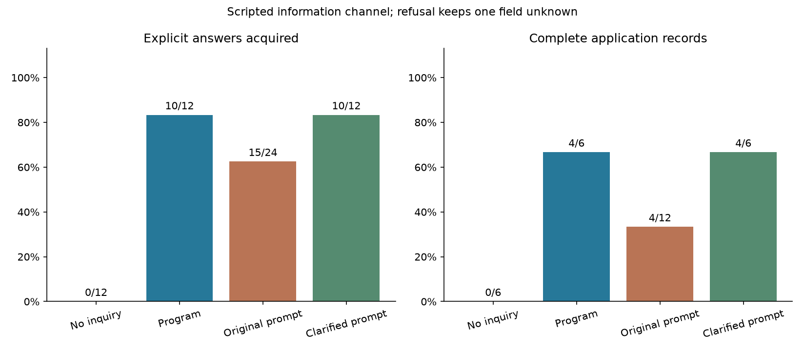
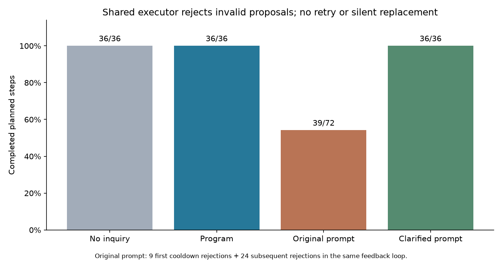
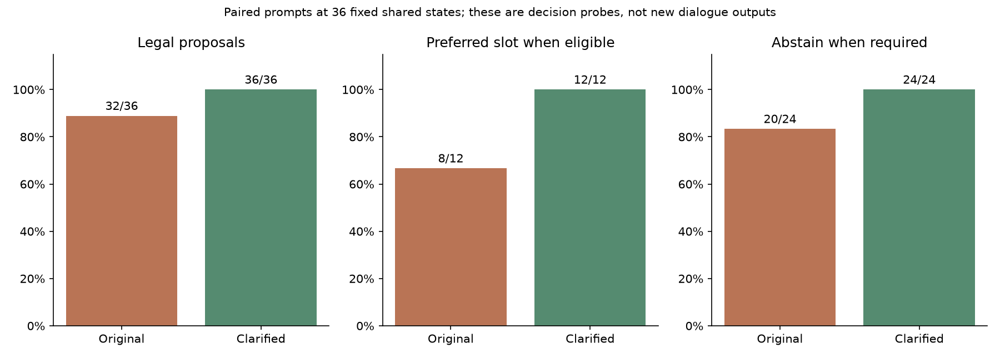

# 从措辞变化到信息行动：共享执行器下的程序追问与提示词决策研究

**研究日期：**2026-11-07  
**研究类型：**合成用户流程、固定共同状态探针与完整流程确认；包含在线模型决策，不含人类受试者。  
**材料：**[复现入口](README.md) · [主方案](protocol.md) · [统计汇总](summary.json) · [接口说明](../../inquiry-policy.md)

## 摘要

人格表达的表面变化不必然产生有用的互动差异。本研究将研究对象转向有明确用途的信息追问：应用提供审核过的问题槽，程序或模型提示词选择一个槽，共同执行器验证权限并交付同一问题。三个合成任务、两组关注偏好构成六个条件，主研究比较程序策略、不追问对照和两次模型重复，共24个六轮流程、144次计划回复。程序交付36/36次，取得10/12项明确答案，完成4/6份双字段记录；原提示决策交付39/72次，取得15/24项答案，完成4/12份记录。其33次拒收均涉及冷却限制，其中9次为各流程的首次拒收，24次为随后相同反馈条件下的连锁拒收。

为区分状态理解与分叉反馈，另取程序流程中的36个共同状态，分别测试原提示和补充精确定义的提示。合法提议由32/36变为36/36，与已定义策略的选择匹配由28/36变为36/36。强化提示随后进行六条完整流程确认，36/36次交付，全部六条可见交互与对应程序流程逐字一致，同样取得10项答案并保留两项拒答。研究共180次API调用、160172个实际总token，产生147条完整对话输出；72次固定状态探针不计为对话输出。

结果支持在既定规则、审核槽及应用确认机制内采用可复算的程序选问，也表明说明充分的提示词在本批任务中能够达到相同可见行为。可确认的局部收益是省去确定性选问所需的模型调用与维持显式执行边界，不能据此宣称模型无法完成该策略，或证明整个框架全面优于传统提示聊天。

**关键词：**人格工程；信息追问；行动选择；用户权限；共享执行器；合成用户；可复现研究

## 1. 研究问题

[前一项多轮研究](../composed_expression_2026_11_07/paper.md)显示，有限句式轮换能够减少相邻文字重复，却没有改善所测自然度和语义重复感。本研究关注答案会改变后续应用记录的信息行动，而非继续增加同义句。

研究问题包括：

1. 程序能否按关注偏好选择一个问题，同时执行等待回答、拒答不重问、禁问、配额、冷却与重启恢复？
2. 在预先固定的用户响应规则下，选问是否实际减少任务中的未知？
3. 将相同规则交给提示词决策，行为差异来自单次状态处理还是互动反馈？明确规则后，差异是否仍然存在？

这里的人格操作化仅涉及任务内的关注优先级与主动性。研究未验证完整角色身份、真实人格结构或长期人际关系。

## 2. 框架与比较对象

### 2.1 问题槽与权限

应用提供`QuestionSlot`，包括稳定ID、主题、完整问题、关注类型、逐字原文证据及信息用途。程序检查字段、证据存在性和状态；应用负责审核问题是否相关、是否夹带建议或未经支持的前提。仅有原文片段不能认证问题语义。

主动槽选问要求当前请求为开放交流、基础动作允许回应，并且没有禁问、同主题待答问题、额度耗尽或冷却阻塞。研究中主动性设为1；存在合格候选时按关注类型权重选最高者，同分保持原顺序：

$$
q_t = \operatorname*{arg\,max}_{q \in E_t} w_{\mathrm{kind}(q)},
\qquad E_t=\varnothing \Rightarrow q_t=\varnothing.
$$

$E_t$为通过当前权限与历史条件的问题槽集合，$\varnothing$表示主动不问。每主题最多交付两个槽问题、同一namespace最多六个，两次槽问题之间要求完成一个同主题普通回复。计数来自确认交付，而非尝试生成；回答、拒答、重新允许追问或重启均不退还额度。原有约定澄清的计数范围与槽问题不同，接口文档另行说明。

问题交付后为`pending`；只有应用确认才能将其变为`answered`或`declined`。已确认答案保存用户逐字原话，不是外部事实核验。模糊回答、沉默及允许继续追问均不自动解决待答问题。模型只选择ID或null，不能创建问题、确认答案、更新权限或重置配额。

### 2.2 三种主方法

| 方法 | 选择过程 | 执行过程 |
| --- | --- | --- |
| 不追问 | 始终提议null | 共同执行器交付普通回应或控制确认 |
| 程序策略 | 按明确规则和关注权重选槽 | 共同执行器验证并原样交付审核问题 |
| 提示词决策 | 模型依据相同规则提议ID/null | 共同执行器验证；非法提议拒收，不替换、不重试 |

提示词获得任务、候选槽、证据、用户要求、有效权限、已交付记录、额度、冷却值和交互历史，不获得程序预选ID或`eligible_ids`。它与程序共享执行器，因此本研究的对照是“提示词决策＋共同执行器”，不是无框架的纯提示聊天。执行器阻止了非法问题交付，不能将被拒收的提议称作用户实际遭遇的越界问题。

null始终是合法的主动弃权，但在本研究主动性为1且有合格槽时，null不符合已定义的主动选择策略。因此合法性与策略匹配分别报告。程序自身定义了匹配参照，程序对参照的匹配不是额外的独立能力证明。

## 3. 方法

### 3.1 合成任务与用户响应

三项任务各有两个需要确认的字段：

| 任务 | 字段 | 固定用户响应规则 |
| --- | --- | --- |
| 报告 | 截止日期、文件格式 | 被问中对应槽后，明确回答“周五”与“PDF” |
| 会议 | 会议日期、人数 | 日期拒答“这个先不说”；人数明确回答“四人” |
| 出行 | 目的地、出发日期 | 首个被问槽先答“还没决定”，保持待答；随后有禁问、倾听与允许控制，第五轮应用确认先前问题的明确答案；另一个槽明确回答 |

出行的明确答案为“苏州”和“周六”。用户响应按槽ID和既定规则产生，不按方法奖励信息。没有问题时不自动透露隐藏答案；拒答和模糊答复不算获得明确答案。所有流程在第三轮后关闭并重开同一Store，保留状态。

两组关注偏好分别为practical优先与detail优先，权重为1和0；`intervention=0`，各流程初始不主动给建议。应用手写内容帧，排除了自动理解和自由措辞生成。原始材料及两个问题的优先顺序见[cases.json](cases.json)、[profiles.json](profiles.json)和[inquiry_config.json](inquiry_config.json)。

所有方法拥有相同初态、响应规则和候选槽。实际问法顺序或弃权不同后，用户回复、状态与历史也会分叉；不能将此描述为完整流程始终拥有相同上下文。

### 3.2 三阶段设计

| 阶段 | 设计与目的 | API调用 | 完整对话输出 |
| --- | --- | ---: | ---: |
| 主研究 | 3任务×2偏好；程序与不追问各一次，提示决策各两次；24条六轮流程 | 72 | 111／144计划步 |
| 共同状态探针 | 固定程序流程的36个输入状态；原提示和强化提示各一次，隔离交互分叉 | 72 | 不计为对话输出 |
| 完整流程确认 | 强化提示在3任务×2偏好上各运行一次六轮流程 | 36 | 36／36计划步 |
| 合计 | 三阶段分别保留方案和结果 | **180** | **147** |

主研究方案在其输出产生前固定。共同状态补测和完整流程确认的问题受到前阶段观测启发，各自的输入、提示与方案在本阶段请求前冻结；它们不是原主研究的重试或事先保留的新实例检验。原提示的失败记录没有被强化提示结果覆盖。

每次调用不重试，各阶段设定请求上限及累计服务异常停止条件。请求模型标识为`deepseek-chat`，temperature为0.3，max_tokens为128；归档的180次响应模型标识均为`deepseek-flash`，finish_reason均为`stop`。请求标识与实际响应标识分别保存。

共同状态补测对每一份相同payload分别使用两种提示，顺序预先随机化。强化提示不改变策略规则，补充说明`gap=0`是有效整数、完成普通回复后才增加冷却计数、非法提议不增加计数，因而重复提议不能越过冷却。两种提示都不看到目标ID或程序筛选结果。

### 3.3 指标与编码

主要指标包括合法提议、共同执行器接受和交付、策略选择匹配、确认答案数、拒答和未知、最终应用记录是否完整以及实际模型调用。任务记录由应用从已确认原话组成，未知保持null，不是模型独立求解的事实答案。

对流程$f$，定义信息取得数与双字段完整性：

$$
U_f=\sum_{q \in Q_f}\mathbf{1}[\mathrm{status}(q)=\mathrm{answered}],
\qquad C_f=\mathbf{1}[U_f=|Q_f|].
$$

因此，尊重拒答的流程可以正确执行却仍有$C_f=0$。完整性表示信息是否齐备，不是整个流程成功与否的统一评分。

两套Codex任务只读取方法映射隐藏的主研究完整轨迹和[编码规则](review_codebook.md)，逐步判断问题相关性、施压与无依据断言，逐流程评价信息推进及1—5分连贯性。未交付步骤在轨迹中明确显示，不能因没有文字而计为一条完整安全回复。两套编码不是人类评价，模板也可能暴露方法。确认阶段没有新增编码，不继承主研究标签。

所有统计均为描述性结果。仅三个合成任务、六轮长度和少量模型重复，轮次及流程不独立，不报告总体显著性或长期人格推断。

## 4. 结果

### 4.1 主研究的信息取得与执行

| 主方法 | 流程数 | 完整交付 | 明确答案／任务字段 | 完整应用记录 | 交付槽问题 | 确认拒答 |
| --- | ---: | ---: | ---: | ---: | ---: | ---: |
| 不追问 | 6 | 36／36 | 0／12 | 0／6 | 0 | 0 |
| 程序策略 | 6 | 36／36 | 10／12 | 4／6 | 12 | 2 |
| 原提示决策 | 12 | 39／72 | 15／24 | 4／12 | 17 | 2 |

程序策略在报告和出行任务的两种关注偏好下均获得两个明确字段；会议任务的日期仍为null，人数为“四人”。两条会议流程的不完整来自规定的拒答，不能据此认定没有尊重用户或执行失败。

不追问组未取得信息，符合本实验封闭信息通道的定义。这说明给定模拟器中“提问—回应—应用确认”产生了下游记录变化，不证明真实用户只会在追问后提供信息，也不能单独构成体验收益。

**图1.** 明确答案和完整记录分别计算。图中强化提示来自后续确认阶段，分母不同且不是主研究的替换结果；拒答保留未知。

原提示在72次决策中有39次合法并交付，与其当时状态下程序策略选择匹配36次。其余合法弃权与非法提议分别记录，不将“合法”混同为“符合全部主动性偏好”。

### 4.2 冷却拒收及反馈链

原提示的33次未交付均为冷却条件下提议了不可问槽。它们分布在9条流程：每条首次拒收一次，共9次；随后同类反馈条件下发生24次进一步拒收。因此33次不是33个相互独立的首次状态错误。

这里的冷却要求在上一问之后先交付一次普通回应。非法槽提议被执行器拒收后，没有普通回复完成，`gap`保持0；后续继续提议槽也不能推进计数。主研究保留这种无自动替换、无重试的反馈过程。该结果指出原提示说明与拒收后的继续方式存在脆弱性，不能直接归因于模型不具备规则理解能力。

**图2.** 未交付发生在共同执行器拒收阶段，不是服务调用中断。执行器守住问题权限，与对话未能推进可以同时成立。

### 4.3 共同状态下的配对探针

| 指标 | 原提示 | 强化提示 |
| --- | ---: | ---: |
| 合法提议 | 32／36 | 36／36 |
| 与已定义策略选择匹配 | 28／36 | 36／36 |
| 应选槽的12个状态：选择匹配 | 8／12 | 12／12 |
| 应弃权的24个状态：选择匹配 | 20／24 | 24／24 |
| 仅冷却阻塞的4个状态：选择匹配 | 0／4 | 4／4 |

null是合法弃权，所以原提示存在合法但不符合本研究主动策略的选择。固定共同状态消除了当次输入的历史差异，强化说明在这批状态上消除了已观察到的不匹配；36个状态仍来自同样的三个任务，不能视为36个独立用户场景。

**图3.** 两提示逐payload配对，分别报告合法性、应问时选择和应弃权时选择。这72次仅产生决策提议，不计入147条完整对话输出。

### 4.4 强化提示的完整流程确认

强化提示在新增六条完整流程中交付36/36次，无非法提议拒收；取得10/12项明确答案、确认两项拒答，完整记录4/6。报告、会议和出行的最终记录均与对应程序流程相同。

进一步按当前用户文字、主动补充原话、助手实际回复及模拟用户回应逐项比较，六条确认流程的可见交互全部与对应程序流程逐字一致。此处报告的是实际文本一致，不是给新输出继承旧评分，也不是新的人类体验证据。

因此，本研究不支持“模型无法实现该追问策略”。强化提示在本批条件中能达到相同可见表现，代价是为六条流程执行36次在线选择调用。程序在相同已定义策略下省去了这些选择调用；应用审核问题、设计槽、核对回答、维护代码及更广义内容理解的成本不在这个比较内。

### 4.5 主研究的Codex轨迹编码

| 主方法 | 连贯性：编码1／编码2 | 相关问题数 | 信息推进：完整／部分／无 |
| --- | ---: | ---: | --- |
| 不追问 | 3.00／2.33 | 0 | 0／0／6 |
| 程序策略 | 5.00／5.00 | 12 | 4／2／0 |
| 原提示决策 | 2.67／2.58 | 17 | 4／7／1 |

两套编码均将实际交付的问题判断为相关；在111条实际回复中，施压与无依据断言均为0个标记。另33项未交付单独保留，不计为完整安全回复。整段连贯性在19/24条流程一致，推进类别24/24一致，逐步问题、施压与无依据断言标签均144/144一致；最后一项分母包含未交付步骤，只表示编码一致性。

连贯性包含任务等待、实际推进与中断体验，不等于人格自然度、角色辨识或人类偏好。原提示的未交付反馈会影响整段评分；这不是在相同可见轨迹下对措辞质量进行比较。强化提示确认阶段没有新增标签。

### 4.6 实际调用与材料核查

| 阶段 | API请求 | 实际总token |
| --- | ---: | ---: |
| 主研究 | 72 | 58651 |
| 共同状态探针 | 72 | 66266 |
| 完整流程确认 | 36 | 35255 |
| 合计 | **180** | **160172** |

总token包含请求与完成部分，来自归档响应元数据，不是仅输出token。全部180次调用正常结束为`stop`，但这不代表所提议的选择全部合法。主研究程序与不追问流程不调用选择模型，所有方法也都不调用内容提取或自由表达模型；不能将这里的零调用推广为完整人格对话产品零成本。

分析脚本的1547项检查核对冻结哈希、实际payload、模型提议、策略重算、执行接受、交付文本、用户模拟原话、应用记录与标签覆盖等材料关系。另有零网络重放：108条已存选择响应仅在完整messages数组逐字一致时复用，30条流程的180个计划步骤及147次完整交付均与归档一致。重放不增加新实验样本或新评价。源码快照及原始失败结果保留；材料核查不认证评价标签的外部真值。

## 5. 讨论

### 5.1 可确认的工程价值

与只改措辞相比，本研究的槽选择改变了获取哪条信息、何时等待和最终记录中哪些字段已知。关注权重控制具体问题的先后，而非仅控制口头语。该机制的行为可以从状态、候选、权限与策略重算，并在共享执行器中对未经授权的选择拒收。

这些能力也可以供提示词策略使用。共同执行器为两种选择方式提供同样的边界，不能把共享部分的保证全部归功于程序选择器。对已经明确、有限且稳定的规则，程序选择提供了无需每轮重新调用模型解释规则的实现；对策略尚未定义清楚的任务，是否适用仍需单独研究。

### 5.2 不能从原提示失败推出模型能力上限

主研究的冷却反馈放大了首次错误。共同状态探针与完整流程确认共同说明，更精确的说明能够在本批任务中消除差异。若只报告主研究的39/72交付，而省略强化提示的36/36，就会高估程序相对提示词的优势。

强化提示是受到已有结果启发的修订，确认阶段仍使用同样的任务和用户模拟器，因此不构成保留集泛化证据。这里确认了“能够做到”，没有确认对任意任务、不同模型版本或长期互动都能稳定做到。

### 5.3 权限、未知与任务完整性需要分开

程序不能为了填满记录而把拒答当答案，也不能把允许继续追问理解为待答已解决。会议任务保留日期未知，是正确尊重拒答的结果；出行任务在模糊回答后等待应用确认，也不应被视为没有主动性。

应用拥有问题语义审核与答案对应确认的责任。原文存在、状态为answered或字段已填，并不等于现实事实被独立核实。这个边界是系统职责，不是对模型普遍正确性的声明。

## 6. 限制与结论

本研究只涵盖三个合成任务、两组关注偏好、六轮流程和一个服务接口。问题槽、内容帧、用户响应及确认规则由研究者提供；没有检验自动槽设计、自然语言答案理解、真实用户体验、一般事实求解、长期人格发展或完整传统聊天方案的优劣。全局配额等机制的存在不意味着每一种边界都已在本批流程中充分激活。

不追问组无法取得模拟器隐藏信息部分源于实验定义，不能据此推断真实世界的信息收益。Codex辅助编码也不能替代人类评价。在线重复可能受远端模型、缓存和采样影响，冻结源码和输入不保证未来响应逐字相同。

本研究支持将明确的信息行动实现为可复算、带权限和交付状态的组件；同时保留一个必要结论：强化提示也能在本批条件下实现相同可见行为。下一步价值判断应围绕实际应用中规则维护、人工确认成本、任务泛化和真实互动体验展开，而不把有限状态机的成功扩大为“模型做不到”或“完整人格已经工程化”。

## 材料与复现声明

三阶段方案、输入、冻结源码、原始请求与响应、账本、匿名轨迹、两套主研究标签和三幅图见[README](README.md)。主研究失败不被后续结果覆盖；探针不混计为对话，确认输出不沿用旧编码。所有统计可离线重算；在线脚本会产生新的付费调用，新文本应另行编码。认证信息不属于公开研究材料。
