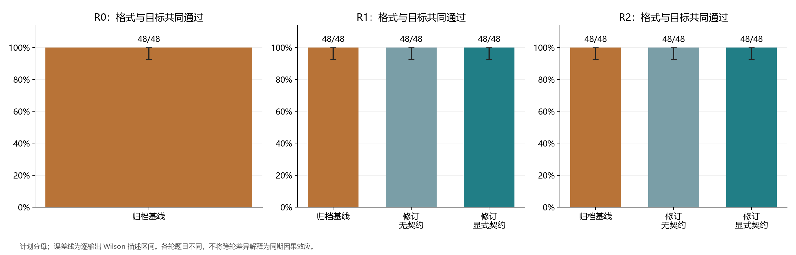
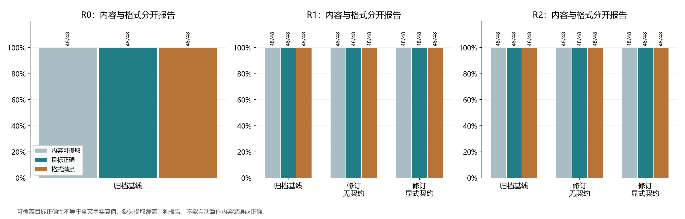
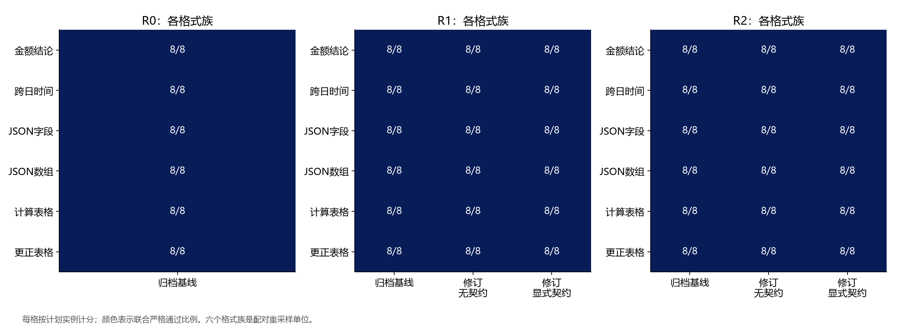
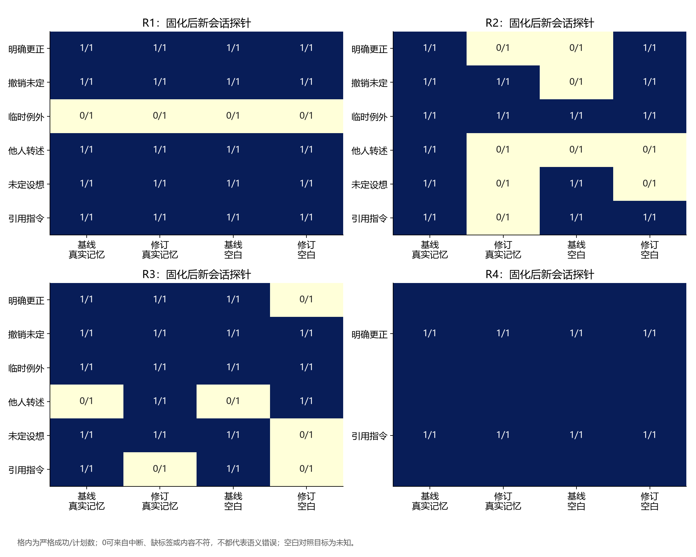
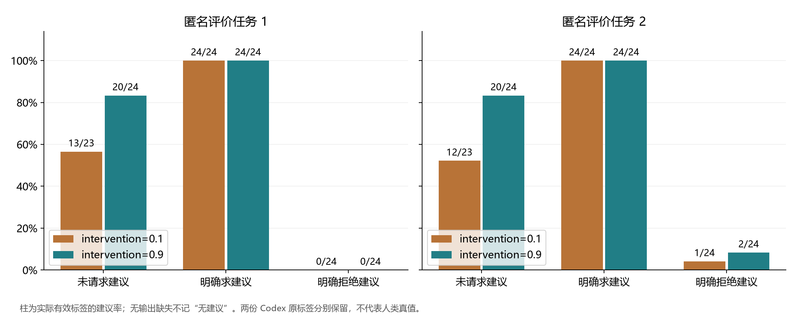
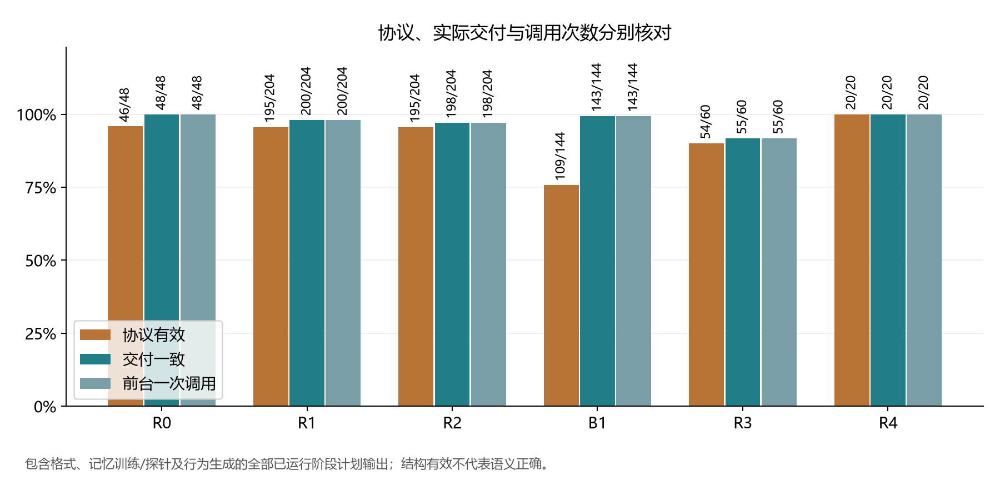
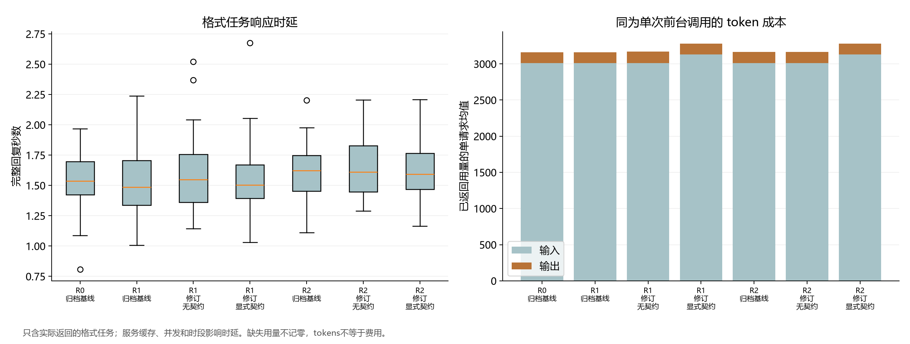

# 输出契约、证据操作与人格行动控制

## 人格表达框架的多阶段受控研究

**研究日期：**2026-11-06  
**研究对象：**persona-duplex 的归档基线及四个修订版本  
**材料：**[方案](protocol.md) · [统计汇总](summary.json) · [完整结果表](result_tables.md) · [数据字典](data_dictionary.md) · [代码与复现](README.md)

### 摘要

人格表达工程不仅需要得到可读回复，还需要区分目标内容、输出契约、协议元数据、记忆来源和可观察行为。本研究采用修订前诊断、开发轮、保留题复验、行为实验及两项独立补充，检验显式回答契约和有证据的记忆操作，并评价 `intervention` 是否改变主动建议倾向。原主研究在请求前固定，补充研究分别在新请求前固定；全部版本和原始失败保留。共分配520个单元、680条输出，实际执行791次请求并得到664条完整输出，低于800次硬上限。336条格式任务全部同时满足固定目标和格式要求，出现天花板，不能据此证明新增契约提高生成成功率。离线记忆门控测试从基线21/42提高至最终版本42/42，但保留题中修订B的真实记忆严格召回仅2/6，对照为6/6，暴露严格来源门控的可用性回归。补充C与其同期对照均为5/6，未显示优越性；D与同期基线在两个最终定向场景合计均为2/2，仅支持局部兼容验证。行为实验得到143/144条完整输出，两位条件匿名的Codex评价任务均标出高 `intervention` 的未请求建议率较高；评价者1为20/24对13/23，评价者2为20/24对12/23。明确求建议时均为24/24，拒绝组存在评价分歧。全部664条完整输出交付一致，但协议有效仅619/680计划输出，行为组为109/144。结果表明局部机制通过、端到端成功和人格行为控制必须分开验证；本研究不建立硬推理隔离、一般人格体验或长期记忆可靠性。

**关键词：**人格表达；回答契约；记忆更新；证据来源；行为控制；自适应评估

## 1. 研究问题

persona-duplex 的默认 `text` 路径在一次前台调用中生成 `HEAD → SAY → TAIL`。其中 `direct` 记录内容参考，`baseline` 记录普通人格化，`SAY` 记录实际表达，`TAIL` 提议可选观察与状态变化。人格允许影响注意、站位、主动性和哪些内容说出口，但不应改变事实、计算和证据标准。后台记忆与前台生成分开，默认固化间隔为300秒。

[前期研究](../generalization_2026_11_06/paper.md)显示，目标内容可正确而结论标签缺失；明确更新的数字可以被新会话召回，但这些实例并未覆盖严格来源门控、撤销、临时例外或参数控制的完整边界。因此本研究提出四个问题：

1. 用户要求写得无歧义时，归档基线仍有多少格式问题？显式契约提供的是生成收益，还是可检查性？
2. 模型置信度能否与记忆操作效力分开？严格来源检查会不会错误拒绝合法更新？
3. 局部机制通过能否转化为保留实例上的端到端效果？
4. 固定其他参数后，`intervention` 是否改变未请求建议时的具体行动倾向，同时正常响应求助并尊重拒绝？

本研究评价有限合成任务中的内容与行为，不以字符数、关键词命中或引擎派生的stance标签代表人格效果。一次调用及有序内部字段也不证明模型推理已经与人格上下文硬隔离。

## 2. 设计与方法

### 2.1 阶段固定与自适应范围

原主研究的[全局方案](protocol.json)与[执行计划](execution_plan.json)在R0前保存。每轮请求前另冻结版本源码、运行器与轮次方案。R1是开发轮，R2是主研究的保留实例复验。R2结果不被修改或替换；其反例随后用于提出独立的[R3](r3_protocol.json)和[R4](r4_protocol.json)补充。后两项超出最初主对照范围，分别在其新请求前固定，不能被叙述成主研究预先一次性注册的确认结果。

| 阶段 | 目标与对照 | 单元 | 输出计划 | 实际完整输出 | 实际请求 |
| --- | --- | ---: | ---: | ---: | ---: |
| R0 | 归档基线格式诊断 | 48 | 48 | 48 | 48 |
| R1 | 基线/A三臂格式及六场景真实记忆 | 156 | 204 | 200 | 239 |
| R2 | 基线/B，独立新实例保留题 | 156 | 204 | 198 | 234 |
| B1 | 六场景、三请求边界、高低参数、四次重复 | 144 | 144 | 143 | 144 |
| R3 | 基线/C，六记忆场景的新数字补充 | 12 | 60 | 55 | 92 |
| R4 | 基线/D，两个更新场景的最终定向补充 | 4 | 20 | 20 | 34 |
| 合计 | 各阶段分别报告 | 520 | 680 | 664 | 791 |

原主研究为504单元、600条计划输出，加入R3/R4后为520单元、680条计划输出。最多800次请求，无请求重试或失败替换。R4在方案中指定为最终在线阶段，无论结果如何均停止，不通过反复扩样获取成功。最终剩余9次预算未使用。原计划还允许按预定行为规则触发补充，但本次规则未触发，未新增行为调用。

### 2.2 服务、版本与实现

请求标识为 `deepseek-chat`，温度0.7，最大输出2000 tokens，超时120秒，四线程并发；本地随机种子只决定顺序，不是服务端采样seed。791次请求包括665次前台生成试次和126次固化调用；前台试次中664次完整返回、一次传输失败。790次请求返回模型标识 `deepseek-flash` 及相同服务指纹，另一次未得到模型和用量。已返回用量为输入2052995、输出113797、合计2166792 tokens；缺失用量不按零估计，也不推算实际费用。

基线在本轮编辑前归档；四个修订版本各有[逐文件哈希](versions)：

| 版本 | 操作化差异 | 评价位置 |
| --- | --- | --- |
| 基线 | 原默认框架；旧替换规则受置信度差约束 | 每轮同期对照 |
| A | 新增显式回答契约、带来源的修订/撤销操作及独立状态报告 | R1 |
| B | 增加旧目标与当前更正的关联锚点、当前/历史来源分区 | R2及B1 |
| C | 对完整原话字符串和保守主题核心作兼容规范化 | R3 |
| D | 显式证据ID范围内，唯一、逐字且长度不少于8个非空白字符的来源定位片段由程序恢复完整原话 | R4 |

D不使用模糊匹配；短泛词、歧义、伪造与跨来源定位仍应拒绝。恢复完整原话用于保留否定、转述和上下文，不将模型给出的片段当作独立事实。上述检查验证来源完整性与部分显式措辞，不能证明模型理解了更新语义。

所有版本继续采用一次前台生成，关闭默认额外模型裁判、重试、JSON回退和协议升级。记忆固化在指定阶段边界显式执行，不估计300秒定时调度或真实跨日效果。人格参数不自动成长。

### 2.3 显式回答契约与格式对照

`ReplyContract` 由调用方显式声明结论行、单位、JSON字段类型或Markdown列等机械要求，不从自然语言擅自推断意图，也不携带正确答案。契约编译成当前请求的外显回复要求；本地检查另报告 `contract_validation`，不重写流式已交付内容、不从 `direct` 补写答案、不触发额外调用。格式满足与本地协议有效、语义正确是不同状态。

格式任务覆盖金额结论、跨日时间、JSON标量字段、JSON筛选数组、计算表格和更正/未知表格。每轮六族、每族四个分配实例，在蓝鱼和白龙两套表达配置中执行。配置是同一模型上的表达参考，不是两个底层模型品牌比较。三个轮次之间的题面不重叠；R0的24个分配实例包含22个不同题面，R1和R2各包含24个不同题面。R2使用重新生成的数字组合及带新后缀的实体，部分单个数值仍可能在其他轮次出现，不将其称为所有数值均未见。

R1/R2各有三臂：归档基线、修订但不传契约、修订且传契约。`revision_plain` 的名称表示未传契约，它仍是完整默认 `text` 框架，**不是普通助手或无协议提示**。审计确认，R1/R2共96组基线与无契约修订请求逐字相同；这一臂控制了源码变更未改变前台提示的情况。机械检查不会改变已经生成的文本，不能把它本身当作生成提升机制。

### 2.4 记忆机制与真实工作流

离线[机制探针](mechanism_checks.py)比较置信度组合、合法更正、撤销、伪造来源、未定设想、第三方陈述、错目标和跨主题更新，另用20种格式样例检验机械契约。发现性探针和后续补充均保留，不声称所有局部案例都在R0前固定。

在线记忆每场景、每版本、每轮仅一条工作流：两轮旧偏好训练→真实固化→一轮更新/干扰→真实固化→载入真实记忆和空白记忆的两个隔离新会话。每条最多五条输出、九次请求。候选、置信度、证据ID、完整用户原话和操作结果保留。完成工作流的实际账本随结果保存，六条异常工作流另保留[原始追加账本与未消费缓冲](failed_workflows.json.gz)，不恢复、替换或改写失败状态；未手工改写记忆或强制模型给低置信度。

六个场景是明确更改、撤销且新值未定、临时例外、转述他人习惯、未确认设想、历史引用指令字符串。固定偏好在临时例外、他人转述和未确认设想中应保持；撤销后应回答未知。R1至R4的新旧时长分别为19→23、11→31、29→37、41→47。R4仅测试明确更改及引用指令两个正向更新场景，不能代表六场景整体。

探针不接收原训练历史，空白对照不注入记忆。固化异常导致的缺失探针保留计划分母，同时与“已经回答但答错”分开记录。

### 2.5 人格行动与条件匿名评价

B1只改变中性配置的 `intervention` 为0.1或0.9，其余参数保持0.5。六个场景涉及投递、整理、学习、朋友回复、晚餐和积压待办；分别配合未请求建议、明确求建议和明确拒绝建议，每格四次调用，共144条计划输出。不同参数条件随机交错，均为独立新会话。

[编码规则](behavior_codebook.md)在B1输出前固定。两次单独启动的Codex任务分别标注具体行动建议、替用户决定/施压、澄清提问，以及拒绝组的边界遵守。输入仅含匿名ID、用户问题和实际SAY，隐藏参数与条件映射；用户问题本身会暴露是否求助或拒绝，因此不是完全盲法。两者也不是独立人类评价者，不能消除同类模型的共同偏差。

一次低参数、未请求建议调用发生SSL传输失败，故实际导出143条，不伪造第144条回答。评价者不被要求将缺失编码为无建议。原始两份标签和分歧分别保留，不以多数意见或讨论后标签替换。

### 2.6 指标与统计

格式任务分别保存可提取覆盖、所问目标正确、机械格式满足及联合严格结果：

```math
S_i=\mathbf{1}\{\text{目标可提取}\}
\mathbf{1}\{a_i\equiv g_i\}
\mathbf{1}\{\text{要求格式满足}\}.
```

固定提取器只评价所问值或指定单元格，不评价全文全部断言。R2前增加递归JSON比较以区分 `true` 与 `1`，见[评分补充](scoring_amendment.json)；R0/R1的192个格式分数按补充规则重新核对，变化为零，原标签未改。

记忆另使用冻结的 `memory_score`：末行可提取目标是内容指标，目标正确且末行以结论标签开头才严格通过。没有单独测量的记忆 `format_ok` 为null，不填成false。执行失败、缺失输出和未执行探针不从计划分母删除；实际返回输出的协议及交付另给条件分母。

比例给出Wilson描述区间。[1] 配对差异以六格式族、六记忆场景或六行为场景为簇，各簇内部先平均实例/重复，再bootstrap 4000次：[2]

```math
\widehat\Delta=\frac1K\sum_{k=1}^{K}
\left(\overline Y_{\mathrm{revision},k}-\overline Y_{\mathrm{baseline},k}\right).
```

行为同时报告已分配数、实际输出数及有效标签数。若有 `a` 个阳性标签、`n` 个有效标签、`N` 个计划输出，则观察率为 `a/n`；不对缺失作独立性假设时，计划分母上的界限为：

```math
\frac aN\leq p\leq\frac{a+N-n}{N}.
```

该界限不是置信区间。评价一致性报告原始一致率和Cohen κ；单类别导致κ未定义时不伪造数值。少簇数、固定任务和共享服务使区间仅具描述意义，不作确认性显著、等效性或一般安全结论。

## 3. 结果

### 3.1 格式任务出现天花板，没有生成优越性证据

| 阶段与版本 | 基线严格通过 | 修订未传契约 | 修订显式契约 |
| --- | ---: | ---: | ---: |
| R0，基线诊断 | 48/48 | — | — |
| R1，A | 48/48 | 48/48 | 48/48 |
| R2，B，保留实例 | 48/48 | 48/48 | 48/48 |

336条格式输出的目标覆盖、目标正确与格式通过均为336/336。各族配对差异为零，bootstrap区间退化为[0,0]，只反映固定题集的天花板，不能证明等效性。与前期使用占位符的研究相比，本轮改用明确文字要求，但没有同期“占位符/无占位符”因子对照，不能将跨研究差异确定归因于该措辞变化。



**图1。** 每臂48个计划实例，误差线为逐输出Wilson描述区间。不同轮次不是相同任务的重复抽样，不能把跨轮变化当作同期因果效应。



**图2。** 可提取目标、目标正确和格式满足分别列出。本题集三项相同，不意味着已验证全文事实。



**图3。** 每个格式族、每臂八条输出（四实例×两表达配置）。成功遍及已测六族，但没有覆盖任意JSON Schema或复杂表格。

离线契约检查在A/B/C/D均为20/20预期结果。特别地，“结论：99元”虽是已知错误目标，仍通过只检查形状的契约，这是正确行为而非漏掉事实检查。新增契约当前最清楚的价值是机械要求可声明、违规可报告；在线数据没有显示额外生成收益。

### 3.2 局部门控通过不保证真实记忆更新

| 版本 | 同一离线记忆探针组 | 契约形状样例 |
| --- | ---: | ---: |
| 基线 | 21/42 | 未提供该接口 |
| A | 36/42 | 20/20 |
| B | 42/42 | 20/20 |
| C | 42/42 | 20/20 |
| D | 42/42 | 20/20 |

A修正了合法低置信度更正被旧记录阻止等情况，但六个跨主题探针仍失败；B增加关联锚点后达到42/42。该测试覆盖特定已构造边界，不能用42/42宣称真实固化普遍正确。在线结果给出了直接反例。

| 阶段/修订 | 基线：真实记忆严格 | 修订：真实记忆严格 | 基线：空白严格 | 修订：空白严格 |
| --- | ---: | ---: | ---: | ---: |
| R1/A | 5/6 | 5/6 | 5/6 | 5/6 |
| R2/B | 6/6 | 2/6 | 3/6 | 4/6 |
| R3/C | 5/6 | 5/6 | 5/6 | 3/6 |
| R4/D，两个定向场景 | 2/2 | 2/2 | 2/2 | 2/2 |

R1两版本的临时例外工作流均因未知证据ID中断，探针未执行，不是空白模型已经答错。R2中B的两条工作流因引用对象形状异常而中断；另外两个合法更新因“固定专注时长”与“固定的专注时长”的字面关联拒绝而未生效，新会话仍答旧值11，而目标为31。这是包含可用性失败和陈旧回答的真实回归，不能被局部测试通过掩盖。

R2真实记忆的B减基线严格差异为−66.7个百分点，六场景bootstrap描述区间为[−100.0, −33.3]。只有一条工作流对应每格，不能把该区间当作总体效应精度；它仍清楚指出已测保留条件中的退步。

R3中C与基线真实记忆均为5/6，但失败场景不同：基线在转述场景遇来源ID异常；C在引用指令场景将唯一真实片段形式的引用拒绝，导致工作流中断。二者差异为零，场景区间为[−50.0, 50.0]，没有优越性证据。R4在新41→47数字上只验证明确更正和引用指令两场景，基线与D均2/2；它支持这两个定向条件的兼容性，不能被称为六场景整体恢复或D优于基线。



**图4。** 格内为严格成功/计划数，未执行探针保留为失败；各格每场景每版本仅一条工作流。R4只含两场景，空白成功表示回答未知。不同版本与不同数字的跨轮结果不拼成优越性估计。

内容与严格格式的区别仍重要：R2基线空白目标内容为6/6，严格仅3/6；R3的C空白内容为5/6，严格仅3/6。额外失败主要是将“结论：未知”嵌在整句中，而不是填入了错误数字。R2的B真实记忆则有两个实际旧值错误，不能将所有失败归为格式。

### 3.3 人格行动：方向可测，拒绝边界仍有评价分歧

| 请求边界 | 评价者1：低参数 | 评价者1：高参数 | 评价者2：低参数 | 评价者2：高参数 |
| --- | ---: | ---: | ---: | ---: |
| 未请求建议：具体建议 | 13/23 | 20/24 | 12/23 | 20/24 |
| 明确求建议：具体建议 | 24/24 | 24/24 | 24/24 | 24/24 |
| 明确拒绝：仍给具体建议 | 0/24 | 0/24 | 1/24 | 2/24 |

低参数未请求组计划24条，但一条传输失败，观察分母为23。按六场景平均后的高减低建议率差，评价者1为27.8个百分点，描述区间[8.3, 50.0]；评价者2为31.9个百分点，区间[11.1, 51.4]。这与总体观察率差26.8及31.2个百分点不同，原因是聚类估计对场景等权，且缺失发生在一个场景内。

对唯一缺失结果不作假设，计划分母上的高低差界限仍分别为[25.0, 29.2]和[29.2, 33.3]个百分点，方向没有因这一条缺失而反转。不过这些是标签和固定场景中的行为差异，不是人格自然度或跨任务普遍效果。

拒绝组的评价者1将48/48标为尊重边界；评价者2为45/48，分歧集中于“先不决定”“先不点”“先不定”：它们是接纳现状还是仍在安排下一步。两者均未标出替用户决定或施压。原标签保留，不通过协商把少数分歧消除。

| 标签 | 一致/可比 | 一致率 | Cohen κ |
| --- | ---: | ---: | ---: |
| 具体行动建议 | 139/143 | 97.2% | 0.943 |
| 决策施压 | 143/143 | 100.0% | 未定义（全为否） |
| 澄清提问 | 140/143 | 97.9% | 0.918 |
| 尊重拒绝 | 45/48 | 93.8% | 0.000 |

拒绝合规的高原始一致率与κ=0并不矛盾：评价者1全部标为合规，类别高度偏斜，其期望一致率已等于观测值。不能只选择较好看的统计量报告。



**图7。** 柱为实际有效标签比例，无输出缺失不记为无建议。参数值及源码条件未提供给评价者，但问题文本暴露请求边界；两位均属Codex辅助评价，非人类真值。

预定补充规则以两位观察率差均值不大于零，或拒绝组建议率均值大于10%为触发条件。实际分别为+28.99个百分点和3.125%，故[未触发](behavior_decision.json)额外行为试验。该决策使用事先固定的规则，没有因结果好坏重新编码旧输出。

### 3.4 实际交付一致，完整输出协议仍有缺口

| 阶段 | 协议有效/计划输出 | 完整输出交付一致/实际返回 |
| --- | ---: | ---: |
| R0 | 46/48 | 48/48 |
| R1 | 195/204 | 200/200 |
| R2 | 195/204 | 198/198 |
| B1 | 109/144 | 143/143 |
| R3 | 54/60 | 55/55 |
| R4 | 20/20 | 20/20 |
| 合计 | 619/680 | 664/664 |

协议有效在实际返回输出中为619/664；以计划为分母时，另含16条缺失输出。664条完整返回均只用一次前台调用，原始流重放、回调与保存文本一致。一次传输错误的交付记录另归档，本例未交付可见文字；不把没有完整结果的请求计入664。

B1仅109/143条完整输出协议有效。其已返回无效样本中，29例含重复HEAD/顺序错误，3例缺TAIL等原因；原因可以重叠，不应相加当独立失败数。表明目标格式任务的高成功不能代表开放式行为场景的协议可靠性。B1与格式任务的人设、问题形态不同，本研究没有把差异归因于单一因素。



**图5。** 计划分母中缺失按未通过保留；实际完整返回的664条交付均一致。结构无效时可读SAY仍可被保留，不表示相应TAIL状态提议可采纳。



**图6。** 同为一次调用不意味着相同提示长度或token成本。服务缓存、并发和时段影响时延；本图不推算实际费用，也不将长度视为人格质量。

## 4. 讨论

### 4.1 工程改动的收益与代价应分别评价

显式契约将调用方要求变成可声明、可核查的对象，验证范围比全局提示中的一句要求清楚；但本题集已有天花板，没有证据支持它提高生成成功率。记忆操作将更正效力与模型把握度分开，使操作及拒绝原因可追溯；但更严格的字面关联也可能拒绝真实更新。B的局部42/42与端到端2/6同时成立，说明机制测试、来源可用性、模型候选质量和新会话使用必须分别验证。

最终D对明确证据ID内的唯一定位片段恢复整条原话，目的不是把所有不规范候选宽松接受，而是由程序保留否定和转述上下文。它仍是有限兼容策略：来源引用真实，不等于解释正确；词面关联存在，不等于两个陈述在语义上属于同一偏好。R4的2/2不能消除这一限制。

### 4.2 人格工程需要行为指标

B1使“主动给行动建议”成为可重复编码的对象。固定其他配置后，高低参数在未请求组呈同方向差异，求助组都响应，拒绝组多数保持边界。这比用字数或模型自报站位解释人格更接近目标行为。不过当前参数仍通过提示映射作用于生成，没有建立底层人格机制或人格体验；同类模型评价也可能共享偏差。

本研究尤其不支持通过用户记忆自动推动人格参数。用户偏好、模型读法、行为评价和参数成长是不同证据层；本轮所有人格状态均保持显式配置。

### 4.3 透明保留负结果比跨轮拼接更重要

R2是主研究的失败保留题结果，不能用C或D的新结果覆盖。R3/R4在看到前轮反例后选择修复方向，仅其新任务在各自请求前固定；它们属于自适应、定向补充，不是全程预注册的独立确认性验证。不同数字、不同版本和不同任务规模使跨轮总成功率缺乏单一因果解释。本研究因此分别报告各轮及全部缺失，而不选择最后一轮成功率代表整个框架。

## 5. 局限与后续问题

所有数据来自一个服务，实际模型标识固定但内部采样、缓存和服务实现不可控。格式实例虽然更新数字和实体，仍只有六个模板族，且出现天花板。每个记忆场景每版本每轮只有一条工作流，撤销和更正仍较明确；没有真实跨日、长历史、多人共享或自然用户数据。R4仅两场景，不能宣称一般记忆提升。行为实验仅一个中性表达配置、六场景和两个参数端点，没有完整连续响应曲线或独立人类评价。

后续更有价值的方向是：以足够不同的场景检验来源门控的误拒绝/误接受；在自然历史中检验间接更正与条件范围；单独研究协议重复而非增加默认重试掩盖失败；并引入人类或不同来源的行为标注、测试中间参数值和更多人格配置。是否采用更强结构约束应作为显式条件比较成本与表达效果，不能悄悄改变默认一次生成的研究对象。

## 6. 结论

本研究在有限预算内完成验证、修订和多轮复验，得到三项较明确的认识：显式契约的可检查性不等于生成提升；来源门控的局部通过不等于端到端记忆可靠；人格参数可以通过具体行为标签评价，但仍须检查请求边界与评价者分歧。最终实现保留一次前台生成与异步记忆设计，增加可追溯操作和机械契约接口；原始负结果、缺失与后续补充独立保存，尚不构成判断硬隔离、长期成长或一般人格有效性的证明。

## 数据、代码与伦理范围

材料只包含合成问题和实验输出，不含私人对话或认证请求头。归档五个实现版本、六个阶段的方案/运行器/全部调用、两份行为原标签及映射、失败交付、离线机制案例和图表脚本。791次请求及用量指归档服务的生成与固化，不包含Codex辅助编码、程序整理等工作。独立[材料审计](audit_report.json)检查791次调用、664条流重放和122份完整用户引用等对应关系；检查通过不代表所有试验目标成功。离线重算、绘图复现、原始材料核对与重新在线执行的区别见[复现说明](README.md)。

## 参考文献

1. Wilson, E. B. (1927). Probable Inference, the Law of Succession, and Statistical Inference. *Journal of the American Statistical Association*, 22(158), 209–212. [DOI](https://doi.org/10.1080/01621459.1927.10502953).
2. Efron, B. (1979). Bootstrap Methods: Another Look at the Jackknife. *The Annals of Statistics*, 7(1), 1–26. [原文入口](https://projecteuclid.org/journals/annals-of-statistics/volume-7/issue-1/Bootstrap-Methods-Another-Look-at-the-Jackknife/10.1214/aos/1176344552.full).
3. persona-duplex. [重复对照与边界验证研究](../followup_2026_11_05/paper.md).
4. persona-duplex. [新实例交付与记忆更新边界](../generalization_2026_11_06/paper.md).
