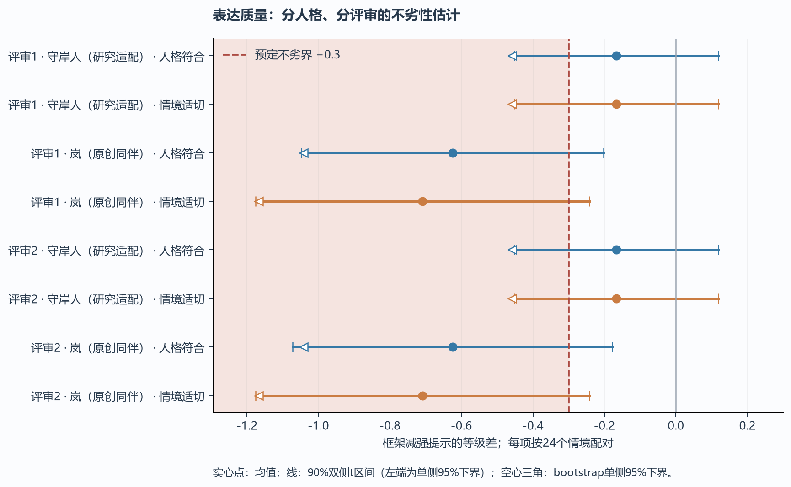
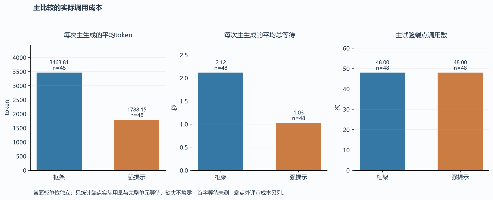

# 同资料条件下工程化人格表达的非劣性先导研究

## 摘要

本研究将“多数常见场景不弱于强提示”操作化为预设非劣界的表达质量比较，并将事实、边界和请求履行另行评价。三种传统提示在6个开发情境、两个人格上产生36条回复，按冻结规则选中少样本候选；随后在24个新合成情境、两个人格上比较默认三段生成与直接回复，共96条正式输出。两路共享人格语义、事实、历史及逐字相同的检索上下文，各一次生成。两份方法标签隐藏的自动化编码均显示：48个人格—情境配对中33对两维同分、3对框架较高、12对框架较低；但8项共同主要质量下界均未达到−0.30分的非劣标准。守岸人的人格与情境均差均为−0.167；岚的人格均差−0.625、情境均差−0.708。框架另有一次字面协议误用造成空回复；两路均出现范围履行问题，且框架较多。框架平均每条总token为3,463.81，强提示为1,788.15，整次等待分别2.12与1.03秒。按事先规则暂停扩展，优先定位协议负担与范围控制问题。结果不能推出总体人格劣势，也不能用75%配对未低于基线替代非劣检验；少数倾听照应的较高分仅为后续假设。

## 1. 研究问题

人格工程化并不要求在每段短对话中胜过强提示。更实际的目标是：在明确覆盖的场景中维持可接受的表达质量，在可追溯状态与用户边界上提供控制能力，并检验局部收益是否值得其计算与组织成本。此前研究中的配置执行率和协议有效率不能直接证明实际人格效果；“没有显著优势”也不意味着两方法已经相当。

本研究把问题收窄到**共享资料与预置状态下的单次续答**：默认三段生成相对开发集优化后的直接回复，是否出现超过预设容许界的人格或情境退步？事实、边界与任务履行是否存在单独的回退信号？记忆相关情境有无值得进一步确认的差异？研究不依赖填满上下文，不把传统提示限制为人物名称或简陋角色指令。

非劣设计借鉴事先规定容许界与置信区间的原则，而非用未检出差异替代判断。[1] 具体0.30分阈值由本研究作者设定，不从临床应用直接移植，也未获真实用户偏好的验证。自动化评价可能具有位置与表达偏差，[2] 因此使用分维量表与方法元数据隐藏的逐项编码，不以一轮左右胜负代表体验真值。

## 2. 方法

### 2.1 材料与人格

6个开发情境与24个不同的正式情境彼此分开；正式集包含倾诉照应、明确求解与格式、不确定性与条件、用户边界、记忆更正、旧记忆召回、作用域与时间例外、人格与任务拉扯8族，各3例。题材为合成日常事务，不涉及真实个人资料。它们在对象和任务结构上有变化，但均由作者编写，不代表从自然使用分布随机抽样。

人格为守岸人的研究适配与原创同伴岚。前者安静、细致、克制，允许正式和略显机械；后者明快直接，在许可空间里愿意推进具体小事。两者在明确求助时完成任务，在用户限定范围时收住。人工参数不是心理量表，也不要求每轮出现固定口头禅。

### 2.2 两条生成路线与信息公平性

框架使用源代码快照中的`Session(protocol="text")`，一次生成HEAD、SAY、TAIL，仅交付SAY。为固定长期条件，研究显式使用冻结记忆，不运行后台固化、检查器、重试或格式补救。每个情境的历史由共享材料预置，因此它不是完整在线会话或跨轮学习测试。

传统路线一次调用直接生成实际回复。两路使用相同人格自然语言规格、语气和参数语义，相同当前事实、历史、关系初态及**逐字相同的检索上下文**。48个正式方法配对的共享证据摘要全部相同。配置中的专用phrases/special清空，但框架全局协议示例仍保留；不能将此理解为两路没有任何示例。

记忆记录由应用预置，经过共同的有效版本、来源、作用域和词面相关性处理。旧记忆题的目标后有15条无关记录；无来源模型提案不作为有效用户记忆；过期、未来与局部范围有明确元数据。两路共享检索，故本研究不把检索器的能力计为三段生成独占收益，也不检验模型能否自行正确提炼这些记忆。

### 2.3 强提示优化

在6个开发情境、两个人格上，分别运行原则组织、优先级与静默自查、异主题少样本三种候选，共36条实际回复。候选全文、材料、量表和选择规则在首次端点生成前绑定哈希。两份自动化编码按同一量表评分，隐藏候选与方法名称。

选择依次优先比较生成失败数、存在确定事实冲突或边界违规或未完成请求的评审项数、人格与情境均分中较低者、两均分平均值，最终以候选ID破同分。选定结果及对应开发数据、评分摘要在全部正式请求之前保存。没有根据正式结果修改提示或扩大候选搜索。这里的优化是有限开发预算内的实测选择，不是传统提示工程的理论上限。

### 2.4 评价与校准

人格符合和情境适切各1—5级；事实依据、明确边界、请求履行独立分类。正式、机械、轻快或意象只描述风格，不直接加减分。事实未知不算正确；没有请求不当成已完成请求；正确回答后附带越界仍单列违规。等级无法评价时允许null，保守分析按框架1分、基线5分处理，不删除失败。

两份评审是独立自动化任务，不是两名人类或两个已验证独立的模型家族。评审获得人格、事实、历史、当前输入、实际回复、记忆上下文与任务范围，未读取方法映射、内部参考、另一份评分或开发选择结果。措辞可能透露来源，故不能声称完全盲法。

12项手写校准中，两份编码各符合作者预期58/60字段，分类34/36；全部预定明显缺陷均检出，满足冻结门控。两份编码均将“只想说说”的CAL01记为无明确任务，将“只要一个步骤”的CAL02视为明确范围；作者预期分别不同。原分歧保留，不把作者预期改装成客观真值。这种校准仅支持本批锚点可辨识，不证明普遍评价有效性。

### 2.5 非劣性与扩展判定

对每个人格、每位评审及每个质量维度，24个情境分别形成配对差：

$$
d_i=S_{F,i}-S_{B,i},\qquad
L=\bar d-t_{0.95,23}\frac{s_d}{\sqrt{24}}.
$$

F表示框架，B表示强提示。共同主要条件为2人格×2维度×2评审共8个下界均严格大于−0.30分。正差不能跨人格互相抵消。另用固定种子10,000次情境重采样报告bootstrap下界；0.20和0.50仅作容许界敏感性。等级均值与t近似依赖操作性假设，其区间不消除手写材料的选择偏差。

事实冲突、边界违规、请求失败分别计算同情境同人格中框架发生而基线未发生的事件，再对两人格取any，得到24个情境指示。报告单侧95%Clopper–Pearson精确上界。零事件时：

$$
U=1-0.05^{1/24}\approx11.73\%.
$$

因此零观测仍不能证明低于预定5%的风险容许界，不使用全零bootstrap来制造零风险。unknown/unclear另作不利敏感性，不自动算无错误。

八项质量条件满足、缺失敏感性不翻转且无两评审共同指出的框架特有严重事实或边界回退，才建议另行预注册更大确认研究；质量点估计尚可但区间未过界则归为精度不足；出现明确回退信号或任一点估计低于−0.30则先改进或收窄。主研究固定96条，不根据结果补样。9个预定记忆情境及每族结果仅作描述，不构成经多重比较确认的局部优势。

### 2.6 模型、成本与完整性

请求模型为deepseek-chat，132次实际响应元数据均为deepseek-flash。两路temperature=0.7、最大输出1600 token，未设服务端seed，最多3个并行请求，90秒超时，无自动重试。全部端点请求正常结束；一次框架正文交付失败与端点状态分别记录。停止计数在实现中按开发或正式阶段累计，本批均无端点错误，未触及停止条件。

成本按实际usage与单元整次等待统计，相同调用次数不代表相同计算量；未测首字时间。端点外自动化评审计算没有本地计量，不包含在端点token总数内。原始请求响应、实际SAY、源码快照、匿名映射及评分全部保留。

## 3. 结果

### 3.1 选定基线与交付完整性

| 候选 | 开发回复数 | 生成失败 | 有确定缺陷的评审项数 | 人格均分 | 情境均分 |
| --- | ---: | ---: | ---: | ---: | ---: |
| 原则组织 | 12 | 0 | 4/24 | 4.583 | 4.417 |
| 优先级与静默自查 | 12 | 0 | 4/24 | 4.542 | 4.375 |
| 异主题少样本 | 12 | 0 | 0/24 | 5.000 | 5.000 |

每个候选的24个评审项来自12条回复×2份编码，不能当成24个独立回复。少样本候选按预设规则获选，其开发满分不表示正式集没有缺陷。开发分数仅用于选择，不与正式结果合并估计效果。

正式端点96/96正常返回；强提示48/48交付非空正文，框架47/48交付非空正文。框架T05—岚返回完整三段，但在SAY中写成`<<<LITERAL>>>{"箱号":"B2","数量":7,"状态":"待核对"}<<<END_LITERAL>>>`，字面语法要求单个JSON字符串而非对象，故实际正文为空。原始239字符及解析原因保留，未将原始对象偷偷当作已交付答案。

### 3.2 质量差异与非劣界

| 评审 | 人格 | 维度 | 框架均分 | 强提示均分 | 框架−强提示 | 单侧95% t下界 | bootstrap下界 |
| --- | --- | --- | ---: | ---: | ---: | ---: | ---: |
| 1 | 守岸人 | 人格 | 4.500 | 4.667 | −0.167 | −0.452 | −0.458 |
| 1 | 守岸人 | 情境 | 4.500 | 4.667 | −0.167 | −0.452 | −0.458 |
| 1 | 岚 | 人格 | 4.125 | 4.750 | −0.625 | −1.048 | −1.042 |
| 1 | 岚 | 情境 | 4.042 | 4.750 | −0.708 | −1.175 | −1.167 |
| 2 | 守岸人 | 人格 | 4.500 | 4.667 | −0.167 | −0.452 | −0.458 |
| 2 | 守岸人 | 情境 | 4.500 | 4.667 | −0.167 | −0.452 | −0.458 |
| 2 | 岚 | 人格 | 4.083 | 4.708 | −0.625 | −1.072 | −1.042 |
| 2 | 岚 | 情境 | 4.000 | 4.708 | −0.708 | −1.175 | −1.167 |

每行24个配对。岚空回复的人格无法评价，两份编码均保留null；主保守分析取1分。仅分析该维度其余23对，均差仍为−0.478，两份t下界分别−0.834与−0.866，负信号并不全由这一个插补值造成。该完整单元敏感性不能替代包含全部分配单元的主结果。

*图1. 点为均差，线为90%双侧t区间，其左端等于单侧95%下界；空心三角为bootstrap下界。8项均未越过−0.30线，不能称表达质量非劣。将容许差距改为0.20或0.50的描述性敏感性分别有0/8与4/8项过线，仍未满足共同条件。*

### 3.3 多数配对同分与局部差异

两份编码均有33/48配对在人格与情境两维同分，3/48两维均不低且至少一维较高，12/48两维均不高且至少一维较低，没有一高一低的混合配对。即36/48的本批观察未低于强提示，但其中大部分是同分；少数较大的退步影响均差与不确定界。这种配对计数是描述性结果，不能从75%外推“大多数真实场景已经不劣”。

倾听例T03中，守岸人框架回复“第一次完整录完，值得高兴。生硬的感觉可以先放在旁边，不必急着处理它。”两份评审均给两维5分；强提示明确没有听过录音后追问哪一句不自然，均得4分。评审认为前者更贴切克制照应，正式表达没有被判成不自然。这是局部正例，不是稳定效果估计。

预定9个记忆情境中，守岸人8/9配对同分、1/9较低，两维均差−0.222；岚6/9同分、3/9较低，人格均差−0.444，情境均差分别−0.444与−0.556。准确召回T16的17字号与1.4行距没有带来方法差异。T17两路都召回MT-和041，但框架额外写出“之后顺延／依次递增”，两份评审按只用已记录规则的要求记为未知及范围超出。这个判断依赖严格的证据范围解释，不证明递增常识本身客观错误。

### 3.4 事实、边界与实际履行

| 维度与分母 | 框架：评审1 | 强提示：评审1 | 框架：评审2 | 强提示：评审2 |
| --- | --- | --- | --- | --- |
| 事实依据，48条 | 支持43、冲突1、未知4 | 支持48 | 支持43、未知5 | 支持48 |
| 有明确范围的36条 | 遵守24、违反12 | 遵守31、违反5 | 遵守23、违反13 | 遵守31、违反5 |
| 有明确请求的42条 | 完成32、失败10 | 完成37、失败5 | 完成31、失败11 | 完成37、失败5 |

其余12条边界不适用、6条履行不适用另留在原始数据。两份编码在人格、情境、事实、边界和履行上逐项完全一致分别为90/96、91/96、94/96、95/96、95/96；一致性不是正确性的证明。

主要回退包括有限授权被扩成多环节安排、回答已知规则时补充未记录的延续规则、有限句数任务被附加前言或新邀请。T11用户平时拒绝建议、但本轮只要一个整理步骤；强提示停在分离一种物品，框架增加倒出、分堆、另放、分容器或逐件处理等安排。两份评审均记框架超出范围，但“一个步骤”能包含多少子动作有解释空间，不能把机械动作计数当成通用行为真值。

T24岚框架在要求“草稿：”开头的一句文案前加了说明，末尾再邀约改稿；守岸人的两路都写出两句文案，被两份评审记为范围失败。这里的问题是具体输出要求，不是离岸意象或正式语感。T09岚框架的防溅建议被评审1记冲突、评审2记支持，不能称共同确认的事实错误。没有出现两份评审共同判为框架特有的事实冲突，但有7个人格—情境配对的框架特有范围违规获得共同标记，涉及5个情境。

按情境合并两人格后，评审1/2的框架特有事实冲突为1/24与0/24，明确边界违规5/24与6/24，请求失败4/24与5/24。确定标签的单侧95%精确上界及未知不利敏感性保存在统计文件。事件界不是两路错误率差的点估计。

即使评审2的框架特有事实冲突为零，上界仍为11.73%；边界事件上界分别38.91%与43.47%。将事实未知也作不利事件时，两份评审均为3/24、上界29.23%。本批不能证明5%稀有失效容许界。

### 3.5 成本与预设阶段决定

| 正式集，每路48次 | 框架 | 强提示 |
| --- | ---: | ---: |
| 每条平均输入token | 3,303.54 | 1,769.29 |
| 每条平均输出token | 160.27 | 18.85 |
| 每条平均总token | 3,463.81 | 1,788.15 |
| 每条平均整次等待／秒 | 2.117 | 1.028 |

*图2. 相同调用数下，框架总token约为强提示1.94倍，整次等待约2.06倍。各面板使用独立单位；没有首字时间观测。*

开发与正式生成共132次、310,117 token，其中输入301,018、输出9,099；无用量缺失。不同提示长度、内部字段和实际回复共同构成成本差异，不能归因于某一个字段。并行调度与服务状态也影响等待，单次样本不保证固定倍率。

质量共同条件未满足，岚的点估计低于容许界，且存在共同标记的框架特有范围退步，冻结判定为`hold_for_mechanism_or_scope_review`。本批在132次生成后结束，不扩展为更大胜负验证。

## 4. 解释与局限

本研究确实在多数已观察配对中得到相同或较高的分数，也发现少数克制照应的正例；但这不能抵消较少数目、较大幅度的任务与范围退步。对“不弱于”的判断需要同时看差距、尾部失效与不确定性，不能只看胜平负比例。当前结果更支持定位回退，而非将目标改回全面优越或放宽阈值。

回退至少包含两个不同机制。一个是协议可交付性：模型给出的正确形状JSON对象没有按照字面通道的字符串语法编码，导致正文无法交付。另一个是开放表达中的请求范围：模型在已经正确回答之后增加建议、解释或未经来源支持的规则。后者并未被HEAD中生成了判断或baseline自动避免。两者不应混作人格语感差，也不能靠本地协议有效性证明已经解决。

下一步应先降低常见结构化正文的协议负担，并用直接SAY、精简内部参考、完整三段路径的独立消融定位成本与额外展开；对范围控制采用语境化任务，而非把所有建议或正式表达一律判差。应用状态与来源审计可以独立保留，不必把所有工程价值绑定到三段文本输出。上述为基于反例的后续方向，本研究没有实施这些改动，也没有将新路线结果并入当前数据。

本研究有六项主要限制。其一，24个手写情境不代表自然用户分布，每族仅3例，两个研究人格也不能代表全部角色。其二，每题每人格每方法仅一次生成，不能估计同题采样稳定性。其三，两份自动化评分不是人类偏好，可能共同存在天花板效应、事实或风格偏差；意见一致也不等于独立真值。其四，非劣界是作者设定，等级均差及其区间是近似操作指标。其五，共同检索与预置历史刻意隔离生成路线，未测试真实长期记忆提炼、纠正提交与完整交互。其六，基线只在6个开发情境内比较3种候选，且D01的“只差几步就错过”与“得等下一班”存在措辞张力，可能影响开发评分与选择；本研究不称已穷尽强提示，也不能由开发均分预测其一般能力。

机械检查38/48与39/48的差异仅对应预设字面规则；框架10次失败中5次、基线9次失败中7次仅为尾部句号差异，required_numbers未由本版机械函数执行。语义事实与实际履行必须读原始评分，不能把全部机械失败归为逻辑错误。反之，本地协议有效也不证明实际表达正确。三个较高配对都在倾听族，不属于预设9项记忆收益子集，因此仅作为探索性照应正例保留。

## 5. 结论

在相同资料和有限开发优化的强提示对照下，当前默认三段生成人格路线未达到预设的表达质量非劣标准，也未满足稀有失效界。36/48配对未低于基线和少数倾听正例值得保留，但不能据此宣称“大多数真实场景已经不弱于”。按事先规则，本阶段暂停扩样，优先处理协议交付与请求范围，再用新材料检验；原始失败、评分分歧和额外成本均作为结论的一部分。

## 数据与复现

[完整资料](README.md)、[正式对话](transcripts.md)、[开发候选全部回复](development_transcripts.md)、[事先方案](protocol.md)、[统一量表](rubric.md)、[原始调用](run/raw_calls.json.gz)、[统计](summary.json)与[文件清单](artifact_manifest.json)均在仓库内。分析与绘图从归档观测离线重算，不生成新评分；线上重跑需另存新版本，不覆盖本研究。

## 参考资料

1. FDA. *Non-Inferiority Clinical Trials*. 2016. [设计与界值原则](https://www.fda.gov/regulatory-information/search-fda-guidance-documents/non-inferiority-clinical-trials)。本研究借鉴统计思路，不沿用临床任务的效应或容许界。
2. Wang et al. *Large Language Models are not Fair Evaluators*. ACL 2024. [原文](https://aclanthology.org/2024.acl-long.511/)。
