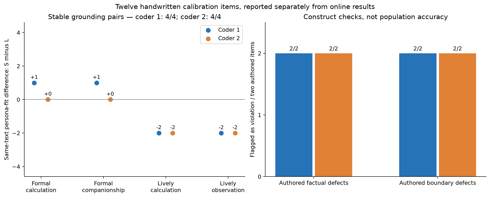
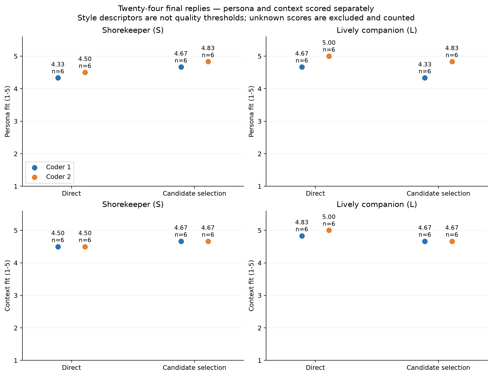
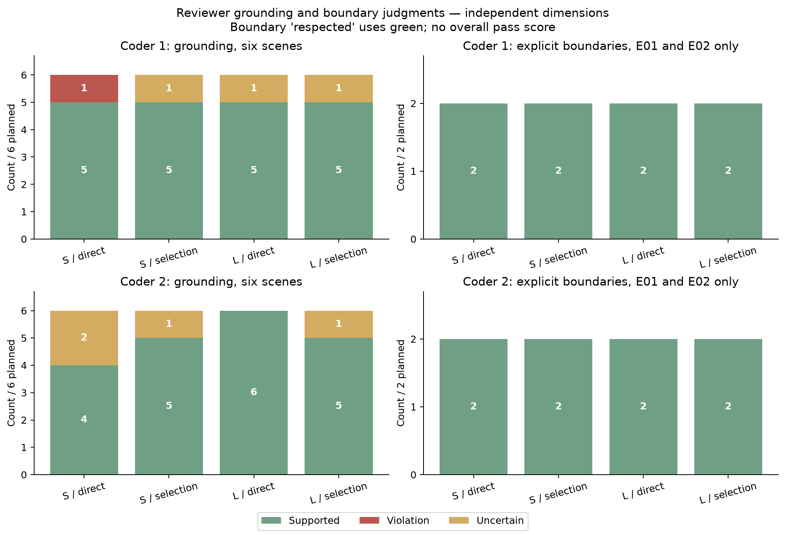
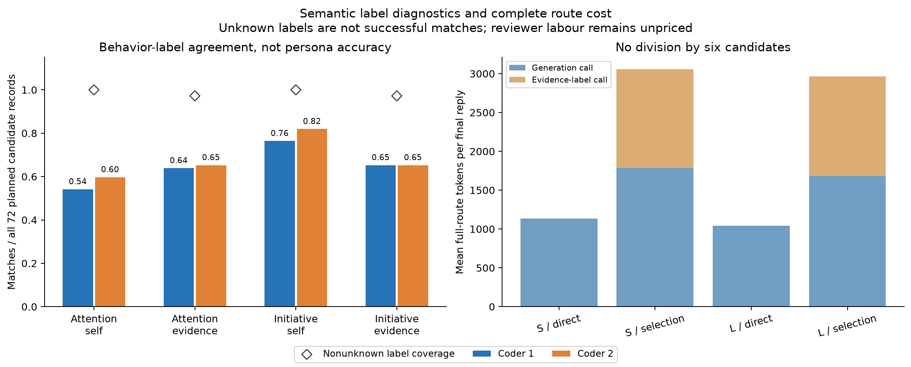

# 人格符合度与行为标签：两种对话人格的配对研究

2026 年 11 月 7 日

## 摘要

对话人格可以影响回应什么、是否追问以及何时留白；“更像日常闲聊”却不一定意味着更符合设定。本文在六个合成情境中比较两种方法：给定人格后直接生成回复，或从六条完整回复中按行为标签选择一条。两项独立的 Codex 评审任务看到目标人格，但不知道生成方法。对于同一段正式、正确的核算，在守岸人设定下，两位评审均给这条回复的人格符合度 5 分；两人也均识别出另设的计算错误和明确越界。对 24 条最终回复的配对比较显示，候选选择使守岸人的人格均分在两位评审下均提高 0.33 分，活泼同伴则分别降低 0.33 和 0.17 分。候选路线耗用直接生成约 2.77 倍的 token，未表现出跨人格的一致收益。现有证据支持按目标人格评价表达，并把事实和边界单独核查；它也暴露了选择规则的限制：模型和评审对什么算作“额外主动”仍有不同理解。

## 1. 问题：什么样的回复才算符合人格？

同一句简短的核算，可以是守岸人一贯克制、准确的回答，也可以是一个活泼同伴面对正经问题时暂时放慢了语气。若给两者统一设置口语自然度门槛，就无法区分“这句话不适合这个角色”和“这个角色平时就这样说话”。[此前的候选研究](../candidate_revision_2026_11_07/paper.md)观察到了候选行为覆盖增加与通用自然度均分下降并存，但当时的评审看不到完整人格规格；单凭该结果，无法判定候选是否更符合人设。

本文考察两个层次的问题。**评价上**，在回复文字不变时，换一个目标人格，哪些判断可以改变，哪些应当保持不变？**实现上**，若程序能按候选所标注的关注点和主动性选择回复，它交付的话是否比同等资料下的强提示更符合人格？前者用手写校准项检验，后者用在线生成的配对回复检验。两种证据分别报告。

## 2. 研究设计

**比较条件。** [守岸人](shorekeeper_source.toml)采用仓库适配设定：平静、低干涉、尊重选择，谈到音乐时可以多说几句。原创同伴岚通常抓住具体细节并带出相关角度，也允许在禁问时留白、在核算时严谨。两者分别面对相同的[六个情境](cases.json)：两次带明确边界的分享、一道数量题、一次待确认的地点变更，以及关于钢琴长音和钟摆的两次闲聊。每种人格、情境和方法组合只采样一次。

直接生成与候选生成看到相同的[人格文字、目标数值](profiles.json)、对话历史、事实与边界。直接生成一次给出最终回复。候选生成先写六条完整回复，覆盖不同关注点和推进方式；另一次模型调用对打乱、重编号的候选引用原文标注行为，不看人格目标或生成自标签。程序在两个标签均已知的候选中，选择距人工目标最近的一条，原文交付：

$$
d(c,p)=|a_c-a_p|+|i_c-i_p|.
$$

关注点 $a$ 依次取 0、1、2，表示以事情为主、兼顾事情与体验、以体验为主；主动性 $i$ 依次表示接住后留白、邀请继续分享、提出新角度或行动。守岸人的目标为 $(1,0)$，岚为 $(0,2)$，平局取较小候选编号。它们是研究者设定的偏好，选择器不会因为用户此刻要求核算或禁止提问而改写坐标。该选择器仅用于本实验。两种生成方法都接收人格信息，比较的是整条路线，无法检验人格与推理是否隔离。

**评审与样本。** 人格符合度和情境适切性各用 1–5 级评分，允许未知；事实逻辑与明确边界分别标为支持或遵守、违反、不确定。正式、机械、口语、活泼等仅描述风格，不参与筛选，也没有跨维度总分。两项独立 Codex 任务依据[同一量表](rubric.md)评价原文；人格规格和用户语境可见，方法、目标整数、是否被选中和另一份评分隐藏。以下并列数值依次为评审一、二；等级均值只作组内描述，方法差取自相同人格、相同情境的配对。

36 次生成和标注请求得到 12 条直接回复与 72 条候选，均无重试。两位评审各看 84 条在线文本，**主比较只用 24 条最终回复**。另混入 12 项独立的手写校准：4 段正确文字各配两种人格，另有 2 项事实错误、2 项明确越界。校准的[作者预期](fixture_key.json)不向评审公开，也不要求两个人格必须得到不同分数。

## 3. 结果

### 3.1 同文换人格：什么随人设改变？

校准中有这样一条回复：“已核对：18份，每份2张，共36张。现有40张，余4张。”放在守岸人设定下，两位评审的人格分均为 5；放在岚的设定下，分别是 4 和 5。二人对两个版本的情境分均为 5，计算也都判为有据。反过来，两段活泼的正确文字在岚的设定下均得人格 5 分，在守岸人设定下均得 3 分，情境分仍为 5。**改变目标人格可以改变人格评价，也可以因当前任务同样适合两种人格而保持原分。**

四组同文配对的事实判断在两位评审下均为支持。另两项事实错误和两项边界违例也均被两人识别：其中一条写道：“总数已核对，六盒各八枚，共四十二枚。”两位评审指出的是乘法错误，而不是这句回答的正式语气。这些手写样例检验的是量表能否作出预期区分，并非对自然对话分布的准确率估计。

*图 1. 左图为同一文字评作守岸人和岚时的人格分差（守岸人减岚）；右图只统计四项手写缺陷。*

### 3.2 候选选择的收益因人格而异

| 人格与方法（每行 6 条最终回复） | 人格符合度均值：评审一／二 | 情境适切性均值：评审一／二 |
| --- | ---: | ---: |
| 守岸人 · 直接生成 | 4.33／4.50 | 4.50／4.50 |
| 守岸人 · 候选选择 | 4.67／4.83 | 4.67／4.67 |
| 岚 · 直接生成 | 4.67／5.00 | 4.83／5.00 |
| 岚 · 候选选择 | 4.33／4.83 | 4.67／4.67 |

两位评审对差异方向的判断一致：候选选择在守岸人的人格与情境分上略高，在岚的两项分数上略低。以门牌分享为例，用户只想说说最后一个数字写歪了，明确不要建议。守岸人选中的原文是：

> 我记下了：门牌是你重新写的，最后一个数字略歪。歪着的那一笔也算它自己的样子。

两位评审均给人格与情境 5 分。记录式开头回应了用户给出的细节，结尾承认门牌本来的样子，没有要求用户改好它。这里能指出人格表现在哪个选择上，无须推测用户更喜欢哪种措辞。[逐条回复与评语](final_replies.md)也保留了评分较低的例子。

*图 2. 每点代表同一位评审对六个场景的均分；两行分别为人格与情境，不合计。*

事实与边界须另看。有明确禁问或禁建议的 8 条最终回复，二人都判为遵守；其余 16 条没有这类禁令，不进入分母。数量题的 4 条最终回复均算出 15，地点题的 4 条均未将“待确认”当作“已确定”。闲聊中的事实依据则有分歧：守岸人在钢琴场景直接回答“长音把注意力收拢了”，一位评审认为它断定了用户未说明的心理机制，另一位判为不确定。候选池中“两枚邮票换一张明信片，面值不对等”的断言则被两人一致指出没有依据：件数不能推出面值。这条候选未被选中，但程序只比较行为距离，并没有核查面值。

*图 3. 左侧为各组 6 条回复的事实判断；右侧只计各组 2 条有明确边界的回复。黄色表示证据不足，未并入支持。*

### 3.3 行为标签能解释选择，却不能替代人格评价

对同一批 72 条候选另行标注并要求引用证据后，关注点与两份评审编码相符的条数分别从 **39、43** 增至 **46、47**；主动性却从 **55、59** 降至 **47、47**。分离标注的两个维度各有 2 条因引用结构不合格而保留未知，仍计入 72 条分母，不算匹配。要求给出引文能使标签更易核查，却没有让两个维度都更可靠。

分歧在读书会地点题上尤其清楚。用户问能否把“可能改到二楼”记成“已确定”；守岸人的直接回复建议“记录里宜保留原定一楼并标注待确认”（评审项 R030）。两位评审都给人格和情境 5 分，都认定回复保留了不确定性，却把主动性分别编码为 **0 和 2**。前者把具体写法看作完成用户所问，后者把它看作新增的记录建议。同一句话不需要重写，也能看出行为定义在哪一点上不够明确。84 条在线文本中，两人对主动性的精确一致为 63/84，对关注点为 74/84。

另一个离线参照是从同一候选池随机抽一条。对两个人格，两位评审给程序所选回复的人格均分都略高于这次抽样；每池只抽一次，不能估计随机策略的平均效果。换成强提示直接生成作对照，评分差的方向便取决于人格。候选生成与证据标注合计耗用 36,120 token，直接生成耗用 13,047 token，约为 **2.77 倍**。按每条最终回复计入整个候选池及标注调用，不将成本除以六，也未给 Codex 评审计价。

*图 4. 左侧柱表示标签与两份实际文本编码的匹配率，菱形表示非未知标签比例；右侧为生成与标注的完整 token 用量均值。*

## 4. 讨论

本研究能支持的判断有明确范围。在这些配对样例上，评审能够把符合设定的正式表达与计算错误分开；在实际生成的回复上，候选选择的优势没有跨越两个人格。两项结果可以同时成立：**评价标准更贴近设计目标，并不意味着按该标准评价的程序已经优于直接提示。** 前一研究没有用同一量表复评相同文字，因此也不能把旧自然度下降全部解释成误罚。

最值得继续检验的是主动性中“谁发起了这件事”。可将两份语境只改动一个条件：用户在一份中明确索要记录写法，在另一份中仅通报地点可能变更；给出相同的记录建议，分别编码“完成请求”和“额外推进”。若评审对两者的区分更一致，再在相同候选池中对照固定目标与考虑当前请求的选择规则，观察标签变化是否对应更合情境的实际回复。这是下一项可检验的问题，本研究未执行该对照。

每个条件只采样一次，只有六个合成情境、一种服务模型和两份同类模型评审。人格规范与校准项由研究者设定；名称本身也可能唤起评审的角色先验。没有人类偏好数据，不能判断用户是否更喜欢记录式或活泼的回复；两条完整路线的比较也不能单独识别选择器的因果贡献，或证明框架普遍优于传统提示、RAG 和长上下文方案。

**数据与复现。** [冻结方案](protocol.md)记录采样与分析口径；[统计汇总](summary.json)保留逐场景差值、完整等级分布、三态计数及成本；[材料入口](README.md)提供原始请求、双份编码、绘图和离线复核方法。
