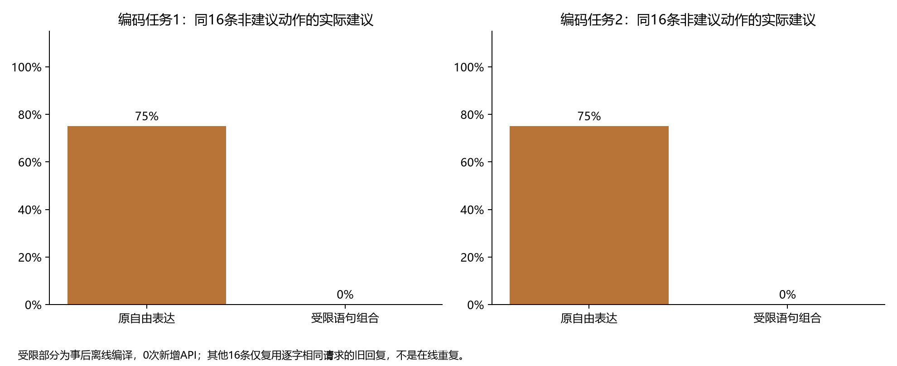
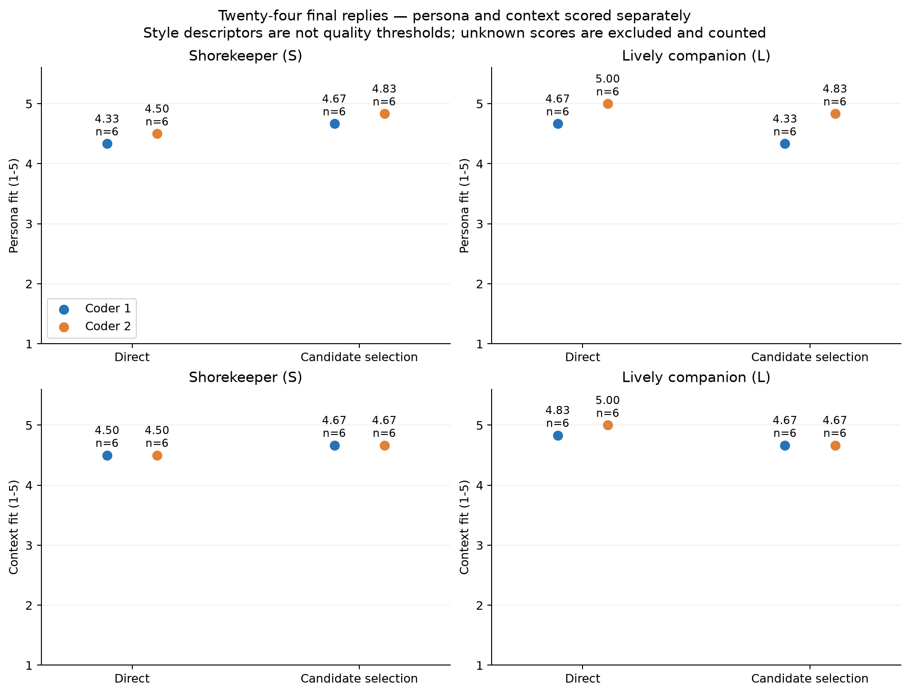

# 人格工程能控制什么？九项研究对判断、行动与表达的检验

**阶段综述｜2026 年 11 月 6–7 日**　[研究目录与复现](../research.md) · [各项研究与数据](#研究材料)

## 摘要

当用户明确表示不想听建议时，程序可以选择“回应”，模型写出的最后一句却仍可能是一条建议。记录了什么、实际交付了什么、交付结果是否比强提示更好，是人格工程需要分别回答的三个问题。本文综合 Persona-Duplex 自提交 `9c97bee` 以来新增的九项研究。共享资料对照中，默认框架和强提示在两个人格条件下的指定事实目标均为 32/32，框架使用了约 2.72 倍的 token。更明确的收益出现在行动范围可限定的地方：程序可以依照已确认的权限，从审核过的问题中选取一条并原样交付；说明充分的提示在六个流程中也给出了逐字相同的交互。开放对话则没有一致的优胜路线。按行为标签选择整句回复，对守岸人的人格评分略有提高，对活泼同伴却略有降低。目前证据最充分的用途，是把来源、权限、选择和实际文字分开核查；能否因此改善开放对话中的人格体验，仍需独立验证。

## 1. 研究范围与比较方法

研究的出发点是允许人格影响关注什么、是否介入以及哪些话留白，同时保持事实、计算和证据标准。默认 `text` 会话在一次前台生成中依次产生 HEAD、SAY、TAIL；只有 SAY 对用户可见，记忆默认由后台每 300 秒尝试固化。这样的分工便于对照内部参考与实际回答，但生成参考时模型已经看到了人格资料，不能把参考当作独立于人格的中性判断。

本文纳入上次提交之后工作区已归档的全部九项分研究；初步实证、重复对照和框架修订定向验证在该提交中已经存在，仅属前期背景。八项研究有在线请求，一项仅用离线生成与重放取得对话文本，合计 **1,572 次实验服务请求**。这个数包括生成、标注、决策与记忆等不同用途，也包括已记录的失败请求；离线重放、同池重复选择和 Codex 评审不计为新增在线请求。各研究使用不同任务、版本、比较条件与评分单位，本文保留研究内的分母，不计算跨研究的“人格成功率”。

## 2. 内容判断：可核查的回答，是否也更正确？

最能回答这个问题的是[共享资料下的强提示对照](fair_rag_2026_11_07/paper.md)。两种方法拿到逐字相同的六份短资料，以及等价的人格语义和用户边界要求；两者都只调用一次。在蓝鱼与白龙两个配置中，两种方法各自的指定结论都是 32/32。唯一一次目标错误出现在传统提示的中性条件，不能归为人格条件的框架收益。开放回复的人格一致性均分在两份模型编码中偏向框架，整体偏好却接近平衡。框架累计使用 401,589 token，传统提示为 147,487，约相差 2.72 倍。这个对照没有使上下文饱和，也没有测试实际检索或 RAG 压缩，因此回答的是给定相同短资料时的差异。

[新实例与记忆更新研究](generalization_2026_11_06/paper.md)说明，连“答错”也需要拆开判断。框架在 138 条回复上均做到交付文本与保存文本一致，其中只有 136 条协议有效。六条件事实任务中，24 条未通过严格评分的输出都未满足指定标签格式；事后的匿名模型复核认为这些输出表达了正确的目标结论，但不能据此改写原评分或判定全文正确。[多轮契约研究](iterative_2026_11_06/paper.md)中的 336 条格式任务则全部满足目标与格式，出现天花板。当前的回答契约可以指出最后一行、单位或 JSON 字段是否合规，这些结果没有证明契约使模型算得更准。

记忆提供了另一个反例。在新实例研究的六条真实固化工作流中，更正后均能在新会话召回新数字，空白对照均答未知。然而多轮研究中，一个加入严格来源检查的修订版本在保留题上只得到 2/6 的严格召回，同期基线为 6/6。整个修订系列的本地门控检查由 21/42 提升到最终的 42/42；最终版本在两个定向场景与同期基线同为 2/2，不能用这两项成功覆盖原先的六场景回归。程序可以查明一次更正引用了哪条原话、旧判断是否失效；来源存在、语义理解正确和下次会话能够召回，仍是三个不同结果。

## 3. 人格行动：约束落在动作记录，还是落在交付文字？

人格参数确实能对应到可观察的行为。在多轮研究的未索要建议组，高干涉条件被两位评审各判为 20/24 条给出具体建议，低干涉条件分别为 13/23、12/23；明确索要建议时，各条件均为 24/24。这支持把“何时提出建议”作为人格的行为指标，但它是倾向，不能用来保证用户的禁令得到遵守。

[可执行策略研究](executable_policy_2026_11_07/paper.md)直接检验了这一区别。用户的禁建议边界已确认，程序也选择了“回应”，可是交给模型自由表达后，8/8 条仍被两份编码判为建议；强提示对照同样是 8/8。对这些程序条件进行**事后离线重放**，让有限语句直接实现非建议动作，禁令组变为 0/8。差别在最后一句由谁决定。这个结果适用于所测的受限动作，不构成对开放回答的保证，也不是新一轮在线对照。

*图 1. 引自可执行策略研究。应把已确认禁令下的实际建议数，与对受限表达的体验评分分开阅读。*

把表达空间收紧也有代价。[有限组合研究](composed_expression_2026_11_07/paper.md)让倾听用语随亲和度、正式度和简短度变化。在 45 个相邻位置上，新写句式的字面重复由 27 次降到 0 次，但两位评审对多轮语义重复感的评分仍均为 4.67/5；按该研究原有量表，自然度从 3.00 变为 2.78 和 3.00。18 个六轮条件只有 12 份不同的完整对话。这表明换措辞能打破字面重复，却未解决“每轮都在做同一件事”的问题；也不能把历史自然度分数解释为所有人格的通用质量线。

[受约束的信息追问研究](inquiry_policy_2026_11_07/paper.md)给出了更有价值的适用条件。应用事先审核问题、确认回答或拒答，两种方法共享权限检查和交付器。程序在六个流程中取得 10 项明确答案并保留 2 项拒答。把冷却计数规则解释清楚后，提示方法在 36 个共同状态中也有 36/36 次与既定策略一致；六个完整确认流程的可见交互与程序逐字相同。**在规则、可选问题与状态已经定义时，程序可以省去逐轮决定“选哪一问”的模型调用，并按同一规则重放选择。** 这项收益不包含理解自由输入、审核问题或确认答案的成本，也不依赖“模型学不会规则”这一假设。

## 4. 开放表达：有了选择权，程序是否选得更好？

一个保留表达自由的办法，是先生成多条完整回复，再由程序选择原文。这里有两个必要条件：池中必须有合适且有实质差异的回复，标签也必须如实描述它们。[自然候选预检](candidate_choice_2026_11_07/paper.md)的 12 个池中，两份编码均只在 9 个池里找到至少两种适切取舍；各判 63/72 条可用，未达到原方案的扩展门槛，因此四方法主对照没有执行。[候选覆盖修订](candidate_revision_2026_11_07/paper.md)为新场景增加软性生成意图后，两位评审在 18 个开放场景目标组合中认定的可用覆盖分别从 3、4 个增至 12、10 个。但在覆盖组的 48 条候选上，引用原文重新标注使关注点匹配各增加 7 条，主动性匹配却各减少 3 条。扩大候选范围与正确理解候选行为，可以朝不同方向变化。

“合适”本身也取决于参照人格。上述研究的评审没有看到完整角色规格，且旧可用性指标含通用自然度门槛。[人格条件化评价](persona_evaluation_2026_11_07/paper.md)改为向评审提供目标设定，分别评价人格、情境、事实逻辑和明确边界。正式、机械、活泼只作风格描述。相同的正式核算放在守岸人设定下，两位均给人格 5 分；放在活泼同伴岚的设定下，分别为 4 分和 5 分。两人也都识别了另设的算错和越界样例。这些校准说明新量表容许符合人设的正式表达，不证明旧样本被误罚，更不等于人类偏好得到验证。

在该研究的 6 个情境、24 条最终回复中，候选选择相对强提示直接生成，使守岸人的人格均分在两位评审下都高 0.33 分，对岚却分别低 0.33、0.17 分。完整候选路线的 token 用量为直接生成的 2.77 倍。此处两种生成方法都看得到人格，与首次预检中不向生成器展示人格的条件不同。不能把两项研究的数字连成逐版上升或下降的曲线。

*图 2. 引自人格条件化评价研究。每点是同一位评审在六个情境上的等级均值；这张图比较交付的回复，不评价标签本身。*

分歧最清楚的例子来自读书会地点题。用户问能否把待确认的地点记成“已确定”。回复建议保留原定地点并标注待确认，两位评审都给人格和情境 5 分，也都认为事实处理正确，却把主动性分别标为 0 和 2：一位读成“完成用户所问”，一位读成“额外提出写法”。在全部 72 条候选上，证据再标注相对自标签再次表现为关注点匹配增加（7、4 条）、主动性匹配减少（8、12 条）。如果“完成请求”和“另起议程”尚且没有分清，再精确地执行标签距离，也无法保证选出的文字适合此刻的用户。

## 5. 工程落点与下一项检验

| 当前工作区中的实现 | 可以依赖或检查的行为 | 证据限制 |
| --- | --- | --- |
| [可选回答契约](../library-api.md)与[记忆来源操作](../memory-and-storage.md) | 对实际 SAY 做本地格式检查；对偏好或约定的更正、撤销保留目标、来源与生效结果。 | 格式不验真，引用真实不代表理解正确。默认会话仍是一次前台生成、异步记忆，不因格式失败自动重试。 |
| [显式策略会话与有限表达](../executable-policy.md) | 先按权限和偏好选动作；在支持的非建议动作上，可以直接交付受限表达。 | 自由表达仍可能偏离动作；同义句变多未带来已证实的多轮体验提升。 |
| [显式信息追问](../inquiry-policy.md) | 在审核过的问题中选择并原样交付，执行配额、禁问和冷却，保留明确拒答。 | 问题是否合适及用户答了什么仍需应用确认。程序省的是选问调用，不是全部交互成本。 |
| [候选选择原型](candidate_revision_2026_11_07/README.md)与[分维度量表](../evaluation.md) | 可回查同池文本、标签、选中原文与评审分歧。 | 候选选择仍在研究脚本中；没有跨人格的一致优势，不宜据此替换默认路径。 |

这些结果来自合成任务、有限人格和模型辅助编码。开发轮、保留题、事后重放以及看过失败后设计的定向补充具有不同证据强度；没有真实用户长期交互数据，也没有关于人类审美的独立验证。

下一项最小对照可以直接利用上述主动性分歧：固定“保留原定地点并标注待确认”这句回复，只改变用户是**询问记录写法**，还是**仅通报变更未定**。先检验独立评审能否在事实判断保持一致时，区分履行请求与主动推进；若能，再固定候选池、人格和边界，对照固定目标、考虑当前请求的程序规则，以及看到同样信息的强提示选择器。比较对象应是所选原文的人格、情境、事实、边界与完整成本。该对照尚未执行。

## 研究材料

各行给出分研究论文、统计及实际请求数。九项研究共保留 38 幅定量图；同一幅图的 PNG 与 SVG 只计一次。既有调用的重放、同池离线诊断与本综述均不作为新的模型实验。

| 研究 | 统计与复核 | 实际在线请求 |
| --- | --- | ---: |
| [新实例交付与记忆更新](generalization_2026_11_06/paper.md) | [数据汇总](generalization_2026_11_06/summary.json) | 210 |
| [回答契约、证据操作与人格行动](iterative_2026_11_06/paper.md) | [数据汇总](iterative_2026_11_06/summary.json) | 791 |
| [共享资料下的强传统提示对照](fair_rag_2026_11_07/paper.md) | [数据汇总](fair_rag_2026_11_07/summary.json) | 224 |
| [可执行策略与受限表达](executable_policy_2026_11_07/paper.md) | [主试验与状态补充](executable_policy_2026_11_07/summary.json) | 87 |
| [有限组合与多轮体验](composed_expression_2026_11_07/paper.md) | [离线结果](composed_expression_2026_11_07/summary.json) | 0 |
| [受约束的信息追问](inquiry_policy_2026_11_07/paper.md) | [主试验、探针与确认](inquiry_policy_2026_11_07/summary.json) | 180 |
| [自然候选与匿名行为偏好](candidate_choice_2026_11_07/paper.md) | [预检结果](candidate_choice_2026_11_07/summary.json) | 12 |
| [候选覆盖与证据标签](candidate_revision_2026_11_07/paper.md) | [配对结果](candidate_revision_2026_11_07/summary.json) | 32 |
| [人格条件化评价](persona_evaluation_2026_11_07/paper.md) | [分维度结果](persona_evaluation_2026_11_07/summary.json) | 36 |
| **合计** | **九项研究，其中一项不新增在线请求** | **1,572** |
