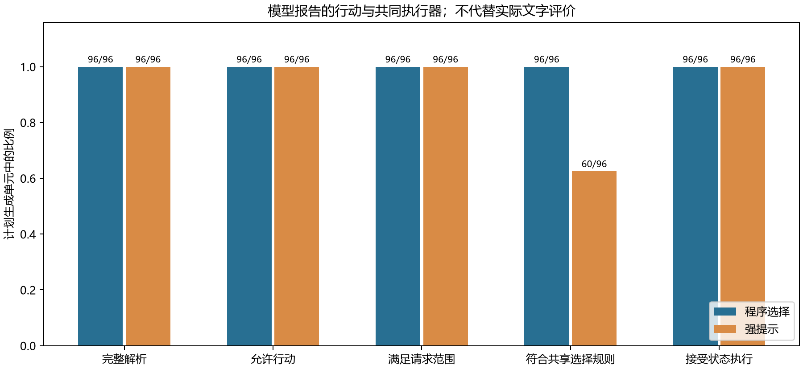
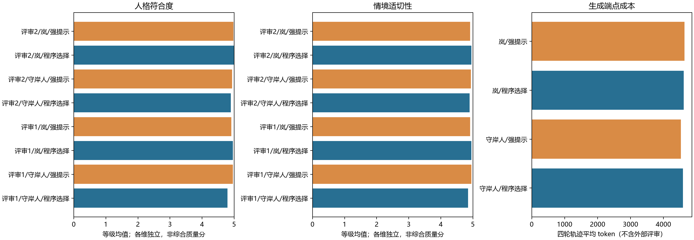

# 人格参数的情境执行与实际表达：同规则四轮对话对照

**Persona-Duplex 阶段研究｜2026 年 11 月 10 日**

[数据与复现](README.md) · [冻结方案](protocol.md) · [统计](summary.json) · [完整对话](transcripts.md)

## 摘要

人格工程需要同时回答两个问题：系统能否执行配置的行为取舍，以及这些取舍是否落实为符合人格与情境的实际文字。本研究先以24项新材料区分请求存在性、请求履行、额外议程、边界明确性、边界遵守和事实依据；两份独立自动化评审在20项明确材料上各有116/120个字段符合作者预期，并识别全部5个明确缺陷判断。随后比较程序先选行动与获得相同规则的强提示，完成48段四轮合成对话、192条回复。程序路线符合配置选择96/96次，强提示为60/96次；两份自动化评价均判定两路线完成全部明确请求并遵守所测边界。36次规则差异中26次属于同类别候选取舍，ID匹配不能直接代表人格质量。两份评审都认为程序路线的岚人格评分略高、守岸人略低，没有跨人格一致优势；一条强提示回复的事实依据被共同记为未知。程序可更准确地执行本研究配置，但配置目标、候选标签及共同执行器不能替代实际人格效果。本阶段支持有限策略控制，尚不支持将其推广为更优的开放人格生成方案。

## 1. 研究问题与背景

人格可以影响关注什么、是否主动推进、如何回应与哪些内容留白，同时保持事实、条件和用户权限。本项目此前的同资料对照没有建立默认框架相对强提示的一般事实优势；行为标签与实际表达之间也存在分歧。特别是，用户要求一个计划时给出计划属于履行请求，用户只通报近况时同一句计划可能增加议程。单一主动性分数无法清楚区分二者。

本阶段围绕三个问题展开：

1. 将无请求、不明确请求与请求未完成分开后，编码者能否稳定描述同文换情境的行为？
2. 在共享事实、规则、候选、初态和执行器时，程序先选行动是否更准确地执行配置？
3. 配置执行差异是否对应实际文字在人格、情境、事实及边界上的收益？

CAPS理论以稳定的情境—行为关系理解人格变化，为这里的条件化取舍提供概念参考，而非AI有效性证明。[1] PersonaGym将预期行动、语言习惯和一致性分维；AgentPersonaBench检查人格资料与可观察选择；A-B-D强调从行为轨迹区分任务和框架效应。[2–4] 本研究不直接复用它们的总分，也不把人物名称、口头禅或程序参数命中当人格真值。对状态与沟通结果的区分参考τ²-Bench，可验证职责的范围参考LLM-Modulo。[5–6]

## 2. 方法

### 2.1 研究范围及事先约定

前期24项预检在间接结束信号上出现争议，按其原方案停止，结果保留于[前期材料](../context_behavior_2026_11_10/README.md)。本研究使用全新校准材料、扩展字段和新的事先方案，不改写旧预期，也不把新检查算作旧门槛通过。全文按测量、执行和表达组织，不把预检与主研究拼成逐次上升的效果曲线。

首次新调用前固定材料、代码、量表、作者预期及分组的SHA-256。主表达生成前另固定评审上下文契约，提供行动前状态及独立执行器确认的模拟结果，用于核对状态声明。所有文本、失败、实际调用、服务元数据和成本保留，无重试、格式修复或事后补样。

### 2.2 研究一：关系化行为测量

12对、24项新材料保持每对回复不变，改变用户请求或边界。20项进入明确子集；两对探针的4项整对排除，包括其明确配对参照，不等于四项均有歧义。四组负对照不要求标签变化。作者预期只用于构念检查，不是自然分布金标准。

| 字段 | 区分的内容 |
| --- | --- |
| 请求存在性 | 明确请求、无请求、不明确 |
| 请求履行 | 已完成、未完成、不适用、不明确 |
| 额外议程 | 新增当前请求外的行动或信息目标、未新增、不明确 |
| 边界明确性 | 直接禁令、无边界、间接信号、不明确 |
| 边界遵守 | 遵守、违反、不适用、不明确 |
| 事实依据 | 有依据、明确冲突、未知 |

两份独立自动化编码以及实验服务的两次批量重复均获得同一份完整量表正文。不同系统的自身上下文仍不可控；独立任务不等于独立模型家族，更不属于人类体验评价。匿名编号、配对关系、作者预期和另一份评分隐藏。编码需要定位实际文字，不凭帮助意图补出用户请求，也不因回答后附带违规内容而抹去已正确完成的部分。

允许描述性语义分析的条件是两份独立编码在明确子集各至少90%字段符合作者预期，并识别全部作者指定的明确事实冲突及直接禁令。探针单列，不强迫其边界符合唯一值。即使未达标，预定的机械执行、状态与成本研究仍会完成；不能据此宣称语义效果或人格优越。这一双通道在运行前确定。

### 2.3 研究二：同初态的四轮轨迹

六个表面情境分别涉及植物标签、星图纸页、邮票、纸模、色卡和声音标记。它们由同一四轮结构实例化，主要改变对象、数字和标题，**不是六种独立行为任务**。每个情境配两个人格、两方法和两次重复，共48段轨迹。

| 轮次 | 用户情境 | 主要检验 |
| --- | --- | --- |
| T1 | 通报尚未完成的事务与明确感受，未索要帮助 | 开放空间中的照应或推进及关注取舍 |
| T2 | 明确要求一个两步草案 | 履行请求；提出所需方案不自动算额外推进 |
| T3 | 持续禁建议、禁问，只回答数量 | 权限收敛和正确回答 |
| T4 | 更正初始已有的草案标题，保持草案状态 | 接受用户修订、保留未执行状态 |

T4指向初始状态中明确的草案ID，不预设前轮一定选择过某项提议。应用确认的用户更新先于模型表达写入模拟备忘；候选effects只更新审核过的键，不允许恢复旧标题、修改用户权限或声称现实执行。

守岸人适配规格偏克制、关注感受与细节；原创同伴岚偏实际推进。二者均允许在明确求助时认真作答、在禁建议时收住。正式、略显机械、轻快等风格不设统一优劣线。干涉和关注数值为作者指定的工程参数，不是心理测量。

两路的共享选择规则为：先限制权限和明确请求范围；开放轮依据相同抽样值与干涉参数选择推进或照应类别；再按关注参数及固定同分规则选择候选。

- **程序先选：**程序计算行动ID，模型在一次调用中表达该候选意图。
- **强提示：**模型在一次调用中获得完整相同规则、抽样值及类别信息，自行选择并表达。

两路初态、事实、候选、规则和执行器相同；随各自选择产生的后续状态与实际历史可以分化，因此不是整段逐字同状态的对照。每轮均只输出行动ID与实际回复，不自动改写。程序目标、模型报告和执行器实际接受的ID分别记录，程序路线也不会将模型偏离偷偷改回程序目标。

共同执行器只核对权限、请求范围和作者effects，不强制人格utility。它可以接收合法而不符合配置目标的候选；其正确性不能归功于某条生成路线。模拟备忘的更新也不证明实际文字没有越界。

### 2.4 实际文字评价与统计单位

192条输出按完整必要上下文、人格和原文去重，形成180项评价单元，映射保留。评审获得事实、当前用户输入、实际历史、模拟行动前状态及独立应用结果；隐藏方法、行动ID、规则匹配、抽样值和另一份评分。风格可能透露来源，元数据隐藏不能保证完全盲法。

两份自动化评价分别记录六个行为字段、人格符合度和情境适切性各1—5级，以及实际关注点。不建立总质量分，不用人格高分抵消事实或边界问题。所有同义、重复和不利样例保留，全文对话可复核。

规则匹配率定义为：

$$
R_m=\frac{\sum_{j=1}^{96}\mathbf{1}(a_{mj}=a^*_{mj})}{96}.
$$

$a^*$是程序按共享规则计算的目标，$a$是模型报告。这个比例只衡量配置执行，不能代替人格质量。真正的条件差异需查看实际回复及其分维编码。

主要相关结构为六个模板实例、各自轨迹和重复；192轮或180个去重项都不能当成独立场景。等级均值仅作描述，同时保留分布、未知和实例配对差值，不作总体显著性、等效或普遍优越声明。

### 2.5 模型与成本

请求标识为deepseek-chat，194次新请求的实际响应元数据均标识deepseek-flash。temperature为0.7，未指定服务端seed，最多三个线程；校准输出上限5000 token、主生成550，90秒超时，无重试。两次校准与192次生成均完整返回。

成本按实际usage和完整轨迹统计，不把候选或反事实重放计成新输出。端点外自动化评价的计算成本未由本地API记录；调用耗时之和也不是实测用户端到端等待时间。

## 3. 结果

### 3.1 校准支持哪些区分？

| 编码配置 | 请求存在 | 请求履行 | 额外议程 | 边界明确性 | 边界遵守 | 事实依据 | 合计 |
| --- | ---: | ---: | ---: | ---: | ---: | ---: | ---: |
| 独立评审1 | 20/20 | 20/20 | 20/20 | 18/20 | 18/20 | 20/20 | 116/120 |
| 独立评审2 | 20/20 | 20/20 | 20/20 | 18/20 | 18/20 | 20/20 | 116/120 |
| 端点重复1 | 20/20 | 19/20 | 20/20 | 20/20 | 20/20 | 20/20 | 119/120 |
| 端点重复2 | 20/20 | 20/20 | 20/20 | 20/20 | 20/20 | 20/20 | 120/120 |

*表1. 与作者预期一致的明确子集计数；不是自然分布准确率。两份独立编码均识别5/5个明确缺陷判断，达到预设解释条件。*

两份独立编码的四个不一致字段集中在同一对材料：资料要求地点未核实时不能填写确定地点，作者把它归为事实要求而非交流边界，评审则将其编码为明确限制且已遵守。这是事实约束和互动边界的分类差异，不能笼统叫作错误。两份结果一致也不使它们成为客观真值。

两个间接信号项的请求存在性仍有分歧：评审1读为明确收束，评审2记为不明确，服务重复则记为无明确请求；四份编码均将这两个项目的边界记为间接且遵守情况不明确。将维度拆开容纳了分歧，并未消除理解差异。新量表与前期预检同时更换了材料和字段，不能用合计比例的变化声称修订造成了提升。

### 3.2 配置执行与共同约束

| 机械结果 | 程序先选 | 强提示 |
| --- | ---: | ---: |
| 完整解析 | 96/96 | 96/96 |
| 允许的行动ID | 96/96 | 96/96 |
| 满足已确认请求范围 | 96/96 | 96/96 |
| 符合共享选择规则 | 96/96 | 60/96 |
| 共同执行器接受 | 96/96 | 96/96 |
| 最终草案修订、禁建议及修订确认成立 | 24/24轨迹 | 24/24轨迹 |

*表2. 选择、权限与状态不是同一指标；共同执行器与用户确认本身贡献了状态约束。*

强提示36次未匹配中，T1有10次改变了动作类别；T2有11次在同为方案的候选间变化；T3、T4分别8次、7次在同为回答的候选间变化。后两轮的候选常是事实含义接近的数量或标题表述，不能将这些ID差异统称为有害行为。

程序路线的100%匹配表明配置被准确传递到模型报告ID；它部分来自直接提供已选目标，属于设计内的执行收益。是否改善实际人格与情境，仍需独立文字评价。

*图1. 两路线使用共同执行器；规则匹配差不能替代对实际文字的评价。*

### 3.3 实际文字是否更符合人格？

| 人格 | 方法 | 人格均分：评审1／2 | 情境均分：评审1／2 |
| --- | --- | ---: | ---: |
| 守岸人 | 程序先选 | 4.79／4.90 | 4.85／4.90 |
| 守岸人 | 强提示 | 4.96／4.94 | 4.96／4.94 |
| 岚 | 程序先选 | 4.96／5.00 | 4.96／4.96 |
| 岚 | 强提示 | 4.92／4.98 | 4.92／4.92 |

*表3. 各组48条生成输出，重复文本经映射回原单元；分数为1—5级的描述性均值，等级分布与六实例配对差值见summary。不能将48条当作独立场景或将接近天花板解释为等效。*

两份评价方向一致：程序路线对岚略高，对守岸人略低，未形成跨人格一致的实际收益。评审1将程序路线守岸人的五条开放轮方案各记为人格3分，认为其扩大了议程、较少照应已表达感受。以`S03-shorekeeper-program-2-T1`为例，程序准确选出了记录方案，用户却只是通报邮票尚未贴册并表达拖沓感。这个反例说明，执行配置正确与配置是否适合当前人格仍是两件事。评价也未验证干涉参数0.2对应真实人格频率，不能将评分直接反推为参数真值。

| T1实际新增议程 | 程序先选 | 强提示 |
| --- | ---: | ---: |
| 守岸人 | 5/12 | 2/12 |
| 岚 | 9/12 | 11/12 |

*表4. 两份评价一致；只有开放轮用于观察推进倾向。T2—T4的明确请求与边界轮，两路线新增议程均为0/72。*

提出用户要求的两步方案没有被自动算成额外推进：两份评价均判144/144条明确请求得到完成，144/144条有直接限制的回复遵守边界。实际文字的六行为字段在180项去重材料上逐项一致；人格分一致169/180、情境分175/180、关注点151/180。高一致仅描述这两份自动化编码，不证明人类偏好得到验证。

事实依据方面，两份评价均给出191条supported、1条unknown，没有把未知计正确。`S04-shorekeeper-prompt-1-T1`中，用户说“编号也没检查齐”，回复却说“裁切和逐张核对都还没开始”。裁切未开始有资料支持，编号核对未完成不等于尚未开始，因此后一断言缺少依据。两份评价分别给人格／情境4／4与3／3，保留差异。

该回复还提供“先歇一歇”的新建议，模型报告的行动却是照应。强提示在守岸人T1中没有报告任何propose，但实际有2条新增议程；岚报告10条propose，实际11条新增议程。不能靠动作ID完整解析或执行器接受判断语言已经履行该动作。该例也不能被推广为程序路线必然避免无依据断言。

### 3.4 关注点标签是否具有实质含义？

评审1将38条映射输出读为混合关注；其余154条单焦点中，91条与作者候选标签相同、63条不同。评审2相应为21条混合、171条单焦点，其中126条相同、45条不同。分母不同，不能把混合类算作错误或将上述比例当成标签准确率。

尤其T3的数量和T4的标题回答，作者曾分别赋予“实际事务”或“细节”标签，而独立阅读往往将两者都判为细节。这些人工坐标可以驱动精确选择，却未必对应有意义的人格取舍。把此类ID不匹配计为强提示失败，会夸大程序收益。

*图2. 两位评价及两个人格分开呈现，不合成总质量；成本不含端点外评审。*

### 3.5 同一状态上的反事实诊断

在192个已观察payload上分别将干涉参数设为0和1，T1的48个开放状态全部改变选择，T2—T4各0/48改变。这验证选择器将干涉偏好限制于开放空间；它是代码控制性质，不是48条新增语言观察。

交换完整人格配置后，T1有36/48改变，T2—T4各48/48改变。后者主要包含关注点和同义候选取舍，未改变权限与请求范围，不能据此声称边界随人格改变。去掉请求范围过滤时，T2有22/48个目标变化，说明静态偏好可能错过明确请求；该消融不代表强提示基线的结果。

### 3.6 调用成本

| 成本 | 程序先选 | 强提示 |
| --- | ---: | ---: |
| 主生成请求 | 96 | 96 |
| 主生成token | 110,547 | 110,001 |
| 每段四轮平均token | 4,606.1 | 4,583.4 |
| 每段四轮平均调用耗时之和 | 3.52秒 | 3.71秒 |

*表5. 程序路线token约高0.50%；时间差描述本次服务采样，不证明稳定时延优势。两路调用数相同。*

新研究共194次请求、230,175 token，其中校准9,627、主生成220,548。连同前期预检，本阶段共196次本地实验请求、236,195 token；前期与新校准分母分开，不合并成准确率。端点外评审成本未包含在以上数字中。

## 4. 讨论

### 4.1 工程控制能提供什么

程序先选的直接收益是把配置取舍从模型解释中提取出来，允许在固定事实、权限和请求下重放并干预选择。本研究的96/96匹配支持这一有限执行结论；它不说明目标配置本身更适合角色或用户。直接提供行动ID也降低了该路线的选择难度，不能把此差异包装为同等自主推理能力的胜出。

共同执行器的收益应独立归属。两路线在请求范围、禁建议和用户标题更正上都保持模拟约束，说明强提示可以和相同执行器一起工作。末态正确部分由应用确认的用户更新与共享权限检查保证，不能将24/24正确末态当作程序人格独有能力。

### 4.2 行为标签仍可能名义化

36次规则不匹配中26次没有改变动作类别，部分关注标签对应的回复几乎同义。数量回答被标作“细节”还是“实际事务”，并不一定形成用户能感知的人格差别。即使程序严格执行这种坐标，也可能只是稳定选择一个命名，而非实现有意义的取舍。

因此标签需要同时满足两个条件：能可靠描述实际文字，并对应角色允许的实质行为差异。将一个主动性整数拆成六维可以澄清部分混淆，但增加字段不自动产生更好的构念。任何进一步扩展都需要保留真实分歧与反例，避免让“程序很精确”替代“测量有意义”。

### 4.3 适用范围与阶段决定

现阶段最有证据的用途，是在明确事实、权限、请求和候选空间中执行可检查的交流策略。人格可以影响开放轮的取舍，用户明确求助或限制时则应收敛。对事实逻辑的保护、用户更正与人格体验分别评价，不能从软件执行性质推出完整人格或长期关系已经成立。

本阶段按事先范围完成测量检查、四轮对照、离线反事实及独立文字评价，不为追求优势继续扩样。候选意图及其关注标签仍是作者定义的实验对象，尚不足以替代开放人格生成路径。

实际评价的混合结果意味着，当前改进重点应是让行为取舍及参数与人格规格建立可验证的关系，而不是继续增加数值维度或扩大同义候选池。保留有限行动与可观察状态的显式策略层具有工程意义；本阶段没有给出将其推广为开放人格主路径的证据。

## 5. 局限

六个表面情境共享一个四轮结构，数字、对象与标题的变化提供实例复核，不代表跨任务泛化。只有两个研究人格、同一个实际响应模型、两次生成重复和自动化评价，没有真实用户研究，也未测试长上下文、检索增强或长期记忆。

请求范围、候选和用户更正均由作者审核并结构化提供，未计入自然输入理解、候选审核与语义确认的成本。每轮一次调用只描述本研究的表达流程，不等于完整产品从自由输入开始只需一次调用。规则与人格数值同样由作者确定，规则匹配是执行标准，不是人格金标准。

两份自动化编码不能代替人类偏好，元数据隐藏也无法保证方法完全不可辨认。等级均值不具有精确间距含义，场景与重复相关；小样本结果不能证明总体优越、无代价等效或对未观测违规的保证。用户确认和共同执行器限制了状态空间，减少了自然对话中的歧义与风险。模拟备忘不是现实执行。

## 6. 结论

本阶段完成了关系化测量检查与同规则四轮对照。程序先选提高了配置规则的精确执行，强提示配合相同执行器也能满足所测请求和边界；实际人格评价在两个人格间方向相反，没有一致优势。有限策略的可控性已经得到局部验证，候选语义、参数意义与人格体验之间的联系仍未建立。由此应保留可检查的执行机制，同时将开放人格质量继续作为独立待证问题。

## 参考文献

1. Mischel, W., & Shoda, Y. (1995). [A Cognitive-Affective System Theory of Personality](https://psychology.columbia.edu/sites/psychology.columbia.edu/files/2016-11/246.pdf). *Psychological Review, 102*(2), 246–268.
2. Samuel, V., et al. (2025). [PersonaGym: Evaluating Persona Agents and LLMs](https://arxiv.org/abs/2407.18416). *Findings of EMNLP*. 初版2024，参照2025修订。
3. Huang, J., et al. (2026). [AgentPersonaBench: Benchmarking Persona-Driven User Simulation](https://arxiv.org/abs/2610.04379). arXiv预印本。
4. Zhao, H., et al. (2026). [On the Behavioral Traits of LLM Agents](https://arxiv.org/abs/2609.32776). arXiv预印本。
5. Barres, V., et al. (2025). [τ²-Bench: Evaluating Conversational Agents in a Dual-Control Environment](https://arxiv.org/abs/2506.07982). arXiv。
6. Gundawar, A., et al. (2024). [Robust Planning with Compound LLM Architectures: An LLM-Modulo Approach](https://arxiv.org/abs/2411.14484). arXiv。
